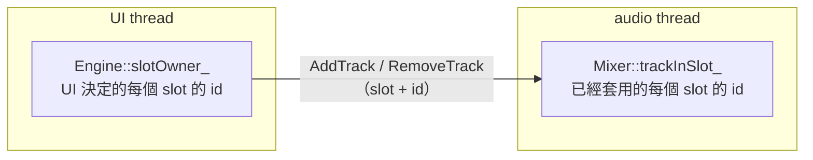

# Step 6 - 有 track 池的 engine

[English](step-06-engine-pool.md) | **繁體中文**

[總覽](../README.zh-TW.md) | 上一步：[Step 5 - Undo 與 redo](step-05-undo.zh-TW.md) | 下一步：Step 7 - App（規劃中）

## 目標

把 Step 1-3 帶進真正的 engine：複製第 14 章的 engine，把它固定的 8 個 track 變成有 id 的 track slot 池，讓 track 能在 audio thread 運作時
新增和刪除。接著證明兩件事：第 14 章做得到的事完全沒變，而新的部分是 real-time safe、沒有 data race 的。

## 設計

### 先複製，再修改

第 14 章維持原樣：它的 step 文件和 starter 都依賴固定的 8 個 track。所以 `lessons/15-daw-growing/engine/` 一開始是
`lessons/14-daw-8track/engine/` 的複本，檔名和 include 路徑都相同，修改都在複本上進行。兩章之間的差異本身就是教材的一部分：

```bash
git diff --no-index lessons/14-daw-8track/engine lessons/15-daw-growing/engine
```

<div align="center">

| 檔案 | 改了什麼 |
|---|---|
| `Constants.h` | `kNumTracks = 8` 變成 `kMaxTracks = 128` 個 slot；`TrackId`（Step 1）；`kMaxGarbagePerCommand` |
| `Commands.h` | track 的 `ChannelRef` 同時帶 slot **和** id；新的 command `AddTrack` 與 `RemoveTrack` |
| `Mixer.h` | `std::array<Track, kMaxTracks>`、audio thread 的 slot 表、`activateTrack()` / `deactivateTrack()`；空的 slot 會被跳過 |
| `Engine.h` | UI thread 的 slot 表、`addTrack()` / `removeTrack()` / `trackRef()`；確定 garbage 放得下才取 command；`processBlock()` 自己計時 |
| `CpuMeter.h` | 新檔：Step 3 的 `CpuMeter` 與 `CpuMonitor` |
| `DemoSong.h` | 自己新增 8 個 track（id 1..8），並用 id 指定它們 |

</div>

其他部分（transport、clip、19 種效果器、insert、send、bus、PDC、renderer）都沒有改。

### 兩張 slot 表，各有一個寫入者

池子需要知道哪個 track 住在哪個 slot，而兩個 thread 都需要這個資訊：UI thread 要用它指定 track，audio thread 要用它處理 track。共用一張表
就會有兩個寫入者，所以有兩張表：



- `addTrack(id)` 在 UI 的表裡挑一個空 slot，寫入這個 slot 的值（fader、pan、mute、solo、send、format，和第 14 章一樣是 atomic），
  然後送出 `AddTrack`。`removeTrack(id)` 送出 `RemoveTrack`，並立刻釋放 UI 表裡的那一格。
- audio thread 依序把這些 command 套用到自己的表上。UI 的表比它超前「queue 裡還沒處理的部分」，這沒有問題，因為 queue 保持順序：
  slot 1 的 `RemoveTrack` 一定比重用 slot 1 的 `AddTrack` 先到（Step 2）。
- UI thread 的函式（`getInsert()`、`getNumInserts()`、`addInsert()` 的檢查）只用 UI 的表。從 UI thread 讀 audio thread 的表是 data race，
  下面的反向測試之一就是 ThreadSanitizer 正好抓到這件事。

### slot 是提示，id 才是真相：現在適用於每一個 command

第 14 章的 `ChannelRef::track(i)` 只是一個 index。第 15 章的 track 參照是 `{slot, id}`，要從 `engine.trackRef(id)` 取得。audio thread 的
`Mixer::getStrip(ref)` 只有在那個 slot 仍然是那個 id 時才回傳 strip。每一個結構性 command（新增、刪除、移動或替換 insert，替換 clip）都
經過 `getStrip()`，所以它們一次全部得到 Step 2 的保護：要給已刪除 track 的 insert 或 clip 清單會被當成 garbage 送回，而不會落到接手那個
slot 的 track 上。

### 刪除一個 track

一個 track 在 heap 上擁有東西：最多 `kMaxInserts` 個效果器和一份 clip 清單。audio thread 套用 `RemoveTrack` 時，`Mixer::deactivateTrack()` 會

1. 拿掉每一個 insert 和 clip 清單，交給 garbage queue（audio thread 從不釋放記憶體），
2. 清除 strip 本身的狀態：最主要是它的延遲補償 delay line，裡面還存著最多「混音中最大 insert latency」那麼長的舊 track 音訊，另外還有
   meter 和平滑器；這樣下一個住進這個 slot 的 track 就不會一開始先播出舊 track 的結尾，
3. 把 slot 標成空的。

一個 command 最多產生 `kMaxGarbagePerCommand = kMaxInserts + 1` 個物件。第 14 章的 engine 假設「一個 command 最多一個 garbage」，garbage
queue 滿了就讓物件 leak（並計數）。第 15 章改用 Step 2 的規則：只有 garbage queue 放得下這個 command 最多可能送回的數量時，audio thread 才
取出它。如果 UI 不再收 garbage，command 就留在 queue 裡等；不會 leak，也不會卡住。

### 被重用的 slot 裡的值

值是由 UI thread 寫入的 atomic（第 14 章的設計，沒有改）。`addTrack()` 會立刻把新 track 的值寫進 slot。如果這個 slot 的前一個 track 還在播
它的最後一個 block（它的 `RemoveTrack` 在 queue 裡，還沒套用），那個 block 可能已經聽到新的值。前一個 track 本來就要被刪除，所以無害；
另一種做法（由 audio thread 在套用 `AddTrack` 時寫入預設值）會讓這些 atomic 有兩個寫入者，還可能覆蓋使用者在這段時間設定的值。

### 空的 slot（幾乎）沒有成本

mixer 用一次比較就跳過空的 slot。solo 是現存 track 的屬性：被釋放的 slot 留下的舊 solo 旗標不能讓其他 track 保持靜音，所以 audio thread 只看
使用中的 slot。記憶體則是事先花掉的：每個 slot 都有一個完整的 `Track`，主要是每個聲道 `kDefaultMaxPdcSamples` 個 sample 的 PDC delay line，
大約 128 KiB，所以 128 個 slot 約 16 MiB。一台機器能*播放*幾個 track 是 CPU 時間的問題（Step 3），而 engine 現在會自己量測：`getCpuMeter()`。

### 重構：先把行為釘住

track 池是結構性的改變；它不能改變 engine 處理 8 個 track 的方式。所以第 14 章的 9 個 engine 測試被複製過來，只在第 15 章 engine 需要的地方
修改：engine 一開始是空的，所以每個測試先新增 id 1..8 的 8 個 track（`tests/TestTracks.h`）。在空的 engine 裡它們會佔用 slot 0..7，所以
「track 3」的意思不變。9 個測試全部通過，包括 demo song 的 -15.5 LUFS 和 752 個 sample 的延遲，和第 14 章完全一樣。

接著是測試新東西的測試：

- `test_track_pool`（16 個 slot 的池）：新增、刪除、重用 slot；給已刪除 track 的過期 command，包括透過 API 和直接送原始 command；被刪除的
  track 擁有的一切都會送回來（8 個 insert 和 clip 清單）；PDC delay line 裡裝滿舊 track 的音訊，被重用的 slot 仍然是安靜的；容量 16 的 garbage
  queue 的反壓；池子滿了、重複和無效的 id；被刪除 track 的 solo 旗標；CPU meter。
- `test_realtime_safety` 第 3 部分：一個計算記憶體配置的 audio thread 在運作，同時 UI thread 隨機新增和刪除 track（各約 750 次）、設定 clip
  和 insert，並對已刪除的 track 送出過期 command。結束後兩張 slot 表必須一致，audio thread 必須完全沒有配置或釋放記憶體。

每一項保證也都被故意弄壞過，確認測試會失敗：

<div align="center">

| 故意弄壞的地方 | 被誰抓到 |
|---|---|
| `getStrip()` 只檢查 slot，不檢查 id | `test_track_pool`：過期的 insert 落在新的 track 上 |
| 刪除 track 時不清除 slot | `test_track_pool`：新 track 一開始先播出 2000 個 sample 的舊 track |
| 不確認 garbage 放得下就取 command | `test_track_pool`：物件 leak |
| UI thread 讀 audio thread 的表 | ThreadSanitizer：`test_realtime_safety` 裡的 data race |

</div>

## 動手試試

```powershell
.\scripts\build.ps1 -Only 15-daw-growing
.\build\bin\Debug\l15_test_track_pool.exe
```

在 Linux 或 macOS 上再加上 ThreadSanitizer 建置：

```bash
./scripts/build.sh --only 15-daw-growing --sanitize thread --build-dir build-tsan
```

然後看兩個 engine 之間的 diff（上面的指令），在裡面找到表格中的每一項修改。

## 你學到了

- 要擴充一個固定的設計，就複製它、修改複本；原本的保留下來當參考。
- 池子把「新增一個 track」變成狀態改變：每個 slot 都事先配置好，空的 slot 會被跳過。
- 兩個都需要同一張表的 thread，就各給一張，各有一個寫入者；command queue 讓兩者保持同步。
- 把 id 放進每一個參照，並讓 audio thread 檢查它：這樣每一個 command（不只新增和刪除）都不怕 slot 被重用。
- 刪除 track 時，把它擁有的一切當成 garbage 送回，並清除它的 DSP 狀態；只有 garbage 放得下時才取 command。
- 重構前先用舊測試把行為釘住；重構後，故意弄壞每一項新的保證，看測試把它抓出來。
