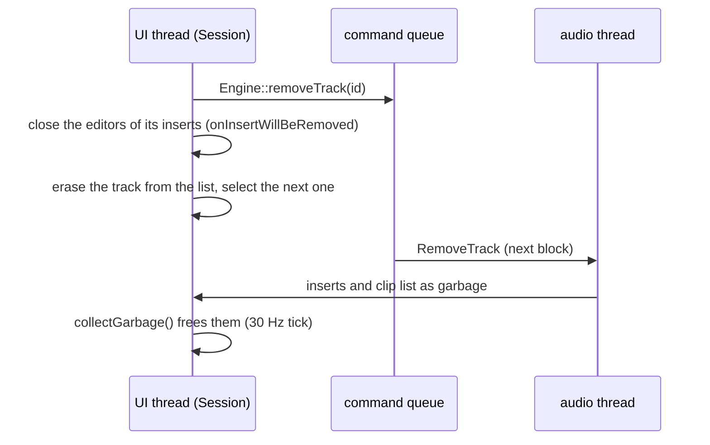

# Step 7 - The app with growing tracks

**English** | [繁體中文](step-07-app-tracks.zh-TW.md)

[Overview](../README.md) | Previous: [Step 6 - The engine with a track pool](step-06-engine-pool.md) | Next: [Step 8 - Saving and opening in the app](step-08-app-files.md)

## Goal

Bring the engine of Step 6 into the JUCE application. Chapter 14's "DawLab 8" becomes
"DawLab 15": tracks are added and deleted from the Track menu, the arrangement and the mixer
scroll when the tracks no longer fit, and the transport bar warns when the computer cannot keep
up. Saving and opening (Step 4) and undo (Step 5) come to the app in Steps 8 and 9; this step
lays the ground they stand on.

## Design

### Copy, then change - again

Like the engine in Step 6, the application is copied first (`lessons/15-daw-growing/app/` starts
as an unchanged copy of `lessons/14-daw-8track/app/`), and every change is made on the copy. The
diff shows the whole step:

```bash
git diff --no-index lessons/14-daw-8track/app lessons/15-daw-growing/app
```

<div align="center">

| File | What changed |
|---|---|
| `Session.h/.cpp` | a list of tracks in display order, each with a `TrackId`; `addTrack()` / `removeTrack()`; every function takes an id |
| `ArrangementView.h/.cpp` | lanes with a minimum height that scroll under the ruler; selection, drop target and clip drag by id |
| `MixerView.h/.cpp` | the track strips in a `juce::Viewport`; one view per track, kept while the track lives |
| `MainComponent.h/.cpp` | Track > Add mono / stereo track, Delete selected track; dropped files add the tracks they need; the dropout warning |
| `TransportBar.h/.cpp` | the CPU display reads the engine's `CpuMeter` through a `CpuMonitor` |
| `AudioHost.h/.cpp` | its own CPU measurement removed |
| `MediaLoader.h/.cpp`, `DawLookAndFeel.h` | a loaded file names its track by id; a track's colour follows its id |
| `SmokeTest.cpp` | the same checks on ids, plus sections 6b (tracks) and 6c (CPU) |

</div>

The engine gets one addition, `Engine::getStrip(ChannelRef)` (below).

### Ids in the GUI, positions only for drawing

Chapter 14's GUI said "track 3" and meant index 3 everywhere: in the clip lists, in the strips,
in the selection, in the file loader. With tracks that come and go, an index names whatever
track happens to be at that position *now*. So the rule of Step 1 now holds for the whole app:

- `Session` keeps the tracks in a `std::vector` in display order. Each entry has its `TrackId`,
  its clip list and its four insert slots.
- `Session` hands out the ids itself and **never gives the same id twice while the program
  runs**, not even after File > New. A result that arrives late for a deleted track - a file the
  loader thread was still reading - then finds nothing, and the status line says so. If ids
  started at 1 again in a new project, that file would land on the new project's track with the
  same id.
- Every `Session` function takes a `TrackId` or a `ChannelRef` (which carries one). The display
  position appears only where something is drawn or clicked: `getTrackId(lane)` and
  `indexOf(id)`.
- The demo song names its tracks `demoTrackId(0..7)`; `Session::applyDemoSong()` adds them with
  new ids from `addTrack()`, like any other track, and translates.

### The UI thread asks its own table

Chapter 14's GUI read a strip's values with `engine.getMixer().getStrip(ref)`. In chapter 15
that function answers by the audio thread's slot table (Step 6): from the UI thread it would be a
data race, and while commands are still queued it is also out of date. The engine therefore gets
one more function for the UI thread:

```cpp
ChannelStrip* Engine::getStrip(ChannelRef ref);  // by the UI's own slot table
```

A track is there from `addTrack()` on and gone from `removeTrack()` on, and a reference to a slot
that another track took over is refused. `test_track_pool` checks all three, and fails when
`getStrip()` asks the audio thread's table instead.

### Lanes and strips that scroll

- **Arrangement.** The lanes share the height below the ruler, but none gets lower than
  `kMinLaneHeight` (36 px). With chapter 14's 8 tracks nothing changes; with more, the lanes
  scroll under the ruler and a scroll bar appears. The mouse wheel scrolls the lanes when they do
  not all fit, Shift + wheel scrolls in time, Ctrl + wheel zooms.
- **Mixer.** The track strips sit side by side in a `juce::Viewport` that scrolls sideways. The
  buses, the master and the analysers keep their place on the right.
- **One view per track.** When the session changes, `MixerView` builds the list of strip views
  again in display order, but a track that is still there keeps *its* view object, so a fader the
  user is holding is not torn away. Only the views of deleted tracks are destroyed.
- **Colour.** A track's colour follows its id, not its position, so it keeps its colour when
  tracks above it come and go.

### Adding and deleting a track

Track > Add mono track (Ctrl+T) and Add stereo track (Ctrl+Shift+T) put a new track below the
selected one, select it, and scroll it into view in the arrangement and in the mixer. When the
pool is full (`kMaxTracks`), the two commands are disabled and the status line says why.

Deleting (Track > Delete selected track, Ctrl+Delete) has an order to it, because the track's
inserts may have editor windows open, and those windows point at the effects:



The effects stay alive until the UI thread itself frees them, so the editors can still close
safely after the command was sent. If the queue is full, `removeTrack()` changes nothing and says
so.

Audio files dropped on a lane fill that track and the ones below it. Chapter 14 refused the files
that did not fit; now the missing tracks are added at the end.

### The CPU warning

Step 3 showed that the limit is CPU time, not a number of tracks. The transport bar now shows the
engine's own measurement (`Engine::getCpuMeter()`, Step 6) through a `CpuMonitor` (Step 3):

<div align="center">

| Display | When |
|---|---|
| `CPU 12%` grey | normal |
| `CPU 80%` orange | the smoothed load went above 75 % (and stays orange until it is below 65 %) |
| `CPU overload` red | a block came too late in the last 2 s: the listener heard a dropout |

</div>

While the display is red, the status line says in words what happened and what to do (remove
tracks or effects, or choose a larger buffer size). That message wins over every other one until
the dropouts stop. `AudioHost`'s own, second CPU measurement was removed: one number, measured in
one place.

An export renders through the same `processBlock()` as fast as the CPU can. In a Debug build
that is slower than real time, so the meter counts "late" blocks that nobody heard. The CPU
history therefore starts over after an export (`TransportBar::forgetCpuHistory()`).

## Testing

The smoke test (`"DawLab 15.exe" --smoke-test`, ctest `l15_app_smoke_test`) runs chapter 14's
checks on ids first. They pass with the same numbers as chapter 14 (140 clips on 28 buffers, 752
samples of mix latency, -15.5 LUFS), so the GUI on the pool still does what DawLab 8 did. Then:

- **6b, tracks.** It adds a stereo track below the bass and 40 mono tracks through the commands:
  49 tracks in the session, the mixer and the engine. The newest lane and strip are scrolled into
  view, and all 49 play. It deletes the drums while their compressor's editor is open: the window
  closes, the bass is selected, nothing leaks. It fills the pool to 128 tracks: the next add is
  refused and the command is disabled. File > New gives 8 tracks with new ids, and 3 files
  dropped on the last lane add 2 tracks.
- **6c, CPU.** An insert that needs 2.5 times the duration of every block is put on a track:
  4 blocks, 4 late, the display reads `CPU overload` and the status line warns. After the GUI
  export (section 9) no overload is shown.

Each guarantee was also broken on purpose:

<div align="center">

| Broken on purpose | Caught by |
|---|---|
| `Engine::getStrip()` asks the audio thread's table | `test_track_pool`: a new track is not seen, a removed one still is |
| removing a track does not close its editors | smoke test 6b: the editor is still open |
| selecting a track does not scroll to it | smoke test 6b: the newest lane is not visible |
| no dropout message | smoke test 6c: the status line does not warn |
| the CPU history is kept after an export | smoke test 9: an overload is shown after the export |

</div>

## Try it

```powershell
.\scripts\build.ps1 -Only 15-daw-growing -Juce
& ".\build\bin\Debug\DawLab 15.exe"
```

Press Ctrl+T a few dozen times and watch the lanes and the mixer start to scroll. Then delete
tracks with Ctrl+Delete while one of their inserts is open. To see the CPU warning, add effects
to many tracks; a Debug build gets there sooner than a Release build.

## What you learned

- In a GUI over a growing list, positions are for drawing; everything else names a track by its
  id. Ids that are never reused make late results harmless.
- Each thread reads the table it owns: the UI asks `Engine::getStrip()`, never the audio thread's
  table.
- Keep views alive while their model lives, and rebuild only the list around them.
- Delete in an order that keeps every pointer valid: send the command, close what points at the
  object, and free it only when the audio thread hands it back.
- Show the CPU limit where the user looks: one measurement, a state with hysteresis, and words
  that say what to do.
