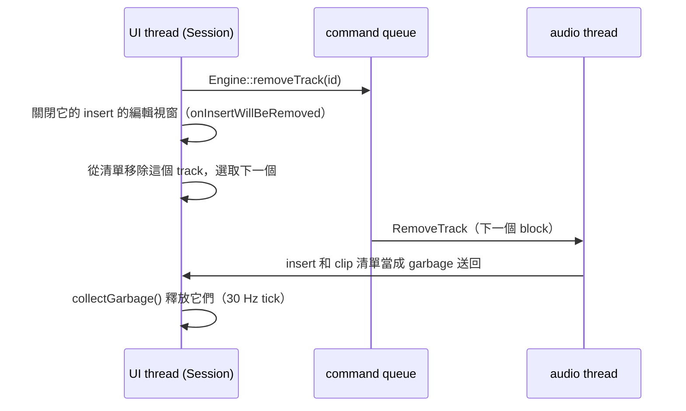

# Step 7 - Track 可以增減的 app

[English](step-07-app-tracks.md) | **繁體中文**

[總覽](../README.zh-TW.md) | 上一步：[Step 6 - 有 track 池的 engine](step-06-engine-pool.zh-TW.md) | 下一步：Step 8 - 在 app 中存檔與開啟（規劃中）

## 目標

把 Step 6 的 engine 帶進 JUCE application。第 14 章的「DawLab 8」變成「DawLab 15」：從 Track 選單新增和刪除 track，track
放不下時 arrangement 和 mixer 可以捲動，電腦跟不上時 transport bar 會發出警告。存檔與開啟（Step 4）和 undo（Step 5）在
Step 8、9 才接進 app；這一步先把它們需要的基礎打好。

## 設計

### 再一次：先複製，再修改

和 Step 6 的 engine 一樣，application 也先複製（`lessons/15-daw-growing/app/` 一開始是 `lessons/14-daw-8track/app/` 原封不動的
複本），所有修改都在複本上進行。這一步的全部內容就是兩者的 diff：

```bash
git diff --no-index lessons/14-daw-8track/app lessons/15-daw-growing/app
```

<div align="center">

| 檔案 | 改了什麼 |
|---|---|
| `Session.h/.cpp` | 依顯示順序排列的 track 清單，每個 track 有一個 `TrackId`；`addTrack()` / `removeTrack()`；每個函式都用 id |
| `ArrangementView.h/.cpp` | 有最小高度、會在 ruler 下方捲動的 lane；選取、拖放目標和拖曳 clip 都用 id |
| `MixerView.h/.cpp` | track strip 放進 `juce::Viewport`；每個 track 一個 view，track 存在期間一直保留 |
| `MainComponent.h/.cpp` | Track > Add mono / stereo track、Delete selected track；拖進來的檔案會新增需要的 track；dropout 警告 |
| `TransportBar.h/.cpp` | CPU 顯示透過 `CpuMonitor` 讀取 engine 的 `CpuMeter` |
| `AudioHost.h/.cpp` | 拿掉它自己的 CPU 量測 |
| `MediaLoader.h/.cpp`、`DawLookAndFeel.h` | 載入的檔案用 id 指定 track；track 的顏色跟著 id |
| `SmokeTest.cpp` | 同樣的檢查改用 id，再加上 6b（track）和 6c（CPU）兩段 |

</div>

engine 只多了一個函式：`Engine::getStrip(ChannelRef)`（見下文）。

### GUI 裡用 id，位置只用來畫圖

第 14 章的 GUI 說「track 3」，指的就是 index 3：clip 清單、strip、選取、載入檔案都一樣。track 會增減之後，index 指的是*現在*
剛好在那個位置的 track。所以 Step 1 的規則現在適用於整個 app：

- `Session` 用一個 `std::vector` 依顯示順序保存 track。每一筆有自己的 `TrackId`、clip 清單和四個 insert slot。
- id 由 `Session` 自己發，而且**程式執行期間同一個 id 絕不發兩次**，File > New 之後也一樣。這樣一來，給已刪除 track 的遲到
  結果（例如 loader thread 還在讀的檔案）就找不到對象，status 列會說明這件事。如果新專案的 id 又從 1 開始，那個檔案就會落到
  新專案裡同 id 的 track 上。
- `Session` 的每個函式都接受 `TrackId` 或 `ChannelRef`（裡面帶著 id）。顯示位置只出現在需要畫圖或處理點擊的地方：
  `getTrackId(lane)` 和 `indexOf(id)`。
- demo song 用 `demoTrackId(0..7)` 指定它的 track；`Session::applyDemoSong()` 和新增其他 track 一樣，用 `addTrack()` 給它們新的
  id，再做對照。

### UI thread 查自己的表

第 14 章的 GUI 用 `engine.getMixer().getStrip(ref)` 讀 strip 的值。在第 15 章，這個函式查的是 audio thread 的 slot 表
（Step 6）：從 UI thread 呼叫就是 data race，而且 command 還在 queue 裡時，它的答案也是過時的。所以 engine 為 UI thread 多了
一個函式：

```cpp
ChannelStrip* Engine::getStrip(ChannelRef ref);  // 查 UI 自己的 slot 表
```

track 從 `addTrack()` 起就查得到，從 `removeTrack()` 起就查不到；指向已被其他 track 接手的 slot 的參照會被拒絕。
`test_track_pool` 檢查這三件事；如果 `getStrip()` 改查 audio thread 的表，測試就會失敗。

### 可以捲動的 lane 與 strip

- **Arrangement。** lane 平分 ruler 以下的高度，但每個 lane 至少有 `kMinLaneHeight`（36 px）。第 14 章的 8 個 track 看起來
  完全一樣；更多 track 時，lane 會在 ruler 下方捲動，右邊出現捲軸。lane 放不下時，滑鼠滾輪捲動 lane；Shift + 滾輪沿時間
  捲動；Ctrl + 滾輪縮放。
- **Mixer。** track strip 並排放在一個可以左右捲動的 `juce::Viewport` 裡。bus、master 和分析器固定在右邊。
- **每個 track 一個 view。** session 改變時，`MixerView` 依顯示順序重建 strip view 的清單，但還在的 track 保留*它自己*的
  view 物件，所以使用者正按住的 fader 不會被抽走。只有被刪除 track 的 view 會被銷毀。
- **顏色。** track 的顏色跟著 id，而不是位置，所以上面的 track 增減時，它的顏色不變。

### 新增與刪除 track

Track > Add mono track（Ctrl+T）和 Add stereo track（Ctrl+Shift+T）在選取的 track 下方新增一個 track，選取它，並在
arrangement 和 mixer 中捲動到它。池子滿了（`kMaxTracks`）時，這兩個指令會停用，status 列會說明原因。

刪除（Track > Delete selected track，Ctrl+Delete）要照順序做，因為 track 的 insert 可能開著編輯視窗，而那些視窗指向效果器：



效果器會一直存活，直到 UI thread 自己釋放它們，所以送出 command 之後，編輯視窗仍然可以安全地關閉。queue 滿了的話，
`removeTrack()` 什麼都不改，並回報失敗。

拖到 lane 上的音訊檔會放進那個 track 和下面的 track。第 14 章會拒絕放不下的檔案；現在會在最後面新增需要的 track。

### CPU 警告

Step 3 說明了限制是 CPU 時間，不是 track 數量。transport bar 現在透過 `CpuMonitor`（Step 3）顯示 engine 自己的量測
（`Engine::getCpuMeter()`，Step 6）：

<div align="center">

| 顯示 | 何時 |
|---|---|
| 灰色 `CPU 12%` | 正常 |
| 橘色 `CPU 80%` | 平滑後的負載超過 75 %（降到 65 % 以下才變回灰色） |
| 紅色 `CPU overload` | 最近 2 秒內有 block 太晚完成：聽的人聽到了 dropout |

</div>

顯示為紅色時，status 列會用文字說明發生了什麼事、該怎麼辦（刪掉一些 track 或效果器，或選更大的 buffer size）。在 dropout
停止之前，這個訊息優先於其他所有訊息。`AudioHost` 自己的第二套 CPU 量測拿掉了：只有一個數字，在一個地方量。

匯出時也是用同一個 `processBlock()`，以 CPU 能跑的最快速度算。Debug 建置下這比即時還慢，所以 meter 會算到沒有人聽到的
「太晚」的 block。因此匯出之後，CPU 的紀錄會重新開始（`TransportBar::forgetCpuHistory()`）。

## 測試

smoke test（`"DawLab 15.exe" --smoke-test`，ctest `l15_app_smoke_test`）先用 id 跑第 14 章的檢查。結果和第 14 章完全相同
（28 個 buffer 上的 140 個 clip、752 個 sample 的混音延遲、-15.5 LUFS），所以建在池子上的 GUI 做的事和 DawLab 8 一樣。
接著：

- **6b，track。** 透過指令在 bass 下方新增一個 stereo track，再新增 40 個 mono track：session、mixer 和 engine 裡都是 49 個
  track。最新的 lane 和 strip 都捲到看得見的地方，49 個 track 都能播放。在 drums 的 compressor 編輯視窗開著時刪除 drums：
  視窗關閉、選取移到 bass、沒有 leak。把池子加滿到 128 個 track：下一次新增被拒絕，指令也停用了。File > New 得到 8 個
  有新 id 的 track，拖到最後一個 lane 上的 3 個檔案新增了 2 個 track。
- **6c，CPU。** 在一個 track 上放一個每個 block 都需要 2.5 倍 block 時間的 insert：4 個 block 全部太晚，顯示
  `CPU overload`，status 列發出警告。GUI 匯出之後（第 9 段）不顯示 overload。

每一項保證也都故意弄壞過：

<div align="center">

| 故意弄壞的地方 | 被誰抓到 |
|---|---|
| `Engine::getStrip()` 查 audio thread 的表 | `test_track_pool`：看不到新的 track，還看得到已刪除的 track |
| 刪除 track 時不關閉它的編輯視窗 | smoke test 6b：編輯視窗還開著 |
| 選取 track 時不捲動到它 | smoke test 6b：最新的 lane 看不到 |
| 沒有 dropout 訊息 | smoke test 6c：status 列沒有警告 |
| 匯出之後保留 CPU 紀錄 | smoke test 9：匯出之後顯示 overload |

</div>

## 動手試試

```powershell
.\scripts\build.ps1 -Only 15-daw-growing -Juce
& ".\build\bin\Debug\DawLab 15.exe"
```

按幾十次 Ctrl+T，看 lane 和 mixer 開始捲動。接著在某個 insert 的編輯視窗開著時用 Ctrl+Delete 刪除 track。想看 CPU 警告，
就在很多 track 上加效果器；Debug 建置會比 Release 早出現警告。

## 你學到了

- 在一個會增長的清單上做 GUI，位置只用來畫圖，其他地方都用 id 指定 track。id 永不重用，遲到的結果就無害。
- 每個 thread 讀自己擁有的表：UI 用 `Engine::getStrip()`，絕不讀 audio thread 的表。
- model 存在期間就保留它的 view，只重建 view 外面的清單。
- 刪除要照能讓每個指標都有效的順序：送出 command，關掉指向那個物件的東西，等 audio thread 送回來才釋放。
- 在使用者看的地方顯示 CPU 的極限：一個量測、有 hysteresis 的狀態，以及說明該怎麼做的文字。
