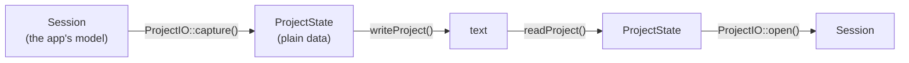

# Step 8 - Saving and opening in the app

**English** | [繁體中文](step-08-app-files.zh-TW.md)

[Overview](../README.md) | Previous: [Step 7 - The app with growing tracks](step-07-app-tracks.md) | Next: [Step 9 - Undo and redo in the app](step-09-app-undo.md)

## Goal

File > Open project (Ctrl+O), Save project (Ctrl+S) and Save project as (Ctrl+Shift+S) in
DawLab 15. The file holds the **whole** project: tracks, clips, faders, pans, mutes, solos,
sends, buses, every insert with its parameters, VST3 plugins with their state, and the audio.
Opening it gives back the same mix, to the bit. Step 4 designed the core of this file; here it
meets the real application.

## Design

### Three layers



- **`ProjectFormat`** (`app/Source/ProjectFormat.h/.cpp`) is Step 4's idea at full size: a
  `ProjectState` is plain data, and `writeProject()` / `readProject()` are pure functions, text
  in, text out. No JUCE, no files, no engine objects - so it has its own test,
  `l15_test_project_format`, which runs in every build and every CI job, not only with `-Juce`.
- **`ProjectIO`** (`app/Source/ProjectIO.h/.cpp`) is the edge: it turns a `Session` into a
  `ProjectState` and back, and does everything that touches the outside world - the text file,
  the audio files, the plugins.
- **`MainComponent`** adds the commands, the file choosers, the status line and the window
  title ("DawLab 15 - Demo").

### Format 3

Step 4's format had tracks (id, name, gain, pan) and clips (track, start, length, file). Format
3 adds what the app keeps, line by line:

```text
DawLabProject 3
sampleRate 48000
nextTrackId 10
tempo 118 4 4
loop 97627 585763 1
track 2 "Bass \"DI\"" -3 0 mono 0 0
bus 0 "Reverb" -2 0 0
master "Master" 0 0 0
send track:2 0 -12.5 1
insert track:1 1 builtin "Compressor" 0
param track:1 1 "Threshold" -20
insert master 3 vst3 "C:/Program Files/Common Files/VST3/DawLabLimiter.vst3" 0 "VC2!..."
clip 1 0 192000 "Demo_media/01235f213fcc259d.wav" 0 0 0 linear 0 0 "drums"
```

- A channel is written `track:<id>`, `bus:<index>` or `master`.
- Built-in parameters are saved **by name**, not by index. A later version of an effect may
  add a parameter or reorder them, and the file still means the same thing. A name the effect
  no longer has becomes a warning, not an error.
- A VST3 plugin is its file plus the state the plugin itself returns
  (`getStateInformation`, base64). Only the plugin understands that state.
- An unused send is the default and is not written, so most strips need no `send` line.
- Lines that refer to something (a send, an insert, a parameter, a clip) are checked once the
  whole file is read, so their order does not matter.
- Formats 1 and 2 (Step 4's files) still open; everything they do not say keeps its default.

The text keeps Step 4's rules: the classic locale, floats with 9 significant digits, every
error with its line number.

### The audio: next to the text, named by its content

The audio is not in the text. Each distinct clip buffer is written once into a folder next to
the project (`Demo.dawlab` -> `Demo_media/`) as a **32-bit float WAV at the project's sample
rate**. 24-bit files would round every sample; a 32-bit float file stores the floats themselves,
so every sample comes back bit for bit.

Each WAV is **named after its content**: a 64-bit hash of its channel count and samples
(`01235f213fcc259d.wav`). That one decision gives three properties:

- Audio that did not change keeps its name, so saving again writes no audio at all.
- New audio gets a new name and never overwrites a file the *previous* version of the project
  still points at. A crash halfway through a save cannot damage the previous version.
- Buffers with equal samples are stored once. The demo song has 28 buffers with 23 different
  contents: 23 WAVs.

### The order of a save

1. Write the WAVs that do not exist yet, each beside its target, then move it over the target
   (`juce::TemporaryFile`).
2. Write the text the same way. From this moment the new version is complete.
3. Delete the WAVs in the media folder that the new version no longer uses.

If anything fails, Save says so and returns. The previous version on disk is still complete,
because nothing it uses was overwritten or deleted.

### The order of an open

1. Read the text and check **all** of it (`readProject()`).
2. Read every audio file it names.
3. Only now replace the open project: `Session::clearProject()`, then the transport, the buses
   and master, the tracks, the inserts, the clips.

A file that does not parse is refused with its line (`Demo.dawlab, line 4: clip on track 2,
which does not exist`), and the project that was open stays exactly as it was.

Some problems should not stop a project from opening, so they become warnings instead: a missing
audio file (its clips are left out), a plugin that does not load, an effect or a parameter this
version does not know, a clip longer than its audio. The status line shows the first warning,
and in the app a message box lists them all.

### Ids: the session's and the file's

Step 7 made the session's track ids count up for as long as the program runs. The ids in a file
are therefore the **file's own references**. Save writes them as 1..N in display order, and Open
gives each track a new session id and translates the clips and channels. Two things follow:

- No id from the file can collide with an id the running program already used.
- Saving an opened project gives the same text again. The smoke test checks this.

### Another sample rate

The file says which rate its positions and audio are at. When the engine runs at another rate,
the opened project is converted exactly as after a device change, with
`Session::handleSampleRateChange()`: the audio is resampled and the positions are scaled.

## Testing

`l15_test_project_format` (no JUCE, 44 checks):

- A round trip of a project that uses every field, with names that contain quotes, backslashes
  and line breaks and floats that need all 9 digits. Write, read, compare; write again: the same
  text.
- Lines in any order, Step 4's formats 1 and 2, CRLF, a byte order mark, comments, and a German
  locale (`"97,5"` must not appear).
- 25 broken files, each refused with the right line and message.

The app's smoke test, section 6d:

- It saves the demo song with changes the demo does not have: a renamed track, a muted track, a
  pre-fader send, a bypassed insert, another tempo, the loop, an extra stereo track.
- A second save writes no WAV again.
- A second window opens the file. Both windows render 2 s: the largest difference is **0**.
- Saving from the second window into another folder gives the **same text**.
- A broken file is refused with its line, and the open project is untouched.
- Without its media folder, the project opens with no clips and one warning per missing file.
- An engine at 44.1 kHz opens the file: the bass clip 3 sits at 88200.

Each guarantee was broken on purpose:

<div align="center">

| Broken on purpose | Caught by |
|---|---|
| the writer does not use the classic locale | `l15_test_project_format`: German locale |
| floats written with 6 digits | `l15_test_project_format`: round trip |
| the session is cleared before the file is checked | smoke test 6d: the broken file empties the project |
| session ids are written into the file | smoke test 6d: the second save gives other text |
| 24-bit WAVs | smoke test 6d: the renders differ |

</div>

The ids control first passed: both windows happened to hand out the same ids, so the text matched
anyway. The test now adds a track in the second window before it opens the file, and then the
control is caught.

## Try it

```powershell
.\scripts\build.ps1 -Only 15-daw-growing -Juce
& ".\build\bin\Debug\DawLab 15.exe"
```

Save the demo song with Ctrl+S, open the `.dawlab` file in a text editor and find each line kind
from the list above. Change a gain there, save the text, and open it again with Ctrl+O. Then make
it invalid, for example `clip 99 ...`, and read the message you get.

## Limits of this step

- Opening reads the audio on the message thread, so a very large project blocks the window while
  it loads. MediaLoader's thread is the place to move this.
- New, Open and Quit do not ask about unsaved changes yet. That needs to know whether the project
  changed, and the undo history of Step 9 knows it (Step 5: the saved serial).

## What you learned

- Put the format in pure functions and the files around them: the format gets fast tests that
  need nothing, and the edge stays small.
- Check everything before you change anything: a file that does not parse must not cost the user
  the project they had open.
- Skip what can be skipped, with a warning; refuse only what makes the file meaningless.
- Name stored data by its content: unchanged data is never written again, and new data never
  overwrites what an older version still uses.
- Ids belong to the place that hands them out. A file's ids are the file's own references.
