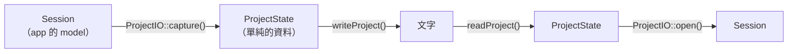

# Step 8 - 在 app 中存檔與開啟

[English](step-08-app-files.md) | **繁體中文**

[總覽](../README.zh-TW.md) | 上一步：[Step 7 - Track 可以增減的 app](step-07-app-tracks.zh-TW.md) | 下一步：[Step 9 - 在 app 中 undo 與 redo](step-09-app-undo.zh-TW.md)

## 目標

在 DawLab 15 加上 File > Open project（Ctrl+O）、Save project（Ctrl+S）和 Save project as（Ctrl+Shift+S）。檔案存的是
**整個**專案：track、clip、fader、pan、mute、solo、send、bus、每個 insert 和它的參數、VST3 plugin 和它的 state，以及音訊。
開啟後得到同樣的混音，一個 bit 都不差。這個檔案的核心在 Step 4 設計好了；這一步把它接上真正的 application。

## 設計

### 三層



- **`ProjectFormat`**（`app/Source/ProjectFormat.h/.cpp`）是完整尺寸的 Step 4：`ProjectState` 是單純的資料，
  `writeProject()` / `readProject()` 是 pure function，文字進、文字出。沒有 JUCE、沒有檔案、沒有 engine 物件，所以它有自己的
  測試 `l15_test_project_format`，在每一次建置和每一個 CI job 都會跑，不只在 `-Juce` 的時候。
- **`ProjectIO`**（`app/Source/ProjectIO.h/.cpp`）是邊界：它把 `Session` 轉成 `ProjectState` 再轉回來，並處理所有碰到外部世界
  的事：文字檔、音訊檔、plugin。
- **`MainComponent`** 加上指令、檔案選擇視窗、status 列和視窗標題（「DawLab 15 - Demo」）。

### 格式 3

Step 4 的格式有 track（id、名稱、gain、pan）和 clip（track、起點、長度、檔案）。格式 3 一行一行加上 app 保存的東西：

```text
DawLabProject 3
sampleRate 48000
nextTrackId 10
tempo 118 4 4
loop 97627 585763 1
track 2 "Bass \"DI\"" -3 0 mono 0 0
bus 0 "Reverb" -2 0 0
master "Master" 0 0 0
send track:2 0 -12.5 1
insert track:1 1 builtin "Compressor" 0
param track:1 1 "Threshold" -20
insert master 3 vst3 "C:/Program Files/Common Files/VST3/DawLabLimiter.vst3" 0 "VC2!..."
clip 1 0 192000 "Demo_media/01235f213fcc259d.wav" 0 0 0 linear 0 0 "drums"
```

- channel 寫成 `track:<id>`、`bus:<index>` 或 `master`。
- 內建效果器的參數**用名稱**存，不用 index。之後的版本可能會新增或重排參數，檔案的意思仍然不變。效果器已經沒有的名稱會變成
  警告，而不是錯誤。
- VST3 plugin 存它的檔案，加上 plugin 自己回傳的 state（`getStateInformation`，base64）。只有 plugin 自己看得懂那個 state。
- 沒用到的 send 就是預設值，不寫出來，所以大部分的 strip 不需要 `send` 這一行。
- 參照別的東西的行（send、insert、參數、clip）會在整個檔案讀完後才檢查，所以順序沒有關係。
- 格式 1 和 2（Step 4 的檔案）仍然能開啟；它們沒寫的東西保持預設值。

文字沿用 Step 4 的規則：classic locale、9 位有效數字的 float（double，也就是 sample rate 和 tempo，用 17 位：像 117.64705882352941 這種來自 MIDI 檔的 tempo 每一位都需要）、每個錯誤都附上行號。它也拒絕符號正確、但 DawLab 從來不會寫出的數字：8000 到 768000 Hz 以外的 sample rate、超過 2^40 個 sample（48 kHz 下大約 260 天）的位置或長度、在檔案的 sample rate 下長於 60 秒的 fade。Fade 是一個 `int`，engine 會對它加 1，換 rate 時會被縮放；以秒為單位，這個上限在每個 rate 下都成立（768 kHz 下是 46,080,000 個 sample）。這些上限放在 `ProjectLimits.h`，第 15 到 20 章共用同一個檔案。檔案裡只會出現一次的關鍵字——`sampleRate`、`nextTrackId`、`tempo`、`loop`、`master`——出現第二次就會被拒絕：不然最後一行會不聲不響地蓋掉前面的。

### 音訊：放在文字旁邊，用內容命名

音訊不放在文字裡。每個不同的 clip buffer 只寫一次，放進專案旁邊的資料夾（`Demo.dawlab` -> `Demo_media/`），存成**專案
sample rate 的 32-bit float WAV**。24-bit 檔案會把每個 sample 四捨五入；32-bit float 檔案存的就是 float 本身，所以每個
sample 都能 bit-exact 地讀回來。

每個 WAV **用它的內容命名**：對聲道數和 sample 算出的 64-bit hash（`01235f213fcc259d.wav`）。這一個決定帶來三個性質：

- 沒有改變的音訊名稱不變，所以再存一次完全不用寫音訊。
- 新的音訊得到新的名稱，絕不會覆蓋*前一個*版本的專案還在用的檔案。存到一半當機，也不會破壞前一個版本。
- 內容相同的 buffer 只存一次。demo song 有 28 個 buffer，其中 23 種不同的內容：23 個 WAV。

### 存檔的順序

1. 寫出還不存在的 WAV，每個都先寫在目標旁邊，再移過去蓋掉目標（`juce::TemporaryFile`）。
2. 用同樣的方式寫文字。從這一刻起，新版本就是完整的。
3. 刪掉媒體資料夾裡新版本已經不用的 WAV。

只要有任何一步失敗，Save 會說明原因並結束。磁碟上的前一個版本仍然完整，因為它用到的東西都沒有被覆蓋或刪除。

### 開啟的順序

1. 讀取文字並檢查**全部**內容（`readProject()`）。
2. 讀取它提到的每個音訊檔。
3. 到這時候才替換目前的專案：`Session::clearProject()`，接著是 transport、bus 和 master、track、insert、clip。

解析不了的檔案會被拒絕並附上行號（`Demo.dawlab, line 4: clip on track 2, which does not exist`），原本開著的專案完全保持原樣。

有些問題不該讓整個專案打不開，所以改成警告：找不到的音訊檔（它的 clip 會被略過）、載入失敗的 plugin、這個版本不認得的
效果器或參數、比音訊還長的 clip。status 列顯示第一個警告，app 裡會跳出訊息視窗列出全部。

警告所略過的東西不在 session 裡，但仍在檔案裡。存回同一個檔案會寫入 session 而失去它們——還會刪掉那些存在但讀不了的音訊檔。
所以帶著警告開啟之後，Save 會要求另一個名稱（建議的是舊檔旁邊的新名稱），`saveProject()` 也拒絕覆寫開啟的那個檔案。以新名稱存下的檔案
內容就是 session 的內容，之後 Save 照常覆寫那個檔案。

### id：session 的和檔案的

Step 7 讓 session 的 track id 在程式執行期間一直往上數。所以檔案裡的 id 是**檔案自己的參照**。Save 依顯示順序寫成 1..N；
Open 給每個 track 一個新的 session id，再對照 clip 和 channel。因此：

- 檔案裡的 id 不會和執行中的程式用過的 id 衝突。
- 開啟後再存檔，得到相同的文字。smoke test 會檢查這一點。

### 不同的 sample rate

檔案寫明它的位置和音訊是哪個 sample rate。engine 跑在別的 rate 時，開啟的專案會像換音訊裝置之後一樣，用
`Session::handleSampleRateChange()` 轉換：音訊重新取樣，位置等比例換算。

## 測試

`l15_test_project_format`（不需要 JUCE，60 項檢查）：

- 一個用到所有欄位的專案，名稱裡有引號、反斜線和換行，還有需要完整 9 位數的 float。寫出、讀回、比對，再寫一次：文字相同。
- 任意順序的行、Step 4 的格式 1 和 2、CRLF、byte order mark、註解，以及德文 locale（不能出現 `"97,5"`）。
- 30 個壞掉的檔案，每個都以正確的行號和訊息被拒絕，其中包括重複出現的關鍵字。
- 上限：sample rate、剛好 2^40 和多一的位置、剛好 60 秒和多一個 sample 的 fade；還有需要完整 17 位數的 tempo，必須精確讀回。

app 的 smoke test 第 6d 段：

- 存下帶有 demo 原本沒有的修改的 demo song：改名的 track、靜音的 track、pre-fader send、bypass 的 insert、不同的 tempo、
  loop、多一個 stereo track。
- 第二次存檔沒有再寫任何 WAV。
- 第二個視窗開啟這個檔案。兩個視窗都 render 2 秒：最大差異是 **0**。
- 從第二個視窗存到另一個資料夾，得到**相同的文字**。
- 壞掉的檔案以行號被拒絕，開著的專案沒有被動到。
- 沒有媒體資料夾時，專案仍然能開啟，沒有 clip，每個找不到的檔案一個警告；存回它自己會被拒絕（檔案不變），以另一個名稱則能存檔。
- 一個 44.1 kHz 的 engine 開啟這個檔案：bass 的第 3 個 clip 在 88200。

每項保證都故意弄壞過：

<div align="center">

| 故意弄壞的地方 | 被誰抓到 |
|---|---|
| 寫出時不用 classic locale | `l15_test_project_format`：德文 locale |
| float 只寫 6 位數 | `l15_test_project_format`：來回測試 |
| 檢查檔案之前就清空 session | smoke test 6d：壞掉的檔案把專案清空了 |
| 把 session 的 id 寫進檔案 | smoke test 6d：第二次存檔的文字不同 |
| 24-bit WAV | smoke test 6d：兩次 render 結果不同 |

</div>

id 的反向測試一開始沒被抓到：兩個視窗剛好發出相同的 id，所以文字還是一樣。現在測試會先在第二個視窗新增一個 track 再開啟
檔案，這樣反向測試就會被抓到。

## 動手試試

```powershell
.\scripts\build.ps1 -Only 15-daw-growing -Juce
& ".\build\bin\Debug\DawLab 15.exe"
```

用 Ctrl+S 存下 demo song，用文字編輯器打開 `.dawlab` 檔，找出上面列出的每一種行。在檔案裡改一個 gain，存檔，再用 Ctrl+O
開啟。接著把它改壞，例如 `clip 99 ...`，看看得到的訊息。

## 這一步的限制

- 開啟時在 message thread 上讀音訊，所以很大的專案載入時視窗會卡住。要改進的話，就把這件事搬到 MediaLoader 的 thread。
- New、Open 和 Quit 還不會詢問是否儲存變更。這需要知道專案有沒有改過，而 Step 9 的 undo 歷史紀錄知道（Step 5：存檔時的序號）。

## 你學到了

- 把格式寫成 pure function，檔案處理放在外面：格式得到不需要任何環境、跑得很快的測試，邊界也保持小。
- 改變任何東西之前先檢查全部：解析不了的檔案，不該讓使用者失去原本開著的專案。
- 能略過的就略過並發出警告；只拒絕會讓檔案失去意義的問題。
- 用內容替儲存的資料命名：沒變的資料不會再寫一次，新的資料也不會覆蓋舊版本還在用的東西。
- id 屬於發出它的地方。檔案的 id 是檔案自己的參照。
