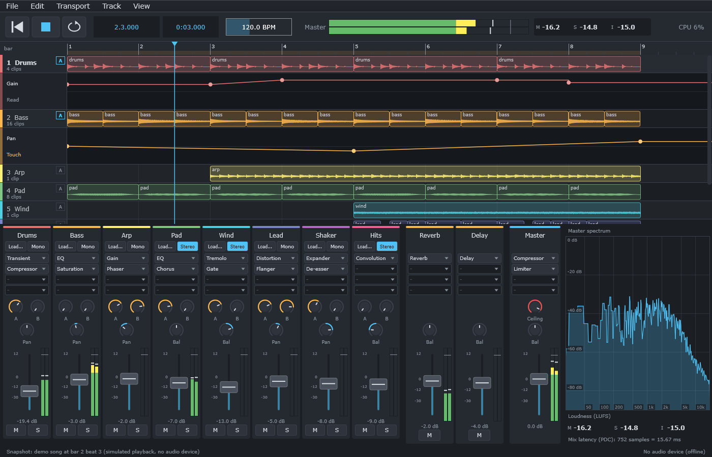

# Chapter 16: Automation - parameters that change over time

**English** | [繁體中文](README.zh-TW.md)

> **Status: finished.** All six steps are done; the chapter ends in **DawLab 16**.

<p align="center"></p>

DawLab 15 (chapter 15) plays a mix whose faders and knobs stay where the user left them. Real
music moves: a fader rises into the chorus, a filter opens over eight bars, a delay is switched on
for one phrase. A DAW records such movements as **automation**: a curve along the timeline for each
parameter that the audio thread follows while it plays.

Automation touches every layer that chapter 15 built. It is data in the project file and in the
undo history, a real-time problem on the audio thread (sample-accurate and without allocating),
and a question of who wins when the user moves a fader that a curve is moving too. This chapter
takes those one at a time, in small snapshots first, then in a copy of chapter 15's engine and
application.

## How to use this chapter

Like chapter 15, every step is a small, self-contained snapshot in `steps/stepNN-*/`: you write the
step's functions in `starter/`, and the self-check tells you when they work. See
[steps/README.md](steps/README.md).

```powershell
.\scripts\build.ps1 -Only 16-automation          # no JUCE needed
.\build\bin\Debug\l16_step01_starter.exe
```

On Linux / macOS: `./scripts/build.sh --only 16-automation`, then `./build/bin/l16_step01_starter`.

## 1. Goals

After this chapter you can

- store automation as points on the timeline and read it back as one value or as a block;
- let the audio thread follow a curve sample-accurately, without allocating, across seeks and loops;
- decide who wins when the user moves an automated control (Read, Touch, Latch, Write) and record
  the movement as points;
- name what a curve belongs to so that it survives deleted tracks, moved effects, the project file
  and undo;
- draw and edit automation in the application.

## 2. The steps

<div align="center">

| Step | Document | Adds | Status |
|---|---|---|---|
| 1 | [The automation curve](docs/step-01-curve.md) | points with a position and a normalized value, Linear and Hold segments, jumps, `valueAt()` and a one-search `render()` | done |
| 2 | [Sample-accurate playback](docs/step-02-playback.md) | the curve on the audio thread: immutable curves swapped like clip lists, a cursor that checks itself across seeks and loops, a limit that stops jumps from clicking | done |
| 3 | [Automation and the user](docs/step-03-modes.md) | Read / Touch / Latch / Write; the audio thread stamps the movement, the UI thread groups it into passes, thins them and punches them into the curve | done |
| 4 | [What a curve belongs to](docs/step-04-targets.md) | targets by track id, effect id and parameter name; lanes that leave and return with their owner; unknown parameters kept; the project file and undo | done |
| 5 | [The engine with automation](docs/step-05-engine.md) | a copy of chapter 15's engine with lanes inside strips and effects, faders that wait for delayed audio, one capture queue; ThreadSanitizer | done |
| 6 | [The app with automation](docs/step-06-app.md) | a copy of chapter 15's app: lanes under the tracks, drawing and dragging points, the mode switch, recording with the fader, project format 4 | done |

</div>

## 3. Where this chapter starts

Chapter 15 ends with an engine whose parameters are atomics that the UI writes and the audio thread
reads once per block (chapter 14, Step 4). That is enough for a knob in the user's hand. It is not
enough for automation: a value per block is a staircase at 48 kHz / 512 samples - ten steps a
second - and the audio thread, not the UI, has to know where the curve is at every sample.

## 4. Start

Start with [Step 1 - The automation curve](docs/step-01-curve.md). When you reach the application:

```powershell
.\scripts\build.ps1 -Only 16-automation -Juce
& ".\build\bin\Debug\DawLab 16.exe"
```

## 5. Exercises

See [exercises/README.md](exercises/README.md), with the answers in [solutions/README.md](solutions/README.md).
Six exercises, none needs JUCE: who may touch a curve (concept), automation by the numbers (calculation),
a curved segment with a tension, a Trim mode that adds to a curve instead of replacing it, copying and
pasting automation, and automating a VST3 plugin properly (design). Three optional projects extend
DawLab 16 with JUCE: a line tool, showing the lane of a touched control, and a lane menu that thins,
clears and removes.

## 6. Next

Continue with [chapter 17 - Recording](../17-recording/README.md). For what a DAW could grow beyond that -
MIDI, time-stretching - see [Where to go next](../14-daw-8track/README.md#10-where-to-go-next) in chapter 14.
