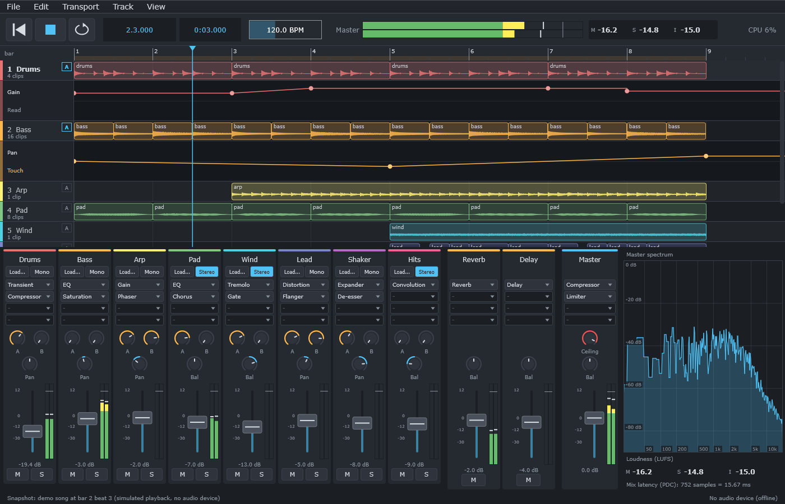

# 第 16 章：Automation - 隨時間變化的參數

[English](README.md) | **繁體中文**

> **狀態：完成。** 六個步驟都已完成；本章的成果是 **DawLab 16**。

<p align="center"></p>

DawLab 15（第 15 章）播放的混音，fader 和旋鈕都停在使用者放的位置。真正的音樂會動：fader 在副歌時推上去，filter 在八小節裡慢慢
打開，delay 只在某一句打開。DAW 把這些動作記錄成 **automation**：每個參數一條沿著時間軸的曲線，audio thread 播放時照著它走。

automation 會碰到第 15 章做的每一層。它是專案檔和 undo 歷史紀錄裡的資料，是 audio thread 上的 real-time 問題（精準到 sample，而且
不能配置記憶體），也是一個「使用者去推一個正被曲線推動的 fader 時，誰說了算」的問題。這一章一次處理一件事：先在小小的 snapshot
裡做，再做進第 15 章 engine 和 application 的複本。

## 怎麼使用這一章

和第 15 章一樣，每個 step 都是 `steps/stepNN-*/` 裡一個小而完整的 snapshot：你在 `starter/` 寫出這一步的函式，自我檢查會告訴你
什麼時候完成。見 [steps/README.zh-TW.md](steps/README.zh-TW.md)。

```powershell
.\scripts\build.ps1 -Only 16-automation          # 不需要 JUCE
.\build\bin\Debug\l16_step01_starter.exe
```

在 Linux / macOS 上：`./scripts/build.sh --only 16-automation`，然後 `./build/bin/l16_step01_starter`。

## 1. 目標

學完這一章，你能夠

- 把 automation 存成時間軸上的點，並讀回單一值或一整個 block；
- 讓 audio thread 精準到 sample 地跟著曲線走，不配置記憶體，跳位置和 loop 也不出錯；
- 決定使用者動到有 automation 的控制項時誰說了算（Read、Touch、Latch、Write），並把動作錄成點；
- 說清楚一條曲線屬於什麼，讓它在 track 被刪除、效果器被移動、專案檔和 undo 之後都還正確；
- 在 application 裡畫出和編輯 automation。

## 2. 步驟

<div align="center">

| Step | 文件 | 加入什麼 | 狀態 |
|---|---|---|---|
| 1 | [Automation 曲線](docs/step-01-curve.zh-TW.md) | 有位置和 normalized 值的點、Linear 與 Hold 兩種段落、跳躍、`valueAt()` 和只搜尋一次的 `render()` | 完成 |
| 2 | [精準到 sample 的播放](docs/step-02-playback.zh-TW.md) | audio thread 上的曲線：像 clip 清單一樣交換的 immutable 曲線、跨 seek 和 loop 都會自我檢查的 cursor、讓跳躍不產生 click 的限制 | 完成 |
| 3 | [Automation 與使用者](docs/step-03-modes.zh-TW.md) | Read / Touch / Latch / Write；audio thread 替動作蓋時間戳，UI thread 把它分組成 pass、精簡後打入曲線 | 完成 |
| 4 | [曲線屬於什麼](docs/step-04-targets.zh-TW.md) | 用 track id、effect id 和參數名稱指定對象；lane 隨擁有者離開和回來；保留無法辨識的參數；專案檔與 undo | 完成 |
| 5 | [有 automation 的 engine](docs/step-05-engine.zh-TW.md) | 第 15 章 engine 的複本，lane 放在 strip 和效果器裡、fader 會等待延遲的音訊、一個 capture queue；ThreadSanitizer | 完成 |
| 6 | [有 automation 的 app](docs/step-06-app.zh-TW.md) | 第 15 章 app 的複本：track 下方的 lane、畫點和拖動點、模式切換、用 fader 錄製、專案格式 4 | 完成 |

</div>

## 3. 這一章從哪裡開始

第 15 章結束時，engine 的參數是 UI 寫入、audio thread 每個 block 讀一次的 atomic（第 14 章 Step 4）。這對使用者手上的旋鈕來說
足夠了，對 automation 卻不夠：每個 block 一個值，在 48 kHz / 512 sample 時就是每秒十階的階梯；而且要知道曲線在每個 sample
位置的是 audio thread，不是 UI。

## 4. 開始

從 [Step 1 - Automation 曲線](docs/step-01-curve.zh-TW.md) 開始。做到應用程式時：

```powershell
.\scripts\build.ps1 -Only 16-automation -Juce
& ".\build\bin\Debug\DawLab 16.exe"
```

## 5. 練習

見 [exercises/README.zh-TW.md](exercises/README.zh-TW.md)，解答在 [solutions/README.zh-TW.md](solutions/README.zh-TW.md)。
共六題，都不需要 JUCE：誰可以碰曲線（概念）、用數字看 automation（計算）、帶 tension 的曲線段、
把變化加到曲線上而不是取代它的 Trim 模式、複製和貼上 automation，以及正確地 automate 一個 VST3 plugin（設計）。
另有三個選做專題用 JUCE 擴充 DawLab 16：畫線工具、顯示被碰到的控制項的 lane，以及能 thin、清除和移除的 lane 選單。

## 6. 下一步

接著讀[第 17 章 - Recording](../17-recording/README.zh-TW.md)。DAW 之後還可以往哪些方向成長（MIDI、time-stretching），請見第 14 章的
[接下來往哪裡走](../14-daw-8track/README.zh-TW.md#10-接下來往哪裡走)。
