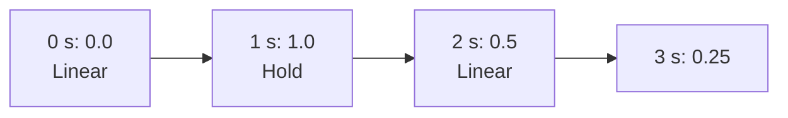

# Step 1 - The automation curve

**English** | [繁體中文](step-01-curve.zh-TW.md)

[Overview](../README.md) | Next: [Step 2 - Sample-accurate playback](step-02-playback.md)

## Goal

Store a parameter that changes over time, and read it back at any position: one value for the
screen, a whole block of values for the audio thread. This step is plain data and plain functions.
Step 2 puts the curve on the audio thread.

## Design

### Points on the timeline

A DAW stores automation as **points** along the timeline and draws a line through them:



```cpp
struct AutomationPoint {
    std::int64_t position; // timeline sample
    float value;           // normalized, 0 .. 1
    Shape shape;           // how the curve goes on to the NEXT point: Linear or Hold
};
```

- **The position is in samples**, like a clip's start (chapter 14). A curve therefore belongs to
  one sample rate, and a device change converts it the way it converts clips.
- **The value is normalized, from 0 to 1.** Chapter 14's `ParameterInfo` already maps 0..1 onto every
  parameter's range and taper (`fromNormalized`). So one curve type serves a fader in dB, a
  frequency in Hz and an on/off switch, and drawing it needs no knowledge of the parameter.
- **The shape belongs to the segment after the point.** `Linear` draws a straight line to the next
  point; `Hold` keeps the value until the next point (a step, for switches and choices).

### What the curve is everywhere

<div align="center">

| Where | Value |
|---|---|
| no points | the curve's default (the parameter's own value) |
| before the first point | the first point's value |
| between point i and i + 1 | Linear: the line between them; Hold: point i's value |
| at or after the last point | the last point's value |

</div>

Between two points the Linear value is

```math
v(x) = v_i + (v_{i+1} - v_i)\,\frac{x - x_i}{x_{i+1} - x_i}, \qquad x_i \le x < x_{i+1}
```

computed in `double` and rounded to `float` once. `valueAt()` and `render()` both call the same
function for it (`between()` in `minidaw.h`), so they cannot disagree by a rounding step.

### Jumps

Two points at the **same position** make a vertical jump. `add()` puts a new point after every
point that already has its position (`std::upper_bound`), so you add the "before" value first and
the "after" value second. Just before the jump the curve heads for the first point; from the jump's
sample on it is the second point's value. That is also why `segmentAt(x)` returns the **last**
point at or before `x`: all points of a jump count as reached at its position.

### Two ways to read it

- `valueAt(position)` finds the segment with one binary search (`O(log k)` for `k` points). That is
  what the UI needs: one value to draw or to show next to a knob.
- `render(start, out, n)` fills a whole block. Calling `valueAt()` for every sample would search
  the points `n` times. `render()` searches **once**, for the block's first sample, and then walks
  forward: a block crosses at most a few points, so the cost is about `n + log k`. Step 2 runs this
  on the audio thread, every block.

## Testing

`check.h` (11 checks) uses the worked example of the diagram above: added out of order,
read at 11 positions, a jump, values outside 0..1 and NaN (stored as 1, 0 and 0), `remove()`.
`render()` over 160000 samples in blocks of 300 must equal `valueAt()` exactly. Then 300 random
curves with jumps and holds are compared against a **reference written as plainly as possible**:
a linear search for the last point at or before the position, then the formula above.

<div align="center">

| Broken on purpose | Caught by |
|---|---|
| `add()` with `lower_bound` (a jump comes out backwards) | the jump example |
| `render()` searches once but never walks forward | render vs `valueAt()`, the random curves |
| the default value before the first point | the worked example, render, the random curves |

</div>

The first control shows why a hand-made example is still needed next to the random curves: the
reference reads the points in the order the curve stored them, so it cannot see that a jump was
stored the wrong way round. Only a test that knows which value must come first can.

### A bug only GCC showed

The first version of the solution passed on Windows and failed on Linux with "second point at 10"
for a curve of three points. The line was

```cpp
return static_cast<int>(points_.insert(at, point) - points_.begin());
```

C++ does not say which side of `-` is evaluated first. GCC called `points_.begin()` first; then
`insert()` needed more room and moved the points to new memory, and the subtraction mixed an
iterator into the new memory with one into the old: undefined behaviour. MSVC happened to evaluate
the other way round. Two statements fix it: keep the iterator `insert()` returns, then subtract.
Building every step with two compilers (chapter 15's CI does) catches this kind of mistake.

## Your turn

Build and run the starter (no JUCE needed):

```powershell
.\scripts\build.ps1 -Only 16-automation
.\build\bin\Debug\l16_step01_starter.exe
```

Write the four functions in `steps/step01-curve/starter/step01.cpp`:

1. `add()`: clamp the value to 0..1 and insert the point after every point at its position.
2. `remove()`: erase a point by index.
3. `valueAt()`: the table above, with `segmentAt()` and `between()`.
4. `render()`: one `segmentAt()`, then walk forward sample by sample.

When it works, the output ends like this:

```text
  render() over 160000 samples in blocks of 300: 0 values differ from valueAt() (expected 0)
  300 random curves (jumps and holds included), 87656 values: 0 differ from the reference,
  0 curves unsorted (expected 0, 0)
[PASS] l16_step01 (11 checks passed)
```

## What you learned

- Automation is a list of points in samples with normalized values; the parameter's own mapping
  turns 0..1 into dB, Hz or a switch.
- Say what the curve is *everywhere*: no points, before the first, between, at a jump, after the last.
- Let the single-value and the block reader share one formula, so they cannot disagree.
- Reading a block means one search and a walk, not one search per sample.
