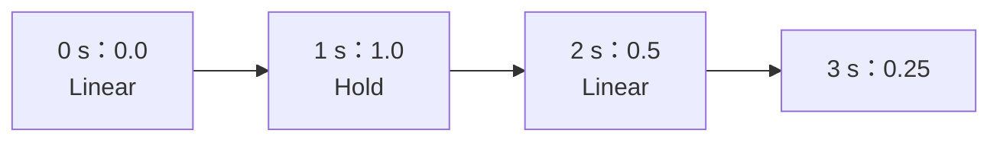

# Step 1 - Automation 曲線

[English](step-01-curve.md) | **繁體中文**

[總覽](../README.zh-TW.md) | 下一步：Step 2 - 精準到 sample 的播放（規劃中）

## 目標

保存一個會隨時間變化的參數，並且能在任何位置讀回來：給畫面讀一個值，給 audio thread 讀一整個 block 的值。這一步只是單純的
資料和函式；Step 2 才把曲線放到 audio thread 上。

## 設計

### 時間軸上的點

DAW 把 automation 存成時間軸上的一串**點**，再畫一條線穿過它們：



```cpp
struct AutomationPoint {
    std::int64_t position; // 時間軸上的 sample
    float value;           // normalized，0 .. 1
    Shape shape;           // 曲線怎麼走到「下一個」點：Linear 或 Hold
};
```

- **位置的單位是 sample**，和 clip 的起點一樣（第 14 章）。所以一條曲線屬於某個 sample rate；換音訊裝置時，它要像 clip 一樣
  被轉換。
- **值是 normalized 的，從 0 到 1。** 第 14 章的 `ParameterInfo` 已經能把 0..1 對應到每個參數的範圍和 taper（`fromNormalized`）。
  所以同一種曲線就能用在以 dB 為單位的 fader、以 Hz 為單位的頻率，以及開關上，畫曲線時也不需要知道參數是什麼。
- **shape 屬於這個點之後的那一段。** `Linear` 畫一條直線到下一個點；`Hold` 保持這個值直到下一個點（階梯狀，用在開關和選項上）。

### 曲線在每個地方的值

<div align="center">

| 在哪裡 | 值 |
|---|---|
| 沒有點 | 曲線的預設值（參數本來的值） |
| 第一個點之前 | 第一個點的值 |
| 第 i 和第 i + 1 個點之間 | Linear：兩點之間的直線；Hold：第 i 個點的值 |
| 最後一個點上或之後 | 最後一個點的值 |

</div>

兩點之間 Linear 的值是

```math
v(x) = v_i + (v_{i+1} - v_i)\,\frac{x - x_i}{x_{i+1} - x_i}, \qquad x_i \le x < x_{i+1}
```

用 `double` 計算，最後只轉成 `float` 一次。`valueAt()` 和 `render()` 都呼叫同一個函式（`minidaw.h` 的 `between()`），所以兩者
不會差一個捨入單位。

### 跳躍

**同一個位置**上的兩個點形成一個垂直的跳躍。`add()` 會把新的點放在所有同位置的點後面（`std::upper_bound`），所以先加「跳躍前」
的值，再加「跳躍後」的值。在跳躍之前，曲線朝第一個點前進；從跳躍那個 sample 開始，就是第二個點的值。這也是為什麼
`segmentAt(x)` 回傳的是 `x` 之上或之前的**最後**一個點：一個跳躍的所有點，在它的位置都算已經到達。

### 兩種讀法

- `valueAt(position)` 用一次 binary search 找到那一段（`k` 個點時是 `O(log k)`）。這是 UI 需要的：畫一個值，或在旋鈕旁邊顯示一個值。
- `render(start, out, n)` 填滿一整個 block。對每個 sample 呼叫 `valueAt()` 會搜尋 `n` 次。`render()` 只搜尋**一次**（block 的
  第一個 sample），然後往前走：一個 block 最多跨過幾個點，所以成本大約是 `n + log k`。Step 2 會在 audio thread 上每個 block
  都執行它。

## 測試

`check.h`（11 項檢查）用上面那張圖的範例：故意不照順序加入，在 11 個位置讀值，一個跳躍，0..1 以外的值和 NaN（存成 1、0、0），
以及 `remove()`。在 160000 個 sample 上以 300 為一個 block 執行 `render()`，結果必須和 `valueAt()` 完全相同。接著用 300 條有跳躍
和 hold 的隨機曲線，和一個**盡可能寫得直白的參考實作**比較：線性搜尋位置之上或之前的最後一個點，再套用上面的公式。

<div align="center">

| 故意弄壞的地方 | 被誰抓到 |
|---|---|
| `add()` 用 `lower_bound`（跳躍的順序反過來） | 跳躍的範例 |
| `render()` 搜尋一次之後就不往前走 | render 與 `valueAt()` 的比較、隨機曲線 |
| 第一個點之前回傳預設值 | 範例、render、隨機曲線 |

</div>

第一個反向測試說明了為什麼有了隨機曲線，還是需要一個手寫的範例：參考實作照曲線存的順序讀點，所以看不出跳躍被存反了。只有
知道哪個值必須在前面的測試才看得出來。

### 一個只有 GCC 抓到的 bug

解答的第一版在 Windows 上通過，在 Linux 上卻對一條只有三個點的曲線印出「second point at 10」。那一行是

```cpp
return static_cast<int>(points_.insert(at, point) - points_.begin());
```

C++ 沒有規定 `-` 的哪一邊先求值。GCC 先呼叫了 `points_.begin()`；接著 `insert()` 需要更多空間，把點搬到新的記憶體，減法就把
指向新記憶體的 iterator 和指向舊記憶體的 iterator 相減：這是 undefined behaviour。MSVC 剛好以另一個順序求值。拆成兩個敘述就
修好了：先保留 `insert()` 回傳的 iterator，再相減。每一步都用兩種編譯器建置（第 15 章的 CI 就是這樣做的），就能抓到這類錯誤。

## 動手做

建置並執行 starter（不需要 JUCE）：

```powershell
.\scripts\build.ps1 -Only 16-automation
.\build\bin\Debug\l16_step01_starter.exe
```

在 `steps/step01-curve/starter/step01.cpp` 寫出四個函式：

1. `add()`：把值限制在 0..1，把點插在所有同位置的點後面。
2. `remove()`：用 index 刪除一個點。
3. `valueAt()`：上面的表格，用 `segmentAt()` 和 `between()`。
4. `render()`：一次 `segmentAt()`，然後一個 sample 一個 sample 往前走。

完成後，輸出的最後會是：

```text
  render() over 160000 samples in blocks of 300: 0 values differ from valueAt() (expected 0)
  300 random curves (jumps and holds included), 87656 values: 0 differ from the reference,
  0 curves unsorted (expected 0, 0)
[PASS] l16_step01 (11 checks passed)
```

## 你學到了

- automation 是一串以 sample 為位置、值為 normalized 的點；由參數自己的對應把 0..1 轉成 dB、Hz 或開關。
- 說清楚曲線在*每一個*地方的值：沒有點、第一個點之前、兩點之間、跳躍、最後一個點之後。
- 讓讀單一值和讀整個 block 的函式共用同一個公式，兩者就不會不一致。
- 讀一個 block 是一次搜尋加上往前走，而不是每個 sample 搜尋一次。
