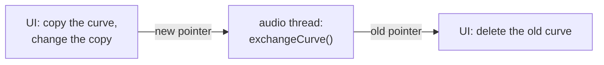

# Step 2 - Sample-accurate playback

**English** | [繁體中文](step-02-playback.zh-TW.md)

[Overview](../README.md) | Previous: [Step 1 - The automation curve](step-01-curve.md) | Next: [Step 3 - Automation and the user](step-03-modes.md)

## Goal

Let the audio thread follow a curve with one value per sample, without allocating, and stay right
when the user seeks, the transport loops, or the curve is replaced in the middle of playback.

## Design

### Why one value per sample

Chapter 15's parameters are read once per block. Do that with a ramp from 0 to 1 over one second, at
48 kHz in blocks of 512 samples, and the gain moves in steps of 0.0107, about 94 times a second: a
staircase you can hear as zipper noise. One value per sample moves in steps of 0.00002.

### The curve is immutable

The audio thread may not take a lock and may not free memory, and it reads the curve all the time.
So an edit never changes the curve the audio thread is reading. It is the same trade as a track's
clip list in chapter 14:



`exchangeCurve()` returns the old curve and frees nothing. This snapshot has no threads: the check
plays both roles. Step 5 sends the pointers through the engine's command and garbage queues.

### A block is a list of segments

A loop that wraps inside a block makes one block out of two or more pieces of timeline. The
transport already describes a block that way (chapter 14), so the lane fills one piece at a time:

```cpp
for (int s = 0; s < numSegments; ++s) {
    const TimelineSegment& segment = segments[s];
    curve->render(segment.timelineStart, out + segment.blockOffset, segment.numSamples, cursor_);
}
```

No segments means the transport is stopped. The block then holds the curve's value at the playhead,
so a fader on screen and the sound still follow a seek while nothing plays.

### The cursor is a hint, and it checks itself

Step 1's `render()` searches once per block. Most blocks simply continue where the last one ended,
so a `CurveCursor` remembers that segment. The obvious danger is that the remembered index goes
stale: after a seek, after a loop wrap, or after a new curve arrives with fewer points. One way out
is to tell the cursor about all those events, and to fix a bug each time someone forgets one.

The other way is the one chapter 15 chose for track slots: **the hint is not the truth**. The answer
we want is defined by two comparisons, so `locate()` simply makes them:

```math
x_i \le \text{position} < x_{i+1}
```

If they hold for the remembered `i`, then `i` is right, whatever happened in between, because the
points are sorted. If they do not, `locate()` searches. Nothing has to invalidate the cursor, and
there is no code path for a seek or a swap. The range check `-1 <= i <= last` belongs to the same
idea: the index may come from a longer curve.

After a block the cursor holds the segment of the block's **last** sample, not its first. That
matters on a recorded curve with several points per block: with the first sample's segment every
block would have to search.

How much does it save? On a curve of ten points, not much: a binary search takes four comparisons.
On a dense recording, with dozens of lanes, it avoids a walk through scattered memory on every
block. It is a small optimization, and it is only acceptable because it cannot be wrong.

### A jump must not click

A seek, a loop wrap, a swapped curve and a Hold step all make the value jump, and a gain that jumps
clicks. But chapter 15's 50 ms fader smoother is no answer here: it would make every curve 50 ms
late and round off every corner. So the lane limits only how far the value may move per sample:

```math
y[i] = \begin{cases}
y[i-1] + s & x[i] - y[i-1] > s \\
y[i-1] - s & y[i-1] - x[i] > s \\
x[i] & \text{otherwise}
\end{cases}
```

with $s = 1/64$ by default. A curve slower than that comes through **exactly**, and that word is
tested: the last line assigns `x[i]`. The natural `y += clamp(x - y, -s, s)` is nearly as good: for
two close floats the difference is exact, and so is the sum. Only when they differ greatly in size
does it round, in 10 of the 3084245 values of the random sessions. Assigning leaves no such case. A
jump becomes a straight ramp of at most 64 samples (1.3 ms at 48 kHz) that starts exactly on the
jump's sample.

The limit has to remember the last value between blocks, otherwise a jump at a block boundary is
not seen. The first sample the lane ever renders has no last value and is taken as it is: a lane
must not fade in from 0.

Two limits of this step, for later: a switch or a choice must not pass through values in between
(Step 5 reads those per block), and the number 64 should come from the sample rate (Step 5 too).

### No curve: the knob

Without a curve the lane fills the block with the knob's value, through the same limit. So removing
a curve during playback slides to the knob instead of clicking.

## Testing

`check.h` (22 checks). The ramp above must equal `valueAt()` at all 48000 samples. A jump at sample
1000, in a block that starts at 800, must start moving at offset 200 and arrive after 32 steps of
1/64. The same session in blocks of 1, 64, 300, 512 and of random sizes must give identical numbers:
the block size is not allowed to change the sound. Also: a loop of 100 samples in a block of 512,
a seek while playing and while stopped, the knob, a swap to a curve with fewer points, how many
searches a session takes, and 2000 blocks with **operator new** counted.

Then 200 random sessions (seeks, loops, stops, swaps, knob moves) are compared with a reference that
works one sample at a time: a position that moves by one and wraps, `valueAt()`, and one limiter.

<div align="center">

| Broken on purpose | Caught by |
|---|---|
| hint trusted without comparing positions | seeks, random sessions |
| no range check on the hint | a shorter curve (a crash, or AddressSanitizer) |
| no check that the next point is after the position | `locate()` directly, dense curve |
| always searches | search counts |
| cursor keeps the block's first segment | dense curve (1000 searches instead of 40) |
| `blockOffset` ignored | block sizes, random sessions |
| stopped: value at 0 instead of the playhead | stopped seek, random sessions |
| no curve: knob ignored | knob, removed curve, random sessions |
| last value forgotten between blocks | block sizes, seek, removed curve |
| first sample ramps from 0 | first sample, knob, random sessions |
| `y += clamp(x - y, -s, s)` instead of `y = x` | random sessions (10 of 3084245 values) |
| no limit at all | jump, loop, seek, random sessions |
| a `std::vector` in `render()` | the allocation count |

</div>

Two of these passed at first. Without the "next point" check, `render()`'s forward walk repairs the
answer, so all values stay right and only a long walk is left; without the cursor update, the hint
survives from the block's start and a sparse curve hardly notices. Neither is a wrong sound; both
are lost promises about cost. So the check got `locate()` called directly and a dense curve. A
control that passes tells you what your tests do not yet say.

### Another gift from GCC

The allocation counter first replaced `operator new` with a one-liner around `malloc`. GCC at `-O1`
warned about `-Wmismatched-new-delete`: it inlined the replacement and saw `free()` on memory from
`operator new`. MSVC said nothing. The counter now goes through helper functions, as in chapter 14,
Step 10, and is clean with GCC from `-O0` to `-O3`.

## Your turn

Build and run the starter (no JUCE needed):

```powershell
.\scripts\build.ps1 -Only 16-automation
.\build\bin\Debug\l16_step02_starter.exe
```

Write the four functions in `steps/step02-playback/starter/step02.cpp`:

1. `CurveCursor::locate()`: use the hint if it is right; otherwise search, count, remember.
2. `AutomationCurve::render()` with a cursor: Step 1's `render()`, `locate()` in place of the search,
   and the last segment back into the cursor.
3. `AutomationLane::render()`: knob, stopped, or one `render()` per segment. Then the limit.
4. `AutomationLane::limitSlew()`: the formula above, across blocks.

When it works, the output ends like this:

```text
  667 blocks through 10 points: 4 searches (expected at most 11); 20 seeks: 7 more (at most 20)
  1000 blocks through a point every 100 samples: 40 searches (expected 40)
  locate() with a hint far behind the position: 7 (expected 7)
  2000 blocks with seeks, a loop and a swap: 0 allocations (expected 0)
  200 random sessions (seeks, loops, stops, swaps, knob moves), 3084245 values: 0 differ from
  the reference (expected 0)
[PASS] l16_step02 (22 checks passed)
```

## What you learned

- One value per block is a staircase; a parameter that moves needs one value per sample.
- Immutable data plus a pointer swap keeps the audio thread free of locks and of `delete`.
- A cached index that verifies itself needs no invalidation: seeks, loops and swaps have no special
  code at all.
- Limit the speed of a value rather than smoothing it: slow movements stay exact, jumps stop clicking.
- The block size must not change the result. It is easy to test, and it finds real bugs.
