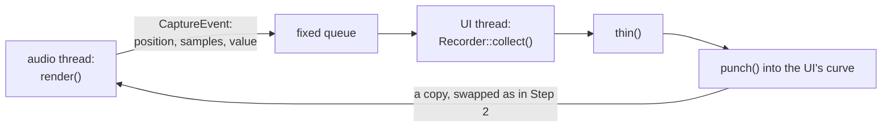
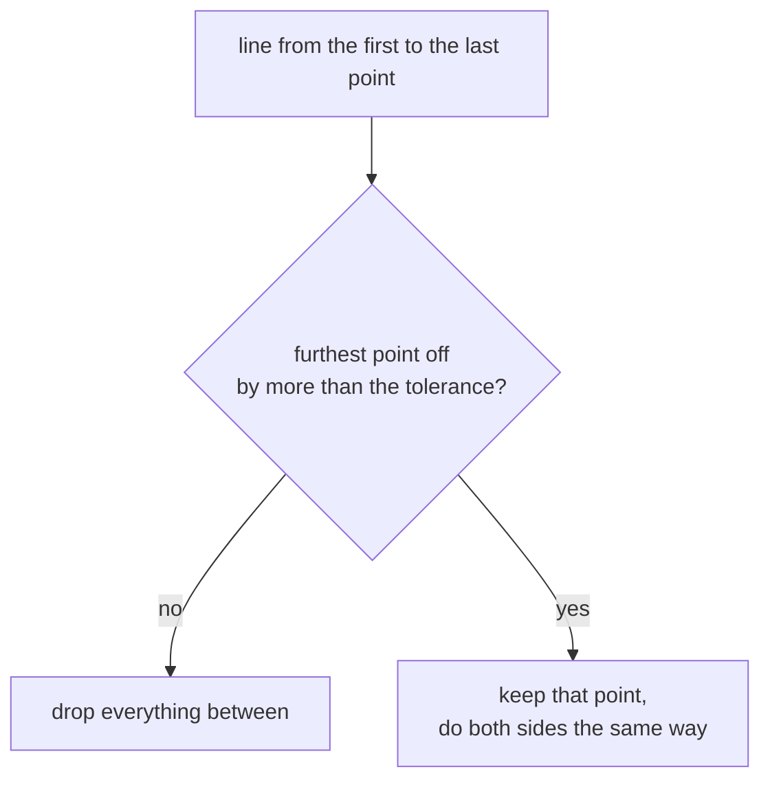
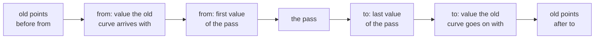

# Step 3 - Automation and the user

**English** | [繁體中文](step-03-modes.zh-TW.md)

[Overview](../README.md) | Previous: [Step 2 - Sample-accurate playback](step-02-playback.md) | Next: Step 4 - What a curve belongs to (planned)

## Goal

A curve is playing and the user grabs the fader. Decide who wins, and when the user wins, turn the
movement into points that play back next time.

## Design

### Four modes

Every DAW has these four, under slightly different names. They answer one question: when does the
hand count?

<div align="center">

| Mode | The curve plays | The user wins | Recorded |
|---|---|---|---|
| Read | always | never | nothing |
| Touch | until touched, and again after the release | while touching | while touching |
| Latch | until the first touch | from the first touch until stop | from the first touch until stop |
| Write | never | from play until stop | from play until stop |

</div>

Touch is for correcting a moment, Latch for a change that stays, Write for overwriting a whole
stretch. While the transport is stopped the hand is simply heard as long as it touches, in every
mode, and nothing is recorded: there is no timeline position to record it at.

`userWins()` is one small function that the audio thread calls once per block. Its only memory is
the latch: set by a touch while playing in Latch mode, cleared by a stop or by leaving Latch mode.

### A click shorter than a block

The UI writes `touching` into an atomic and the audio thread reads it once per block. At 4096 samples
a block lasts 85 ms, and a quick click may begin and end in between: the audio thread never sees
`touching == true`. For Touch that is fine, because the click is over before it counts. For Latch it
is not: the click should have latched. So `touch()` also increments a counter, and the audio thread
compares it with the count it saw last.

### The audio thread stamps, the UI thread edits

Only the audio thread knows which timeline position is being heard, so it stamps the user's value.
Only the UI thread may allocate, so it builds the points:



The lane sends one event per **segment**, so a loop wrap inside a block shows up as two events. The
queue has a fixed size. When the UI hangs and the queue fills up, events are lost, and only those:
the audio thread goes on unharmed. Again this snapshot has no threads; Step 5 uses the engine's
`SpscQueue`.

### Passes

A **pass** is one unbroken stretch of timeline. The recorder needs no knowledge of loops or seeks
to find them, only one comparison: does this event start where the last one ended? A loop wrap, a seek
and a lost event all break it, in the same way and through the same line of code.

What the comparison cannot see is the end of a recording: no event simply comes next. So the lane
sends an **end marker** (`numSamples == 0`) when the user wins no longer. The marker may not fit in a
full queue; then the lane owes it and tries again next block, before that block's events, because
those may already belong to the next pass.

### Thinning

One value per block is about 94 values a second, and a fader move does not need that many. A
straight line needs two points, however long it took to draw. **Ramer-Douglas-Peucker** keeps exactly
the points that matter:



The usual version measures the distance perpendicular to the line. Here a position in samples and a
value from 0 to 1 have no common unit, and what we care about is the **value's** error at a position:

```math
e_i = \left| v_i - \left( v_a + (v_b - v_a)\,\frac{x_i - x_a}{x_b - x_a} \right) \right|
```

The default tolerance of 0.002 is 0.2 % of the control's range. A worklist replaces the usual
recursion, because a long recording should not depend on the size of the stack. It runs on the UI
thread: its worst case is quadratic, while a real movement splits about evenly and costs
$n \log n$.

### Punching

The pass replaces the curve between its first and last position. Everything outside stays:



The two extra points are Step 1's jumps, one going in and one going out, so the curve around the pass
keeps its exact shape. Two details need care:

- **Going in**, if the old curve has a jump right at `from`, the value it arrives with is that
  jump's **first** point. `valueAt(from)` would give the last one.
- **Going out**, a Hold that started inside the pass still holds after it. The point at `to` takes
  the shape of the old segment it lands on.

Punching an empty curve works without a special case: both extra points carry its default value, so
the first recording of a parameter leaves the rest of the song where it was.

### What this step leaves open

Touch returns to the curve within 64 samples. Real DAWs often glide back for longer, a setting worth
adding later. The knob's value passes the limit of Step 2 without a smoother, so a very coarse fader
would still step: Step 5 decides what the engine does with it. And the screen needs to show the value
the lane is playing, which also belongs to Step 5.

## Testing

`check.h` (36 checks). All four modes through six situations, as a printed table. Clicks between two
blocks. The exact events of a touch across a loop wrap. `thin()` by hand and on 200 random
recordings, each input point compared with the result by a plain polyline function. `punch()` by hand
(a ramp, a jump, a Hold, an empty curve) and on 300 random curves: outside the pass the curve may not
change, inside it must be the pass.

Then a whole recording: a moving hand in Touch mode, the UI timer collecting every third block, then
playback in Read without a hand. Playback stays within 0.013 of what was heard: the recording has one
value per block, so that is one block of the hand's movement. Finally a loop and a seek while
recording, a queue nobody empties, and 2000 blocks with `operator new` counted.

<div align="center">

| Broken on purpose (32 in all, some of them) | Caught by |
|---|---|
| a touch between blocks not seen | Latch click |
| the latch survives a stop, or leaving Latch | mode table, Latch to Read and back |
| Touch counts a click that is already over | Touch click |
| captures while stopped | the hand stopped; a stop with the hand still on the fader |
| no end marker, or not retried, or after the block's events | events, recording, full queue |
| one event per block, not per segment | the loop's events |
| `thin()`: no tolerance, one side only, not absolute, last point lost | hand cases, random recordings, playback |
| `punch()`: `valueAt()` going in | the jump case |
| `punch()`: Hold lost going out | Hold case, random curves |
| `punch()`: old points left inside | jump case, random curves |
| `punch()`: an extra point missing | hand cases, random curves |
| `punch()`: default lost | empty curve |
| recorder: no continuity check, no last point, not thinned | loop and seek, playback, point count |
| a `std::vector` in `render()` | the allocation count |

</div>

Four of them passed at first. A click in Touch mode, a capture while stopped, the marker's order and
the lost default all looked harmless in the hand-made cases, because none of those cases looked one
block further. The worst of them was real: with `capture = user`, a stop with the hand still on the
fader did not end the recording until the hand let go. Each one got its own check.

The worklist in `thin()` has no check: a recursive version gives the same numbers, and how deep the
stack may go differs by platform.

## Your turn

Build and run the starter (no JUCE needed):

```powershell
.\scripts\build.ps1 -Only 16-automation
.\build\bin\Debug\l16_step03_starter.exe
```

Write the five functions in `steps/step03-modes/starter/step03.cpp`:

1. `AutomationLane::userWins()`: the table above, the latch, and the touch counter.
2. `AutomationLane::render()`: Step 2's, plus the user's value, the events and the end marker.
3. `thin()`: Ramer-Douglas-Peucker with a worklist, measuring the error in value.
4. `punch()`: old points, the point going in, the pass, the point going out, old points.
5. `Recorder::collect()`: group the events into passes, finish each one.

When it works, the output starts and ends like this:

```text
           untouched touched released stopped  stopped  playing
                                               +touch   again
  Read     0.25     0.25     0.25     0.25     0.75     0.25
  Touch    0.25     0.75     0.25     0.25     0.75     0.25
  Latch    0.25     0.75     0.75     0.25     0.75     0.25
  Write    0.75     0.75     0.75     0.25     0.75     0.75
  ...
  2000 blocks with touches, stops and a loop: 0 allocations (expected 0)
[PASS] l16_step03 (36 checks passed)
```

## What you learned

- The four automation modes are one question: when does the hand count?
- A state read once per block can miss an event; a counter cannot.
- Whoever knows the time stamps the data, whoever may allocate builds the result.
- One comparison ("does this continue the last event?") covers loops, seeks and lost events.
- Thinning needs an error in the units you care about, here the value at a position.
- An edit of a range needs a jump at both ends to leave everything outside it untouched.
