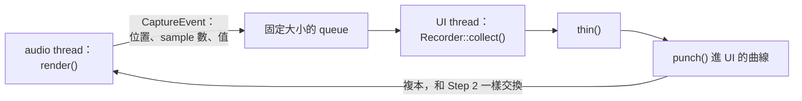
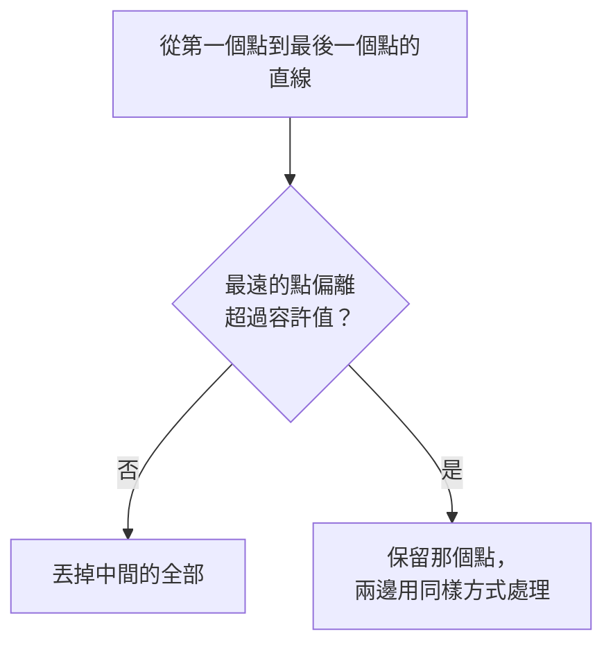
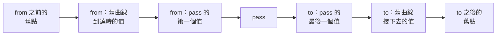

# Step 3 - Automation 與使用者

[English](step-03-modes.md) | **繁體中文**

[總覽](../README.zh-TW.md) | 上一步：[Step 2 - 精準到 sample 的播放](step-02-playback.zh-TW.md) | 下一步：Step 4 - 曲線屬於什麼（規劃中）

## 目標

曲線正在播放，使用者抓住了 fader。決定誰贏；使用者贏的時候，把這個動作變成下次會播放出來的點。

## 設計

### 四種模式

每個 DAW 都有這四種模式，只是名字略有不同。它們回答同一個問題：手什麼時候算數？

<div align="center">

| 模式 | 曲線播放 | 使用者贏 | 錄製 |
|---|---|---|---|
| Read | 永遠 | 永遠不會 | 不錄 |
| Touch | 碰到之前，以及放開之後 | 碰著的時候 | 碰著的時候 |
| Latch | 第一次碰到之前 | 從第一次碰到直到停止 | 從第一次碰到直到停止 |
| Write | 永遠不會 | 從播放直到停止 | 從播放直到停止 |

</div>

Touch 用來修正某個片刻，Latch 用來做持續的改變，Write 用來覆寫一整段。transport 停止時，在每個模式下，只要手碰著就聽得到，而且什麼都不會錄：
此時沒有時間軸位置可以記錄。

`userWins()` 是一個小函式，audio thread 每個 block 呼叫一次。它唯一記住的東西是 latch：播放中在 Latch 模式被碰到時設定，停止或離開 Latch 模式時清除。

### 比一個 block 還短的點擊

UI 把 `touching` 寫進 atomic，audio thread 每個 block 讀一次。4096 個 sample 的 block 長達 85 ms，一次快速點擊可能在兩次讀取之間就開始又結束，audio thread
永遠看不到 `touching == true`。對 Touch 這沒問題，因為點擊在生效前就結束了。對 Latch 就不行：這次點擊本來應該要 latch。所以 `touch()` 也會把一個計數器加一，
audio thread 再和上次看到的計數比較。

### audio thread 蓋時間戳，UI thread 編輯

只有 audio thread 知道正在聽到的是時間軸的哪個位置，所以由它替使用者的值蓋上時間戳。只有 UI thread 可以配置記憶體，所以由它建立點：



lane 每個 **segment** 送一個 event，所以 block 內的 loop 折返會變成兩個 event。queue 的大小是固定的。UI 卡住、queue 滿了的時候，遺失的只有 event：audio thread
不受影響，繼續執行。這個 snapshot 一樣沒有 thread；Step 5 會用 engine 的 `SpscQueue`。

### Pass

**pass** 是一段沒有中斷的時間軸。recorder 不需要知道 loop 或 seek 就能找出它們，只要一個比較：這個 event 是否從上一個結束的地方開始？loop 折返、seek 和遺失的
event 都會讓它不成立，方式相同，走的也是同一行程式碼。

這個比較看不到的是錄製的結束：後面單純就沒有 event 了。所以使用者不再贏的時候，lane 會送一個 **end marker**（`numSamples == 0`）。queue 滿了放不下時，lane
會記著這筆欠帳，下一個 block 再試一次，而且排在該 block 的 event 之前，因為那些 event 可能已經屬於下一個 pass。

### Thinning（精簡）

每個 block 一個值，大約是每秒 94 個值，而 fader 的動作用不到這麼多。一條直線不管畫了多久，都只需要兩個點。**Ramer-Douglas-Peucker** 剛好留下真正重要的點：



常見的版本量的是到直線的垂直距離。但這裡以 sample 為單位的位置和 0 到 1 的值沒有共同的單位，而我們在意的是某個位置上**值**的誤差：

```math
e_i = \left| v_i - \left( v_a + (v_b - v_a)\,\frac{x_i - x_a}{x_b - x_a} \right) \right|
```

預設容許值 0.002 是控制項範圍的 0.2%。這裡用工作清單取代常見的遞迴，因為很長的錄製不該依賴 stack 的大小。它在 UI thread 上執行：最壞情況是平方時間，而真實的動作
大致會平均切分，成本約 $n \log n$。

### Punching（打入）

pass 取代曲線在它第一個和最後一個位置之間的部分。外面的全部保留：



多出來的兩個點就是 Step 1 的跳躍，一個進入、一個離開，所以 pass 周圍的曲線形狀完全不變。有兩個細節要小心：

- **進入時**，如果舊曲線剛好在 `from` 有跳躍，它到達時的值是那個跳躍的**第一個**點。`valueAt(from)` 給的會是最後一個。
- **離開時**，在 pass 裡開始的 Hold，在 pass 之後仍然持續。`to` 上的點要採用它落在的那段舊曲線的 shape。

打入空曲線不需要特殊處理：多出來的兩個點都帶著它的預設值，所以參數的第一次錄製不會影響歌曲的其他部分。

### 這一步留下的問題

Touch 在 64 個 sample 內回到曲線。真正的 DAW 常常會滑回去久一點，這是之後值得加的設定。knob 的值經過 Step 2 的限制但沒有 smoother，所以很粗糙的 fader 還是會有階梯感：
engine 要怎麼處理由 Step 5 決定。畫面也需要顯示 lane 正在播放的值，這同樣屬於 Step 5。

## 測試

`check.h`（36 項檢查）。四個模式走過六種情況，印成一張表。兩個 block 之間的點擊。一次碰觸跨過 loop 折返時的確切 event。`thin()` 的手工案例和 200 段隨機錄製，每個輸入點都用
一個直白的 polyline 函式和結果比較。`punch()` 的手工案例（ramp、跳躍、Hold、空曲線）和 300 條隨機曲線：pass 外面的曲線不能改變，裡面必須是 pass。

接著是一次完整的錄製：Touch 模式下一隻移動的手，UI timer 每三個 block 收集一次，然後在 Read 模式、沒有手的情況下播放。播放結果和當時聽到的最多差 0.013：錄製是每個 block
一個值，所以這就是手在一個 block 內的移動量。最後是錄製中的 loop 和 seek、沒人清空的 queue，以及用計數的 `operator new` 跑 2000 個 block。

<div align="center">

| 故意弄壞的地方（共 32 個，這裡列出一部分） | 被誰抓到 |
|---|---|
| 看不到兩個 block 之間的碰觸 | Latch 點擊 |
| latch 在停止或離開 Latch 後還在 | 模式表、Latch 到 Read 再回來 |
| Touch 把已經結束的點擊算進去 | Touch 點擊 |
| 停止時還在 capture | 停止時的手；停止時手還在 fader 上 |
| 沒有 end marker、沒有重試，或排在 block 的 event 之後 | event、錄製、滿的 queue |
| 每個 block 一個 event，而不是每個 segment | loop 的 event |
| `thin()`：沒有容許值、只做一邊、沒取絕對值、遺失最後一點 | 手工案例、隨機錄製、播放 |
| `punch()`：進入時用 `valueAt()` | 跳躍案例 |
| `punch()`：離開時遺失 Hold | Hold 案例、隨機曲線 |
| `punch()`：裡面的舊點留著 | 跳躍案例、隨機曲線 |
| `punch()`：少了多出來的點 | 手工案例、隨機曲線 |
| `punch()`：遺失預設值 | 空曲線 |
| recorder：沒有連續性檢查、沒有最後一點、沒有精簡 | loop 和 seek、播放、點的數量 |
| `render()` 裡有 `std::vector` | 配置次數 |

</div>

其中四項一開始是通過的。Touch 模式的點擊、停止時的 capture、marker 的順序和遺失的預設值，在手工案例裡看起來都無害，因為那些案例都沒有再往後看一個 block。其中最嚴重的是真實的問題：
寫成 `capture = user` 時，手還放在 fader 上就按停止，錄製要等到手放開才會結束。每一項都補上了自己的檢查。

`thin()` 的工作清單沒有檢查：遞迴版本會得到相同的數字，而 stack 能有多深又因平台而異。

## 動手做

建置並執行 starter（不需要 JUCE）：

```powershell
.\scripts\build.ps1 -Only 16-automation
.\build\bin\Debug\l16_step03_starter.exe
```

在 `steps/step03-modes/starter/step03.cpp` 寫出五個函式：

1. `AutomationLane::userWins()`：上面的表格、latch，以及碰觸計數器。
2. `AutomationLane::render()`：Step 2 的版本，加上使用者的值、event 和 end marker。
3. `thin()`：用工作清單做 Ramer-Douglas-Peucker，以值來量誤差。
4. `punch()`：舊點、進入的點、pass、離開的點、舊點。
5. `Recorder::collect()`：把 event 分組成 pass，並完成每一個 pass。

完成後，輸出的開頭和結尾會是：

```text
           untouched touched released stopped  stopped  playing
                                               +touch   again
  Read     0.25     0.25     0.25     0.25     0.75     0.25
  Touch    0.25     0.75     0.25     0.25     0.75     0.25
  Latch    0.25     0.75     0.75     0.25     0.75     0.25
  Write    0.75     0.75     0.75     0.25     0.75     0.75
  ...
  2000 blocks with touches, stops and a loop: 0 allocations (expected 0)
[PASS] l16_step03 (36 checks passed)
```

## 你學到了

- 四種 automation 模式其實是同一個問題：手什麼時候算數？
- 每個 block 讀一次的狀態可能錯過事件；計數器不會。
- 知道時間的一方蓋時間戳，可以配置記憶體的一方建立結果。
- 一個比較（「這是否接著上一個 event？」）就涵蓋了 loop、seek 和遺失的 event。
- 精簡需要以你在意的單位來量誤差，這裡是某個位置上的值。
- 編輯一段範圍時，兩端都要有跳躍，外面的部分才能完全不受影響。
