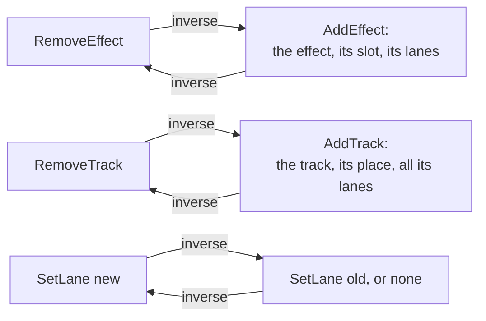

# Step 4 - What a curve belongs to

**English** | [繁體中文](step-04-targets.zh-TW.md)

[Overview](../README.md) | Previous: [Step 3 - Automation and the user](step-03-modes.md) | Next: [Step 5 - The engine with automation](step-05-engine.md)

## Goal

A curve moves something: this track's fader, that compressor's threshold. Name that something so that
the curve survives moved effects, deleted tracks, undo and the project file.

## Design

### A target is three names

```cpp
struct AutomationTarget {
    StripRef strip;        // a track by id, a bus by index, or the master
    EffectId effect;       // none: the strip's own controls
    std::string parameter; // by name
};
```

Each part answers "what could change under it?":

- **The strip** uses the `TrackId` of chapter 15. A track's display position and engine slot change;
  its id does not.
- **The effect** gets its own id, handed out once and never reused. The obvious choice, the slot, is
  wrong: move the compressor below the delay, and a curve addressed to "slot 0" now moves the delay's
  parameters.
- **The parameter** goes by name, as chapter 15's project file already saves it, because a later
  version of an effect may add parameters or reorder them.

### Three things can happen

<div align="center">

| What happens | What the lane does | Why |
|---|---|---|
| its effect moves | nothing | an id does not care about slots |
| its effect or track is removed | goes with it, in the same edit | no lane can point at something that is gone |
| its parameter is unknown | stays, silent, and is saved again | a file from another version must not lose a recording |

</div>

The second row is a choice with an alternative: keep the lane as an orphan until someone cleans up.
But then every reader of a lane has to ask whether its owner still exists, for ever. Removing it in
the same edit makes that a **rule of the model**, and the inverse brings it back, so the user loses
nothing. The random sessions in `check.h` test the rule after every single edit.

The third row looks like the same situation and is not. There the owner is present and only *this
version* of the program does not understand the name. Deleting would be destroying data the program
does not understand, so the lane stays: `resolve()` reports `NoParameter`, and nothing plays it.

Replacing an effect is a remove and an add, one undo step. The new effect has a new id, so the old
curve cannot land on it by accident, even when both are compressors.

### Undo

Chapter 15's rule holds: what the project file saves is undoable, through one function that returns
each edit's inverse. New edits:



`SetLane` holds a whole curve, so a recording, a dragged point and a changed mode are the same edit.
That costs memory: an inverse keeps a copy of the curve, and the history (100 entries) can hold that
many copies. It is simple and right, and an edit of a range is the obvious next step if a project
ever shows it matters.

Because the lanes come back under the same ids, older entries keep working: record, delete the track,
undo the delete, undo the recording. `Project::lanes` is kept in one fixed order, so that a project
after an undo compares **equal** to the one before, whichever way its lanes arrived.

Undo of an add still does not take back its id: `nextEffectId` only goes up, as `nextTrackId` does.

### The file

Format 4 adds two kinds of line:

```text
lane 1 track:2 7 "Threshold" touch 0.5    number, channel, effect id (0: the strip), parameter, mode, default
point 1 48000 0.25 linear                 lane number, position, value, shape
```

The rules are those of chapter 15, Step 4. Everything from a file is outside data, checked once, with
the line of the first problem. A value out of 0..1 is an error, even though `add()` would clamp it:
a file with 1.5 in it is damaged, and silently changing it would hide that. References are checked
after the last line, so the order of the lines does not matter, with one exception: points of a lane
at the same position keep the order of their lines, because that order *is* the jump.

A lane's number means something only inside the file; it is simply how a `point` line says which lane.
Format 3 files still open, with no lanes.

Opening at another sample rate converts every position with `std::llround`. Rounding never reverses
two positions, so the points stay sorted without sorting, and a jump stays a jump. Two points close
together may land on one sample at a lower rate and become a jump: at that distance nobody can hear
the difference.

### What this step leaves open

The application's files use ids local to the file, and an opened project gets new ones (chapter 15,
Step 8). Step 6 has to map lanes along with them. Parameters of VST3 plugins are not targets yet:
their names come from the plugin at run time, and `effectParameters()` here knows only the built-in
effects. And nothing here plays: Step 5 turns a target into the fader or atomic it moves.

## Testing

`check.h` (43 checks). `resolve()` on eleven targets, printed as a table. A moved effect, a removed
effect and a replaced one, each undone and redone. A deleted track with lanes on its fader and on its
effects, with undo entries older than the delete. All-or-nothing changes, a merged drag. The file:
round trip with hard floats, a jump and a quote in a name; lines in any order; an unknown parameter
saved again; 20 broken files, each with the right line and reason; format 3; another sample rate.

Then 60 random sessions: after every change no lane may have lost its owner, and the file must read
back as the same project. At the end all of it is undone and redone, and each step must equal the
project recorded on the way.

<div align="center">

| Broken on purpose (43 in all, some of them) | Caught by |
|---|---|
| effect looked up on any strip, or ignored | the target table (the first by a crash) |
| `SetLane` on a missing strip or effect | `SetLane` cases |
| `SetLane` refuses an unknown parameter | the file round trip |
| lanes appended, not in order | undo compares equal; lanes in any order |
| `RemoveEffect` or `RemoveTrack` leave lanes behind | hand cases, no lane without an owner |
| `RemoveTrack` forgets the lanes of its effects | hand case, no lane without an owner |
| comes back in another place | undo cases, random sessions |
| an id in use accepted, also through a track | id cases |
| a counter that does not rise, or falls back | replace case, file round trip |
| mode, default or shape not saved | round trip, random sessions |
| clamps a value instead of refusing it | broken files |
| unknown parameter refused on opening | round trip, unknown parameter |
| error reported on the wrong line | broken files |
| points in reverse | round trip (the jump) |
| positions rounded down | sample rate |

</div>

Four of them passed at first: two kinds of id clash nobody had tried, an error line that was right
only because the bad lane happened to be the last line, and lanes put in file order. The file's own
round trip could not see that last one, because writing puts them in order first. It takes a file
*not* written by this program, which is exactly what a project file may be.

## Your turn

Build and run the starter (no JUCE needed):

```powershell
.\scripts\build.ps1 -Only 16-automation
.\build\bin\Debug\l16_step04_starter.exe
```

Write the six functions in `steps/step04-targets/starter/step04.cpp`:

1. `resolve()`: what a target means right now.
2. `applyEdit()`: the six edits, each with its inverse.
3. `writeLanes()`: the `lane` and `point` lines.
4. `parseLaneLine()`: check one line by itself.
5. `attachLanes()`: check what the lines refer to, then put the lanes in.
6. `convertSampleRate()`: every position, nothing else.

When it works, the output ends like this:

```text
  a lane for "Knee", unknown to this compressor: ok, NoParameter; saved again: kept (expected ok, NoParameter, kept)
  20 broken files: 0 not refused with the right line and reason (expected 0); format 3 opens: ok, 0 lanes
  44.1 kHz file opened at 48 kHz: 1 s is now at 48000, the jump is still a jump: yes (expected 48000, yes)
  60 random sessions, 1470 changes: 0 lanes without an owner, 0 files that read back differently,
  0 wrong undos, 0 wrong redos (expected 0, 0, 0, 0)
[PASS] l16_step04 (43 checks passed)
```

## What you learned

- Name a thing by what stays the same: an id, not a slot; a name, not an index.
- Removing an owner removes what depends on it, in one edit, so the model never holds a dangling reference.
- "Gone" and "not understood by this version" are different: the first may be removed, the second must be kept.
- Keep data in one fixed order, and "the same project" becomes a plain comparison.
- A file written by your own program cannot test what your program does with other files.
