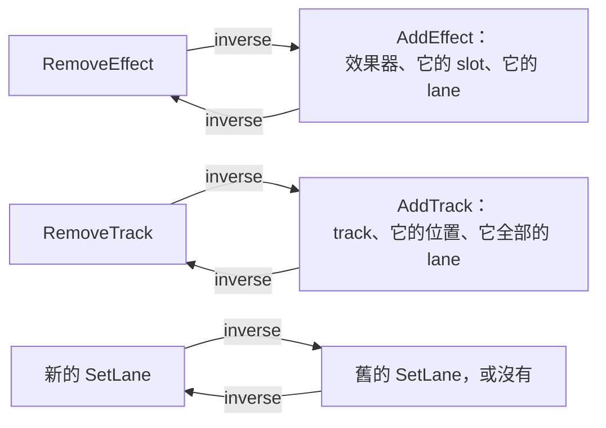

# Step 4 - 曲線屬於什麼

[English](step-04-targets.md) | **繁體中文**

[總覽](../README.zh-TW.md) | 上一步：[Step 3 - Automation 與使用者](step-03-modes.zh-TW.md) | 下一步：Step 5 - 有 automation 的 engine（規劃中）

## 目標

一條曲線會推動某個東西：這個 track 的 fader、那個 compressor 的 threshold。替這個東西命名，讓曲線在效果器被移動、track 被刪除、undo 和專案檔之後都還活著。

## 設計

### 對象是三個名字

```cpp
struct AutomationTarget {
    StripRef strip;        // 用 id 指定的 track、用 index 指定的 bus，或 master
    EffectId effect;       // 沒有：strip 自己的控制項
    std::string parameter; // 用名字
};
```

每一部分都在回答「它底下什麼東西可能改變？」：

- **strip** 用第 15 章的 `TrackId`。track 的顯示位置和 engine slot 會變，它的 id 不會。
- **effect** 有自己的 id，只發一次，永不重複使用。看起來理所當然的選擇 slot 是錯的：把 compressor 移到 delay 下面，指定給「slot 0」的曲線就變成在推 delay 的參數。
- **parameter** 用名字，第 15 章的專案檔本來就是這樣存的，因為效果器之後的版本可能新增參數或調整順序。

### 可能發生的三件事

<div align="center">

| 發生什麼事 | lane 怎麼做 | 為什麼 |
|---|---|---|
| 它的效果器被移動 | 什麼都不用做 | id 不在乎 slot |
| 它的效果器或 track 被移除 | 在同一個 edit 裡跟著移除 | 這樣 lane 不可能指向已經不存在的東西 |
| 它的參數無法辨識 | 留下、不發聲，並再次存檔 | 來自其他版本的檔案不應該遺失錄製內容 |

</div>

第二列是一個有替代方案的選擇：把 lane 留成孤兒，等有人來清理。但那樣一來，每個讀取 lane 的地方都得永遠先問它的擁有者還在不在。在同一個 edit 裡移除，讓這件事變成 **model 的規則**，而 inverse 會把它帶回來，所以使用者什麼都不會失去。`check.h` 的隨機操作在每一個 edit 之後都會測試這條規則。

第三列看起來是同一種情況，其實不是。那裡的擁有者還在，只是*這個版本*的程式不懂這個名字。刪除就等於毀掉程式看不懂的資料，所以 lane 留著：`resolve()` 回報 `NoParameter`，也沒有任何東西會播放它。

取代效果器就是一次移除加一次新增，算一個 undo 步驟。新效果器有新的 id，所以舊曲線不會意外落在它身上，就算兩個都是 compressor 也一樣。

### Undo

第 15 章的規則不變：專案檔存的東西都可以 undo，透過一個會回傳每個 edit 之 inverse 的函式。新的 edit：



`SetLane` 帶著一整條曲線，所以一次錄製、一個被拖動的點和一次模式變更都是同一種 edit。這要付出記憶體：一個 inverse 保留一份曲線的複本，而 history（100 筆）可能存著這麼多份複本。它簡單又正確；如果哪天專案證明這很重要，只編輯一段範圍的 edit 就是明顯的下一步。

因為 lane 回來時 id 相同，比較舊的 undo 項目仍然有效：錄製、刪除 track、undo 刪除、undo 錄製。`Project::lanes` 維持固定的順序，所以 undo 之後的專案和之前的專案比較起來**相等**，不管它的 lane 是怎麼回來的。

undo 一次新增仍然不會收回它的 id：`nextEffectId` 只增不減，和 `nextTrackId` 一樣。

### 檔案

格式 4 增加兩種行：

```text
lane 1 track:2 7 "Threshold" touch 0.5    編號、channel、effect id（0：strip）、參數、模式、預設值
point 1 48000 0.25 linear                 lane 編號、位置、值、shape
```

規則和第 15 章 Step 4 相同。來自檔案的一切都是外部資料，只檢查一次，並回報第一個問題所在的行。超出 0..1 的值是錯誤，就算 `add()` 會把它限制住也一樣：檔案裡有 1.5 代表它損毀了，默默改掉只會掩蓋這件事。參照在讀完最後一行之後才檢查，所以行的順序不重要，只有一個例外：同一個 lane 在同一個位置的點，要保持它們行的順序，因為那個順序*就是*跳躍。

lane 的編號只在檔案內有意義；它只是 `point` 行用來說明屬於哪個 lane 的方式。格式 3 的檔案仍然打得開，只是沒有 lane。

以其他 sample rate 開啟時，每個位置都用 `std::llround` 轉換。捨入不會讓兩個位置反過來，所以點不用重新排序也還是排序好的，跳躍也還是跳躍。在較低的 sample rate 下，距離很近的兩個點可能落在同一個 sample 而變成跳躍：在這種距離下沒有人聽得出差別。

### 這一步留下的問題

應用程式的檔案用的是只在檔案內有效的 id，開啟的專案會拿到新的 id（第 15 章 Step 8）。Step 6 必須讓 lane 跟著對應。VST3 外掛的參數還不能當對象：它們的名字是執行時由外掛提供的，而這裡的 `effectParameters()` 只認識內建效果器。還有，這裡什麼都不會播放：Step 5 才會把對象轉成它推動的 fader 或 atomic。

## 測試

`check.h`（43 項檢查）。`resolve()` 處理 11 個對象，印成一張表。效果器被移動、移除和取代，每一種都做 undo 和 redo。一個 fader 和效果器上都有 lane 的 track 被刪除，還有比刪除更早的 undo 項目。全有或全無的 change，以及合併的拖動。檔案：帶有難處理的 float、跳躍和名字裡有引號的來回存取；任意順序的行；無法辨識的參數再次存檔；20 個損毀的檔案，每個都要有正確的行號和原因；格式 3；其他 sample rate。

接著是 60 段隨機操作：每個 change 之後，都不能有 lane 失去擁有者，而且檔案必須讀回同一個專案。最後把全部 undo 再 redo，每一步都必須等於途中記錄下來的專案。

<div align="center">

| 故意弄壞的地方（共 43 個，這裡列出一部分） | 被誰抓到 |
|---|---|
| 在任何 strip 上找效果器，或者忽略它 | 對象表（前者是 crash） |
| 在不存在的 strip 或效果器上 `SetLane` | `SetLane` 案例 |
| `SetLane` 拒絕無法辨識的參數 | 檔案來回存取 |
| lane 直接附加，沒有排序 | undo 後比較相等；任意順序的 lane |
| `RemoveEffect` 或 `RemoveTrack` 留下 lane | 手工案例、沒有無擁有者的 lane |
| `RemoveTrack` 忘了它效果器上的 lane | 手工案例、沒有無擁有者的 lane |
| 回來時位置不同 | undo 案例、隨機操作 |
| 接受已經使用的 id，包括透過 track 帶進來的 | id 案例 |
| 計數器沒有增加，或往回掉 | 取代案例、檔案來回存取 |
| 沒有存模式、預設值或 shape | 來回存取、隨機操作 |
| 把值限制住，而不是拒絕 | 損毀的檔案 |
| 開啟時拒絕無法辨識的參數 | 來回存取、無法辨識的參數 |
| 錯誤回報在錯的行 | 損毀的檔案 |
| 點的順序反過來 | 來回存取（跳躍） |
| 位置無條件捨去 | sample rate |

</div>

其中四項一開始是通過的：兩種沒人試過的 id 衝突、一個只因為壞掉的 lane 剛好在最後一行才正確的錯誤行號，以及照檔案順序放的 lane。檔案自己的來回存取看不到最後那一項，因為寫入時已經先排好順序了。要抓到它，需要一個*不是*這個程式寫出來的檔案，而專案檔本來就可能是這樣。

## 動手做

建置並執行 starter（不需要 JUCE）：

```powershell
.\scripts\build.ps1 -Only 16-automation
.\build\bin\Debug\l16_step04_starter.exe
```

在 `steps/step04-targets/starter/step04.cpp` 寫出六個函式：

1. `resolve()`：這個對象現在代表什麼。
2. `applyEdit()`：六種 edit，各有它的 inverse。
3. `writeLanes()`：`lane` 和 `point` 行。
4. `parseLaneLine()`：單獨檢查一行。
5. `attachLanes()`：檢查行所參照的東西，然後把 lane 放進去。
6. `convertSampleRate()`：每個位置，其他都不動。

完成後，輸出的最後會是：

```text
  a lane for "Knee", unknown to this compressor: ok, NoParameter; saved again: kept (expected ok, NoParameter, kept)
  20 broken files: 0 not refused with the right line and reason (expected 0); format 3 opens: ok, 0 lanes
  44.1 kHz file opened at 48 kHz: 1 s is now at 48000, the jump is still a jump: yes (expected 48000, yes)
  60 random sessions, 1470 changes: 0 lanes without an owner, 0 files that read back differently,
  0 wrong undos, 0 wrong redos (expected 0, 0, 0, 0)
[PASS] l16_step04 (43 checks passed)
```

## 你學到了

- 用不會變的東西來命名：用 id 而不是 slot，用名字而不是 index。
- 移除擁有者時，在同一個 edit 裡移除依賴它的東西，model 就不會有懸空的參照。
- 「不見了」和「這個版本看不懂」是不同的：前者可以移除，後者必須保留。
- 讓資料維持固定順序，「同一個專案」就變成一個單純的比較。
- 自己的程式寫出來的檔案，測不出程式面對其他檔案時的行為。
