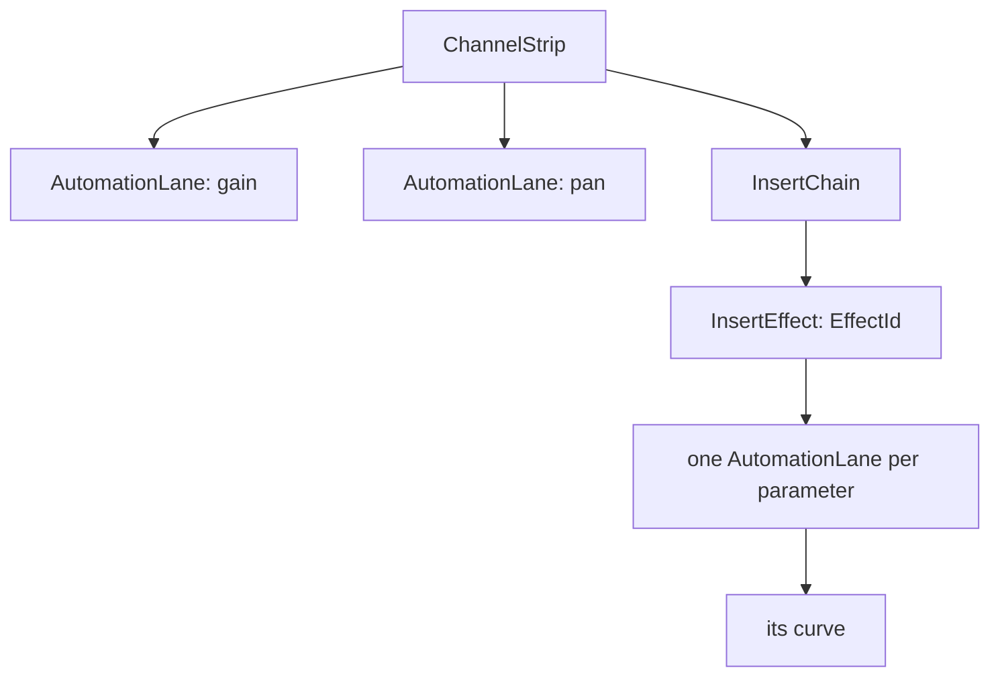
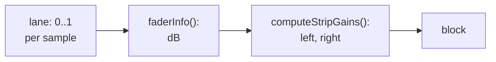

# Step 5 - The engine with automation

**English** | [繁體中文](step-05-engine.zh-TW.md)

[Overview](../README.md) | Previous: [Step 4 - What a curve belongs to](step-04-targets.md) | Next: Step 6 - The app with automation (planned)

## Goal

Bring Steps 1-4 into the real engine: real faders, real effects, real queues, a real audio thread.
Then prove three things: nothing changes without a curve, a curve is sample-accurate on the real
signal path, and the new part is real-time safe and free of data races.

There is no starter in this step, as in chapter 15, Step 6: it is the same code as the snapshots, and
what you learn is what changes when it meets the rest of the engine.

## Design

### Copy, then change

The first commit of this step is an unchanged copy of chapter 15's engine and its tests, so the next
commit shows exactly what automation changes. Chapter 15's ten tests were not edited and still pass:
that is the proof that an engine without curves does what it did.

### The lane lives in what it automates

Step 4 says a lane must leave with its owner. The engine gets that for free by putting it there:



Removing an effect already hands it to the UI thread for deletion; its lanes and curves die with it,
on the right thread, with no new code. Moving it moves them. A strip's two lanes stay in the slot, so
removing a track also sends their curves to the garbage queue. That raises the most garbage one
command can produce from `kMaxInserts + 1` to `kMaxInserts + 3`, and the engine reserves that room
before it takes a command.

`EffectId` is new here. `Engine::addInsert()` hands one out, or keeps the one undo brought back and
stays above it.

### Reaching a lane

```cpp
engine.setLaneCurve({trackRef, effectId, parameter}, curve); // a copy; the audio thread swaps a pointer
```

It works like `setTrackClips()`: a `ReplaceCurve` command, the old curve back through the garbage
queue. The audio thread finds the lane by id, by **its own** view of the chain. That matters because
the command may directly follow `addInsert()`: the UI cannot see that effect in the chain yet, but the
queue is in order, so the audio thread can. If the effect has gone by then, no lane is found and the
new curve goes straight back as garbage.

### One gain per sample, on the real signal path

Step 2's lane produced numbers. Now they meet the fader:



While a lane is active, this replaces the fader's 50 ms smoother, which would make every curve late.
A value that did not change since the last sample costs no `pow()` and no `sin()`, so a held curve is
cheap. At the end of the block the smoothers are told where the lane stopped, so when the curve goes
away the fader ramps to the knob from there. And when no lane is active, the strip calls the very
function chapter 15 called.

The fader's range is linear in dB: 0..1 means -100..+12 dB. So the speed limit of Step 2 is a limit in
dB per sample, which is what an ear cares about.

### The speed limits

Step 2 left the number 64 open. There are now two limits, computed from the sample rate:

<div align="center">

| Source | Full range in | Why |
|---|---|---|
| a curve | 2 ms | only takes the click out of a jump; slower curves stay exact |
| the hand | 50 ms | the UI sends values a few dozen times a second; like a fader without automation |

</div>

### Effects: one value per block

An effect has only `setParameter()`. To give it a value per sample, the engine would have to cut the
block at every change, and most effects would not benefit: they smooth what they get. So a parameter
takes **one value per block**, the one at the block's start, and it is in force in that same block.
For the effect this is a knob that moved, so its lane has no speed limit, and a choice never passes
through a value in between.

The price: an effect's automation does depend on the block size. Only the strip's faders and pans
have the guarantee "the block size changes nothing".

### Latency: the fader must wait for its audio

This one no snapshot could show. A fader comes after the inserts and the PDC delay. With a limiter
that looks ahead by 100 samples, the audio at the fader is 100 samples older than the transport's
position. A curve read at the transport's position moves the fader 100 samples **before** the audio
it belongs to:

```math
x_{\text{lane}} = x_{\text{transport}} - L
```

`L` is the delay of the path up to that fader:

<div align="center">

| Strip | L |
|---|---|
| track | its inserts + its PDC delay |
| bus | the tracks' aligned latency + its inserts + its PDC delay |
| master | the whole mix's latency |

</div>

The hand's events get the same shift, so what is recorded lands where it was heard. An effect's lanes
are not shifted: an effect early in the chain has seen no latency. Later in the chain it is off by the
effects before it, a value per block is too coarse to notice, and the limit is written down here.

### One capture queue

Step 3's lane had its own queue. With hundreds of lanes that is megabytes of mostly empty memory, so
there is one `SpscQueue<CaptureEvent>`, and each event says which lane it is from. The recorder keeps
one open pass per lane.

### A new track in a used slot

Chapter 15 resets a slot's values for its next track. The lanes need the same: the curves left with
the old track, and `addTrack()` puts the mode back on Read. A command still queued for the old id finds
nothing, through the old rule: the slot is a hint, the id is the truth.

### What this step leaves open

- Sends are not targets yet. VST3 parameters get lanes but no names to reach them by (Step 4).
- At a loop wrap, the last `L` samples before it are still on their way while the lane has wrapped.
- A track deleted during a recording leaves its pass open in the recorder: it never finishes and is
  never punched, which is right, but its points stay until the recorder goes.
- A device change does not convert curves to the new sample rate: like clips, that is the
  application's job (Step 6).
- The cost of a moving curve (a `pow()` and a pan law per sample, per active lane) is not measured
  yet. `CpuMeter` will show it in the application.

## Testing

`tests/test_automation.cpp` (95 checks) uses a DC clip, so every gain shows up as a sample value.

- A fader ramp and a pan ramp equal the reference at every sample; a jump starts on its sample and
  takes the right number of samples, also at 96 kHz.
- Blocks of 1, 64, 300, 512 and random sizes, across a loop and a jump, give identical samples.
- A curve arriving during playback stays within the limit of 1.17 dB per sample; leaving, it ramps to
  the knob. Two bounces are identical, and each starts on the curve.
- Latency: on the track that has it, on a track with its PDC delay, on the master and on a bus, a
  latency-compensated bounce has the jump on exactly sample 10000.
- Effects: a moved effect, a removed one, a replaced one, an id that undo brings back, a curve queued
  behind a removal, the knob when the curve leaves. Effects on buses and on the master.
- The four modes through the real engine, a recording played back (within 0.77 dB of what was heard),
  a first recording with no curve at all, a removed track and the next one in its slot.
- Full queues: a dropped command does not leak its curve, and removing a track with everything on it
  hands back exactly `kMaxGarbagePerCommand` objects.
- 1000 blocks with curves arriving, touches, stops and seeks: no allocation and no free on the audio
  thread.
- A real audio thread next to a UI thread doing all of that, also adding and removing effects and
  tracks with curves on them, under ThreadSanitizer.

<div align="center">

| Broken on purpose (44 in all, some of them) | Caught by |
|---|---|
| no latency shift on a track, a bus or the master | the jump on sample 10000 |
| events stamped without the shift | the stamp at 900 |
| the hand at the curve's speed, or the reverse | the hand's first block; the jump |
| the limit ignores the sample rate | 96 kHz |
| a lane forgets its value while idle | a curve arriving |
| no end marker when a lane goes idle | back to Read while recording |
| smoothers not told where the lane stopped | a curve leaving |
| the fader's or pan's knob not written | Write without a curve |
| reset keeps the last value | two bounces |
| curves stay on a removed track | the next track in the slot |
| an effect's value one block late | the effect's value in each block |
| an effect limited like a fader | the effect after a seek |
| the first curve from an old knob | a knob turned before the curve |
| a dropped command's curve, or one with no lane | AddressSanitizer: a leak |
| the old garbage maximum | AddressSanitizer: a leak |
| looks up an effect by slot, not id | the moved effect |

</div>

Ten of the 44 passed at first, and each got a check. The most instructive: an effect value "one block
late" passed because the test effect read its parameter directly, unlike a real one, which takes it
in `applyPendingParameters()`. A test double that is easier than the real thing tests less than you
think.

The checks also changed the design once. An effect's lane first had the fader's speed limit, and
after a seek its value moved only one step per block's first sample, so it arrived a block late. To an
effect that takes one value per block, a limit per sample means nothing, so it went.

## Try it

```powershell
.\scripts\build.ps1 -Only 16-automation
.\build\bin\Debug\l16_test_automation.exe
```

Under ThreadSanitizer (GCC or Clang; on Windows in WSL):

```bash
./scripts/build.sh --only 16-automation --sanitize thread --build-dir build-tsan
```

The output ends like this:

```text
  1000 blocks with curves arriving, touches, stops, seeks, a loop: 0 allocations or frees (expected 0)
  3000 UI rounds next to a real audio thread: 755 blocks, 188 passes recorded, 0 commands dropped, 0 leaked
[PASS] l16_test_automation (95 checks passed)
```

(The number of blocks and passes depends on your machine and build.)

Remove the line `lanes.shift = track.getInsertLatencySamples() + ...` in `Mixer.h`, and watch the jump
move 100 samples ahead of its audio.

## What you learned

- Put data where its lifetime already is: lanes inside effects need no code to leave with them.
- A smoother and sample accuracy exclude each other; a limit on speed gives both exactness and no clicks.
- "Sample-accurate" must say at which point of the signal path: behind latency, the position is older.
- An interface that takes one value per block sets what is possible: say so, and do not pretend.
- A test double easier than the real thing hides real bugs.
