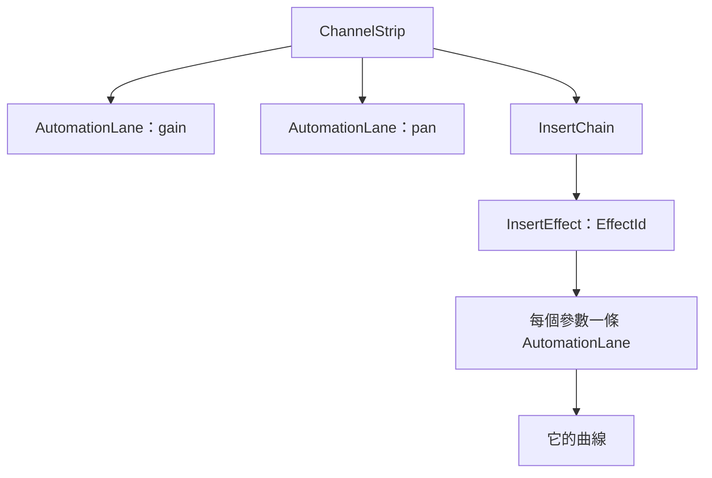
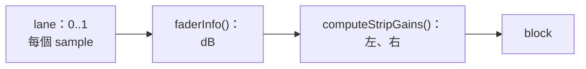

# Step 5 - 有 automation 的 engine

[English](step-05-engine.md) | **繁體中文**

[總覽](../README.zh-TW.md) | 上一步：[Step 4 - 曲線屬於什麼](step-04-targets.zh-TW.md) | 下一步：[Step 6 - 有 automation 的 app](step-06-app.zh-TW.md)

## 目標

把 Step 1-4 帶進真正的 engine：真正的 fader、真正的效果器、真正的 queue、真正的 audio thread。然後證明三件事：沒有曲線時什麼都不變、曲線在真正的訊號路徑上精準到 sample，以及新增的部分符合 real-time 要求且沒有 data race。

和第 15 章 Step 6 一樣，這一步沒有 starter：程式碼和 snapshot 是一樣的，你要學的是它碰到 engine 其他部分時會發生什麼改變。

## 設計

### 先複製，再修改

這一步的第一個 commit 是第 15 章 engine 和測試的原樣複本，所以下一個 commit 剛好顯示 automation 改了什麼。第 15 章的十個測試沒有被修改，而且仍然通過：這就是沒有曲線的 engine 行為不變的證明。

### lane 住在它推動的東西裡

Step 4 說 lane 必須隨擁有者離開。engine 只要把它放在那裡，就自然做到了：



移除效果器時本來就會把它交給 UI thread 刪除；它的 lane 和曲線跟著一起消失，在正確的 thread 上，不需要新的程式碼。移動它，它們也跟著移動。strip 的兩條 lane 留在 slot 裡，所以移除 track 時也會把它們的曲線送進 garbage queue。這讓一個 command 最多產生的 garbage 從 `kMaxInserts + 1` 變成 `kMaxInserts + 3`，而 engine 在取用 command 前會先保留這麼多空間。

`EffectId` 是這裡新增的。`Engine::addInsert()` 會發一個，或者保留 undo 帶回來的那一個，並讓計數器維持在它之上。

### 找到一條 lane

```cpp
engine.setLaneCurve({trackRef, effectId, parameter}, curve); // 一份複本；audio thread 交換一個 pointer
```

它的運作方式和 `setTrackClips()` 一樣：一個 `ReplaceCurve` command，舊曲線經由 garbage queue 回來。audio thread 用 id、以**它自己**看到的 chain 找到 lane。這很重要，因為這個 command 可能緊接在 `addInsert()` 之後：UI 還看不到 chain 裡的那個效果器，但 queue 是有順序的，所以 audio thread 看得到。如果到那時效果器已經不在了，就找不到 lane，新的曲線會直接以 garbage 的形式回來。

### 每個 sample 一個 gain，在真正的訊號路徑上

Step 2 的 lane 只是產生數字。現在它們碰到了 fader：



lane 啟用時，這會取代 fader 50 ms 的 smoother，否則每條曲線都會遲到。和上一個 sample 相同的值不需要 `pow()` 和 `sin()`，所以保持不動的曲線很便宜。block 結束時會告訴 smoother lane 停在哪裡，所以曲線消失時，fader 會從那裡 ramp 到 knob。沒有任何 lane 啟用時，strip 呼叫的就是第 15 章呼叫的那個函式。

fader 的範圍在 dB 上是線性的：0..1 代表 -100..+12 dB。所以 Step 2 的速度限制在這裡是每個 sample 的 dB 限制，而這正是耳朵在意的。

### 速度限制

Step 2 留下了 64 這個數字沒有決定。現在有兩個限制，都由 sample rate 算出來：

<div align="center">

| 來源 | 走完整個範圍需要 | 為什麼 |
|---|---|---|
| 曲線 | 2 ms | 只是去掉跳躍的 click；比較慢的曲線維持精確 |
| 手 | 50 ms | UI 每秒只送幾十次值；和沒有 automation 的 fader 一樣 |

</div>

### 效果器：每個 block 一個值

效果器只有 `setParameter()`。要給它每個 sample 一個值，engine 必須在每次改變時切開 block，而多數效果器不會因此受益：它們會把收到的值平滑化。所以參數**每個 block 取一個值**，也就是 block 開始時的值，並且在同一個 block 就生效。對效果器來說，這就是一個被轉動的 knob，所以它的 lane 沒有速度限制，選項也不會經過中間值。

代價是：效果器的 automation 確實取決於 block 大小。只有 strip 的 fader 和 pan 才有「block 大小不改變任何事」的保證。

### Latency：fader 必須等它的音訊

這是 snapshot 無法呈現的。fader 位於 insert 和 PDC delay 之後。有一個 lookahead 100 個 sample 的 limiter 時，到達 fader 的音訊比 transport 的位置舊 100 個 sample。在 transport 的位置讀曲線，fader 就會比它所屬的音訊**提早** 100 個 sample 移動：

```math
x_{\text{lane}} = x_{\text{transport}} - L
```

`L` 是到那個 fader 為止的路徑延遲：

<div align="center">

| Strip | L |
|---|---|
| track | 它的 insert + 它的 PDC delay |
| bus | track 對齊後的 latency + 它的 insert + 它的 PDC delay |
| master | 整個混音的 latency |

</div>

手的 event 也套用同樣的位移，所以錄下來的內容會落在當時聽到的地方。效果器的 lane 不位移：chain 前段的效果器還沒有經過任何 latency。在 chain 後段它會差上前面效果器的延遲；每個 block 一個值本來就粗到聽不出來，這個限制也寫在這裡。

### 一個 capture queue

Step 3 的 lane 有自己的 queue。有幾百條 lane 時，那就是好幾 MB 幾乎空著的記憶體，所以這裡只有一個 `SpscQueue<CaptureEvent>`，每個 event 說明它來自哪條 lane。recorder 替每條 lane 保留一個開啟中的 pass。

### 用過的 slot 裡的新 track

第 15 章會替下一個 track 重設 slot 的值。lane 也需要同樣處理：曲線已隨舊 track 離開，`addTrack()` 再把模式設回 Read。仍在 queue 裡、給舊 id 的 command 什麼也找不到，用的還是那條老規則：slot 是 hint，id 才是事實。

### 這一步留下的問題

- send 還不能當對象。VST3 參數有 lane，但沒有能找到它們的名字（Step 4）。
- 在 loop 折返時，折返前最後 `L` 個 sample 還在路上，lane 卻已經折返了。
- 錄製中被刪除的 track 會在 recorder 裡留下一個開啟的 pass：它永遠不會完成，也不會被打入，這是對的，但它的點會留到 recorder 消失為止。
- 換音訊裝置不會把曲線轉換到新的 sample rate：和 clip 一樣，這是應用程式的工作（Step 6）。
- 移動中曲線的成本（每條啟用的 lane 每個 sample 一次 `pow()` 和 pan law）還沒有量測過。`CpuMeter` 會在應用程式裡顯示它。

## 測試

`tests/test_automation.cpp`（99 項檢查）使用 DC clip，所以每個 gain 都會直接呈現成 sample 的值。

- fader ramp 和 pan ramp 在每個 sample 都等於參考值；跳躍從它的 sample 開始，並走正確的 sample 數，在 96 kHz 也一樣。
- 1、64、300、512 和隨機大小的 block，跨過 loop 和跳躍，給出完全相同的 sample。
- 播放中到來的曲線維持在每個 sample 1.17 dB 的限制內；離開時會 ramp 到 knob。兩次 bounce 完全相同，而且都從曲線上開始。
- Latency：在有 latency 的 track、有 PDC delay 的 track、master 和 bus 上，補償過 latency 的 bounce 都讓跳躍剛好落在 sample 10000。
- 效果器：被移動、被移除、被取代的效果器，undo 帶回來的 id，排在移除之後的曲線，曲線離開時的 knob。bus 和 master 上的效果器。
- 經過真正 engine 的四種模式、播放一段錄製（和當時聽到的最多差 0.77 dB）、完全沒有曲線時的第一次錄製、被移除的 track 和 slot 裡的下一個 track。
- 滿的 queue：被丟棄的 command 不會洩漏它的曲線，移除一個全滿的 track 剛好交回 `kMaxGarbagePerCommand` 個物件。
- 1000 個 block，有曲線到來、碰觸、停止和 seek：audio thread 上沒有任何配置和釋放。
- 真正的 audio thread 旁邊有一個 UI thread 做上述所有事，還加上新增和移除帶著曲線的效果器與 track，在 ThreadSanitizer 下執行。

<div align="center">

| 故意弄壞的地方（共 44 個，這裡列出一部分） | 被誰抓到 |
|---|---|
| track、bus 或 master 沒有 latency 位移 | 落在 sample 10000 的跳躍 |
| event 蓋時間戳時沒有位移 | 蓋在 900 的時間戳 |
| 手用曲線的速度，或者反過來 | 手的第一個 block；跳躍 |
| 限制忽略 sample rate | 96 kHz |
| lane 閒置時忘記它的值 | 到來的曲線 |
| lane 閒置時沒有 end marker | 錄製中回到 Read |
| 沒告訴 smoother lane 停在哪裡 | 離開的曲線 |
| 沒有寫入 fader 或 pan 的 knob | 沒有曲線時的 Write |
| reset 保留上一個值 | 兩次 bounce |
| 曲線留在被移除的 track 上 | slot 裡的下一個 track |
| 效果器的值晚一個 block | 每個 block 裡效果器的值 |
| 效果器像 fader 一樣受限制 | seek 之後的效果器 |
| 第一條曲線用舊的 knob | 曲線之前轉動的 knob |
| 被丟棄 command 的曲線，或找不到 lane 的曲線 | AddressSanitizer：洩漏 |
| 舊的 garbage 上限 | AddressSanitizer：洩漏 |
| 用 slot 而不是 id 找效果器 | 被移動的效果器 |

</div>

44 個裡有 10 個一開始是通過的，每一個都補了檢查。最有啟發性的是效果器的值「晚一個 block」：它會通過，是因為測試用的效果器直接讀參數，不像真正的效果器在 `applyPendingParameters()` 裡才取值。比真實物件簡單的 test double，測到的東西比你以為的少。

檢查也改變過一次設計。效果器的 lane 一開始和 fader 有相同的速度限制，結果 seek 之後，block 第一個 sample 的值只移動一步，到達時晚了一個 block。對每個 block 只取一個值的效果器來說，每個 sample 的限制沒有意義，所以拿掉了。

## 試試看

```powershell
.\scripts\build.ps1 -Only 16-automation
.\build\bin\Debug\l16_test_automation.exe
```

在 ThreadSanitizer 下（GCC 或 Clang；Windows 上用 WSL）：

```bash
./scripts/build.sh --only 16-automation --sanitize thread --build-dir build-tsan
```

輸出的最後會是：

```text
  1000 blocks with curves arriving, touches, stops, seeks, a loop: 0 allocations or frees (expected 0)
  3000 UI rounds next to a real audio thread: 755 blocks, 188 passes recorded, 0 commands dropped, 0 leaked
[PASS] l16_test_automation (99 checks passed)
```

（block 和 pass 的數量取決於你的機器和建置方式。）

把 `Mixer.h` 裡 `lanes.shift = track.getInsertLatencySamples() + ...` 這一行拿掉，看看跳躍如何跑到它的音訊前面 100 個 sample。

## 你學到了

- 把資料放在它的生命週期本來就在的地方：效果器裡的 lane 不需要任何程式碼就會隨它離開。
- smoother 和 sample 精準互相排斥；限制速度則同時給你精確和沒有 click。
- 「精準到 sample」必須說清楚是在訊號路徑的哪一點：在 latency 之後，位置比較舊。
- 一個每個 block 只取一個值的介面，決定了什麼做得到：把它說清楚，不要假裝。
- 比真實物件簡單的 test double 會藏住真正的 bug。
