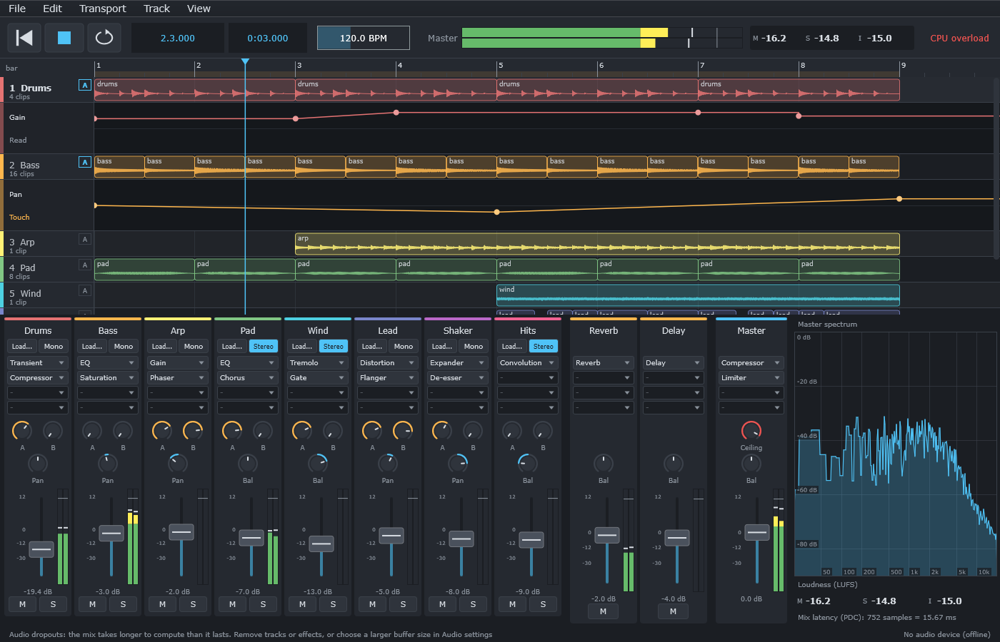
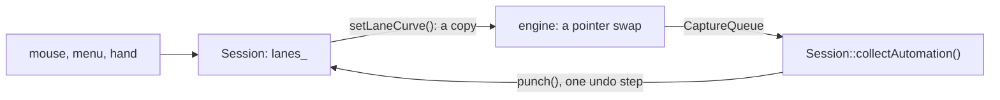

# Step 6 - The app with automation

**English** | [繁體中文](step-06-app.zh-TW.md)

[Overview](../README.md) | Previous: [Step 5 - The engine with automation](step-05-engine.md)

<p align="center"></p>

## Goal

Bring the chapter to the user: **DawLab 16** is chapter 15's application with automation lanes under
the tracks, points to draw and drag, Read / Touch / Latch / Write, recording with the real fader, and
all of it in the project file and in undo.

## Design

### Copy, then change

As in Step 5, the first commit is an unchanged copy of chapter 15's application, so the next commit
shows what automation changes. Chapter 15's smoke test stays in it and still passes.

### Session keeps the GUI copy

The curves follow the pattern the clips already have. The model keeps the copy that may change, and
the engine gets immutable copies:



A lane is named by a `LaneAddress`: strip, `EffectId`, parameter name. That is Step 4's target, and
Step 4's reasoning holds with real effects. A moved effect needs no code. A lane leaves with its owner
and comes back in the owner's inverse, under the same id.

### Undo needs the knob, not the value

A curve moves `setParameter()`, so `getParameter()` now answers where the **curve** is. Chapter 15 saved
and restored exactly that value. Here that would be a quiet bug: delete an automated effect, undo, and
its knob sits wherever the curve happened to be. So `Session::knobValue()` asks the lane first, and both
snapshots and files use it.

### The hand

Step 3 said a hand on a control is either an edit or a recording, never both:

```cpp
// MixerView: moving the fader
if (session_.handMoves({target, {}, "Gain"}, value))
    return;                 // an active lane: this movement is a recording
session_.perform(edit::SetValue{...}); // otherwise the usual undoable edit, as in chapter 15
```

The sliders' `onDragStart` and `onDragEnd` become `touch()` and `release()`. The 30 Hz tick calls
`collectAutomation()`, and each finished pass is one undo step, named "Record Gain". The strip shows
`getShownGainDb()`, so a fader moves on screen as its curve plays, while `getGainDb()` stays the knob.

A first recording on a lane with no curve has nothing to return to, so it does not punch: the pass
**is** the curve, holding its first value before and its last value after.

A fader behind latency hears the song's start before position 0 (Step 5's shift), so its events can be
stamped below 0. A file may not hold that, so `collectAutomation()` moves them to 0.

### A bounce plays what is written

A lane left in Write mode must not overwrite itself when you export, and the file must not depend on
where a knob stood. So `renderOffline()` sets the lanes read-only for its duration: every curve plays,
no hand is heard, nothing is recorded. This is an engine change, found only when the app asked what
an export should do.

### The file: format 4

```text
lane 1 track:1 0 "Threshold" touch 0.5    number, channel, GUI slot (-: the strip's own), parameter, mode, default
point 1 48000 0.25 linear                 lane number, position, value, shape
```

One difference from Step 4's snapshot: the real file has no effect ids. Chapter 15 writes inserts by
slot and track ids local to the file, and an opened project gets new ids anyway. So a slot **is** the
file's own name for an effect, as `track:1` is for a track, and an `EffectId` would add a second name.
The ids exist while the program runs, the slots while the file rests.

The rest is Step 4: references checked after the last line, a value out of range refused, a jump kept
by line order. Lanes are saved in a fixed order, so saving an opened project gives the same text. A
parameter this version does not know stays, shown as "(unknown)", and is saved again. Format 3 files
still open.

### Rows of two heights

Until now a row's top was `lane * laneHeight`. With a lane under some tracks it is a sum:

```math
y_i = i \cdot h + 72 \cdot \left|\{\, j < i : \text{track } j \text{ shows a lane} \,\}\right|
```

`rowTop()` is the only place that knows this; `laneAt()`, the scroll range and `scrollToTrack()` go
through it. The shown lanes belong to the view: like zoom, they are not saved and not undoable.

### The mouse

<div align="center">

| Where | Action | Result |
|---|---|---|
| `A` in a track's header, or the key A | click | show or hide its lane |
| lane header, upper half | click | choose the parameter |
| lane header, lower half | click | choose the mode |
| lane, on nothing | click and drag | add a point and move it; snapped to the beat, Alt for free |
| lane, on a point | drag | move it, also past its neighbours; one drag is one undo step |
| lane, on a point | right click | remove it |

</div>

### What this step leaves open

- A track shows one lane at a time. Several per track is a matter of the view, not of the model.
- Sends and VST3 parameters are not offered as targets.
- Points cannot be selected together, copied, or moved with their clips.
- Touch returns to the curve within 2 ms: no adjustable glide.
- While a pass records, it is not drawn. It appears when it finishes.
- A curve's hand ramp (50 ms) has not been tried with real faders by ear, and the two header menus have
  not been clicked by a test: they call functions the checks do use. The checks read numbers, and nobody
  has listened to this yet.
- The cost of moving curves is not measured. The window's CPU display will show it on a real project.

## Testing

The smoke test now has 265 checks, all of chapter 15's and a new section. `tests/test_project_format.cpp`
adds the lanes: a round trip, lines in any order, 17 broken files with the right line.

The new section drives the real objects without an audio device:

- A lane plays in a bounce, and undo and redo take it away and bring it back.
- Point edits: one undo step each, a drag past a neighbour as one step.
- A hand in Touch mode: one pass, one undo step, the right value. A first recording, behind latency.
- An effect removed, restored with the same id, its knob and a curve that still plays. A replaced
  effect that inherits nothing. A whole track with lanes on its fader and its effect.
- Save and open with new track ids. Then a file edited by hand, with a parameter from the future.
- A sample rate change. New project. A bounce in Write mode.
- The view with real `MouseEvent`s: rows, add, drag, right click, the toggle, a deleted track.

<div align="center">

| Broken on purpose (25 in the app, 2 more for the bounce in the engine) | Caught by |
|---|---|
| a removed track or effect keeps its lanes | the lane is gone |
| a replaced effect keeps the old lanes | the new effect inherits nothing |
| undo gives a new id, or loses the lanes | the effect brought back; the track brought back |
| undo or a file takes the curve's value as the knob | the knob at -6 dB and at -9 dB |
| a recording stamped below 0 | a first recording behind latency |
| a first recording punched into nothing | the value after the pass |
| the hand is an edit of its own | the hand in Touch mode |
| positions stay at a new sample rate | the conversion |
| the engine does not get the mode or the curve | the bounce, the hand |
| opening forgets a lane, or a silent lane | save and open; the future parameter |
| lanes in no fixed order | saving an opened project |
| rows ignore the lanes | the layout |
| every step of a drag its own undo | the mouse |
| right click does nothing, or adds a point | the mouse |
| a track target compared by slot | the recording cannot find its lane |

</div>

Two of the 25 passed at first, both about the knob. The test printed the knob after undo but did not
check it, and the file test saved before any block had run, so the curve had not moved the parameter
yet. A test must first put the system in the state where the bug can show.

## Try it

```powershell
.\scripts\build.ps1 -Only 16-automation -Juce
& ".\build\bin\Debug\DawLab 16.exe"
```

Load the demo song (File menu) and select a track:

1. Press **A**: its Gain lane opens. Click into it a few times, and drag a point.
2. Play: the fader on the mixer follows the curve.
3. Click the word **Read** in the lane's header and choose **Touch**. Play, and grab the fader. When you
   let go, the fader returns, and after the release the new shape is in the curve.
4. Ctrl+Z takes the whole movement back.
5. Add an effect to the track, and choose one of its parameters in the lane's header. Delete the effect,
   and press Ctrl+Z: the curve is back.
6. Save, close, open. It is all there.

Without a window:

```powershell
& ".\build\bin\Debug\DawLab 16.exe" --smoke-test
& ".\build\bin\Debug\DawLab 16.exe" --snapshot dawlab_output\dawlab16.png
```

## What you learned

- A new layer often follows an old pattern: curves behave like clips, so Session needed no new idea.
- When something else starts to move a value, "the value" splits in two: what it is now, and what the
  user left it at. Decide which one you save.
- Each input has one meaning at a time: a movement is a recording or an edit, never both.
- An id for the running program and a name for the file at rest may be different things.
- Asking what the user expects at an export found an engine rule no test had asked for.
