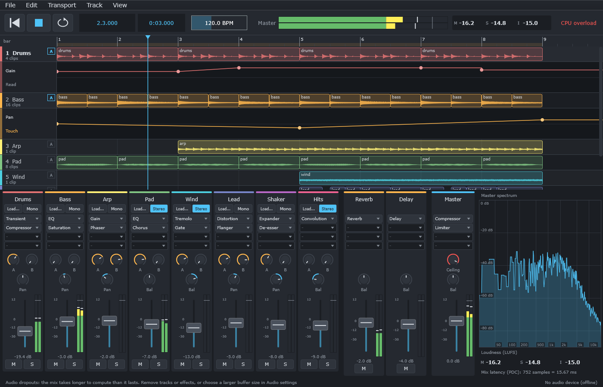
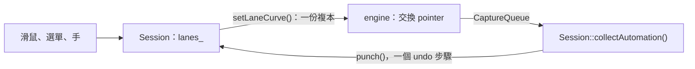

# Step 6 - 有 automation 的 app

[English](step-06-app.md) | **繁體中文**

[總覽](../README.zh-TW.md) | 上一步：[Step 5 - 有 automation 的 engine](step-05-engine.zh-TW.md)

<p align="center"></p>

## 目標

把這一章交到使用者手上：**DawLab 16** 是第 15 章的應用程式，加上 track 下方的 automation lane、可以畫和拖動的點、Read / Touch / Latch / Write、用真正的 fader 錄製，而且這一切都在專案檔和 undo 裡。

## 設計

### 先複製，再修改

和 Step 5 一樣，第一個 commit 是第 15 章應用程式的原樣複本，所以下一個 commit 剛好顯示 automation 改了什麼。第 15 章的 smoke test 留在裡面，而且仍然通過。

### Session 保存 GUI 複本

曲線沿用 clip 已有的模式。model 保存可以修改的那一份，engine 拿到 immutable 的複本：



lane 用 `LaneAddress` 命名：strip、`EffectId`、參數名稱。這就是 Step 4 的對象，而 Step 4 的理由放到真正的效果器上也成立。被移動的效果器不需要任何程式碼。lane 隨擁有者離開，在擁有者的 inverse 裡以相同的 id 回來。

### Undo 需要的是 knob，不是當下的值

曲線會推動 `setParameter()`，所以 `getParameter()` 現在回答的是**曲線**在哪裡。第 15 章存檔和還原的正是這個值。在這裡那會是一個安靜的 bug：刪除一個有 automation 的效果器再 undo，它的 knob 會停在曲線剛好經過的地方。所以 `Session::knobValue()` 會先問 lane，snapshot 和檔案都用它。

### 手

Step 3 說過，放在控制項上的手要嘛是編輯，要嘛是錄製，絕不會兩者都是：

```cpp
// MixerView：移動 fader
if (session_.handMoves({target, {}, "Gain"}, value))
    return;                 // lane 啟用中：這個動作是錄製
session_.perform(edit::SetValue{...}); // 否則就是平常可以 undo 的編輯，和第 15 章一樣
```

slider 的 `onDragStart` 和 `onDragEnd` 變成 `touch()` 和 `release()`。30 Hz 的 tick 會呼叫 `collectAutomation()`，每個完成的 pass 是一個 undo 步驟，名稱是「Record Gain」。strip 顯示 `getShownGainDb()`，所以曲線播放時畫面上的 fader 會動，而 `getGainDb()` 仍然是 knob。

在沒有曲線的 lane 上第一次錄製時，沒有可以回去的地方，所以不做打入：這個 pass **就是**曲線，之前維持它的第一個值，之後維持它的最後一個值。

位於 latency 之後的 fader，會在位置 0 之前就聽到歌曲的開頭（Step 5 的位移），所以它的 event 可能蓋上小於 0 的時間戳。檔案不能存這種值，所以 `collectAutomation()` 會把它們移到 0。

### Bounce 播放寫下來的內容

留在 Write 模式的 lane，匯出時不應該覆寫自己，檔案也不應該取決於 knob 剛好停在哪裡。所以 `renderOffline()` 在執行期間把 lane 設為唯讀：每條曲線都播放，聽不到手，也不會錄製。這是 engine 的修改，要到 app 問「匯出時應該怎樣」才發現。

### 檔案：格式 4

```text
lane 1 track:1 0 "Threshold" touch 0.5    編號、channel、GUI slot（-：strip 自己的）、參數、模式、預設值
point 1 48000 0.25 linear                 lane 編號、位置、值、shape
```

和 Step 4 的 snapshot 有一個差別：真正的檔案裡沒有 effect id。第 15 章用 slot 和只在檔案內有效的 track id 寫 insert，而開啟的專案本來就會拿到新的 id。所以 slot **就是**檔案自己對效果器的稱呼，就像 `track:1` 是對 track 的稱呼一樣，`EffectId` 只會多出第二個名字。id 存在於程式執行時，slot 存在於檔案靜置時。

其餘都和 Step 4 相同：參照在讀完最後一行後才檢查，超出範圍的值會被拒絕，跳躍靠行的順序保存。lane 以固定順序存檔，所以開啟後再存檔會得到相同的文字。這個版本不認識的參數會留下，顯示為「(unknown)」，並再次存檔。格式 3 的檔案仍然打得開。

### 兩種高度的列

到目前為止，列的頂端是 `lane * laneHeight`。有些 track 下方有 lane 時，它就變成一個總和：

```math
y_i = i \cdot h + 72 \cdot \left|\{\, j < i : \text{track } j \text{ 顯示 lane} \,\}\right|
```

`rowTop()` 是唯一知道這件事的地方；`laneAt()`、捲動範圍和 `scrollToTrack()` 都透過它。顯示中的 lane 屬於 view：和縮放一樣，不存檔，也不能 undo。

### 滑鼠

<div align="center">

| 位置 | 動作 | 結果 |
|---|---|---|
| track header 的 `A`，或按鍵 A | 點擊 | 顯示或隱藏它的 lane |
| lane header 上半部 | 點擊 | 選擇參數 |
| lane header 下半部 | 點擊 | 選擇模式 |
| lane 的空白處 | 點擊並拖動 | 新增一個點並移動它；對齊拍子，按 Alt 自由移動 |
| lane 的點上 | 拖動 | 移動它，也可以越過相鄰的點；一次拖動是一個 undo 步驟 |
| lane 的點上 | 按右鍵 | 移除它 |

</div>

### 這一步留下的問題

- 一個 track 一次顯示一條 lane。每個 track 顯示多條是 view 的事，不是 model 的事。
- send 和 VST3 參數沒有列為可選的對象。
- 點無法一起選取、複製，或隨 clip 移動。
- Touch 在 2 ms 內回到曲線：沒有可調整的滑回時間。
- 正在錄製的 pass 不會畫出來，要等它完成才出現。
- 手的 ramp（50 ms）還沒有用真正的 fader 親耳試過，兩個 header 選單也沒有被測試點過：它們呼叫的函式有被檢查。檢查讀的是數字，還沒有人聽過。
- 移動中曲線的成本沒有量測過。視窗上的 CPU 顯示會在真實專案裡呈現它。

## 測試

smoke test 現在有 265 項檢查，包含第 15 章全部的檢查和一個新的段落。`tests/test_project_format.cpp` 增加了 lane：來回存取、任意順序的行、17 個行號正確的損毀檔案。

新的段落不用音訊裝置，直接驅動真正的物件：

- lane 在 bounce 裡播放，undo 和 redo 會把它拿走再帶回來。
- 點的編輯：各一個 undo 步驟，越過相鄰點的拖動算一個步驟。
- Touch 模式下的手：一個 pass、一個 undo 步驟、正確的值。在 latency 之後的第一次錄製。
- 被移除的效果器以相同的 id、它的 knob 和仍在播放的曲線回來。被取代的效果器什麼都不繼承。一整個 fader 和效果器上都有 lane 的 track。
- 以新的 track id 存檔再開啟。接著是手動編輯過、含有來自未來之參數的檔案。
- sample rate 改變。新專案。Write 模式下的 bounce。
- 用真正的 `MouseEvent` 操作 view：列、新增、拖動、右鍵、切換、被刪除的 track。

<div align="center">

| 故意弄壞的地方（app 裡 25 個，engine 的 bounce 另有 2 個） | 被誰抓到 |
|---|---|
| 被移除的 track 或效果器留下 lane | lane 不見了 |
| 被取代的效果器留下舊 lane | 新效果器什麼都不繼承 |
| undo 給了新 id，或遺失 lane | 帶回來的效果器；帶回來的 track |
| undo 或檔案把曲線的值當成 knob | -6 dB 和 -9 dB 的 knob |
| 錄製的時間戳小於 0 | 在 latency 之後的第一次錄製 |
| 第一次錄製打入空的曲線 | pass 之後的值 |
| 手變成獨立的編輯 | Touch 模式下的手 |
| sample rate 改變時位置不變 | 轉換 |
| engine 沒有收到模式或曲線 | bounce、手 |
| 開啟時遺失 lane 或不發聲的 lane | 存檔再開啟；未來的參數 |
| lane 沒有固定順序 | 開啟後再存檔 |
| 列忽略 lane | 版面配置 |
| 拖動的每一步都是獨立的 undo | 滑鼠 |
| 右鍵沒有反應，或新增了一個點 | 滑鼠 |
| 用 slot 比較 track 對象 | 錄製找不到它的 lane |

</div>

25 個裡有 2 個一開始是通過的，都和 knob 有關。測試在 undo 後印出 knob 卻沒有檢查它，而檔案測試在任何 block 執行之前就存檔，所以曲線還沒有推動參數。測試必須先讓系統進入 bug 能夠顯現的狀態。

## 試試看

```powershell
.\scripts\build.ps1 -Only 16-automation -Juce
& ".\build\bin\Debug\DawLab 16.exe"
```

載入 demo song（File 選單）並選一個 track：

1. 按 **A**：它的 Gain lane 會打開。在裡面點幾下，再拖動一個點。
2. 播放：混音器上的 fader 會跟著曲線動。
3. 點 lane header 裡的 **Read**，選 **Touch**。播放，抓住 fader。放開後 fader 會回去，放開之後新的形狀就在曲線裡了。
4. Ctrl+Z 會把整段動作拿回來。
5. 在 track 上加一個效果器，在 lane header 裡選它的一個參數。刪除效果器再按 Ctrl+Z：曲線回來了。
6. 存檔、關閉、開啟。全部都還在。

不開視窗：

```powershell
& ".\build\bin\Debug\DawLab 16.exe" --smoke-test
& ".\build\bin\Debug\DawLab 16.exe" --snapshot dawlab_output\dawlab16.png
```

## 你學到了

- 新的一層常常沿用舊的模式：曲線的行為和 clip 一樣，所以 Session 不需要新的想法。
- 當有別的東西開始移動一個值時，「那個值」就分成兩個：它現在是多少，以及使用者把它留在多少。要決定存哪一個。
- 每個輸入一次只有一種意義：一個動作要嘛是錄製，要嘛是編輯，絕不會兩者都是。
- 給執行中程式用的 id，和給靜置檔案用的名字，可以是不同的東西。
- 問使用者匯出時期待什麼，找到了一條沒有測試問過的 engine 規則。
