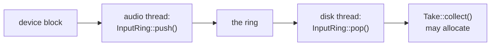
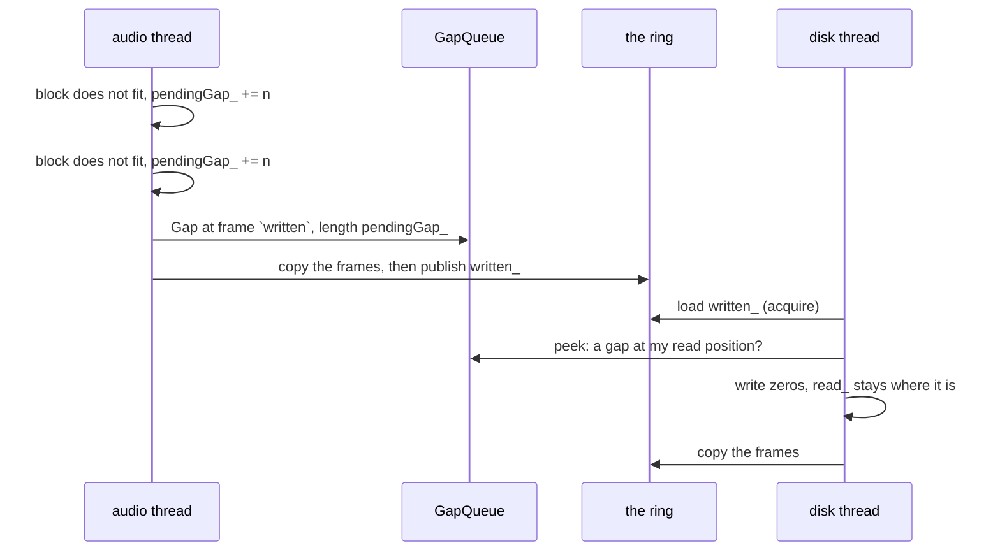

# Step 1 - From the audio thread to the disk thread

**English** | [繁體中文](step-01-input-ring.zh-TW.md)

[Overview](../README.md)

## Goal

Get every block of the audio input off the audio thread, without that thread ever waiting or
allocating, and keep the recording in time even when the disk cannot keep up.

## Design

### Two threads that must not meet

The audio thread has a few milliseconds per block and may not wait for anything. A recording has to
grow in memory and on disk, and a disk can stall for hundreds of milliseconds. So the two jobs run on
two threads, with a ring buffer between them:



The disk thread polls. The audio thread does not wake it, because waking a thread is a system call
and may block. The ring has to be big enough for one polling interval plus the worst stall you want
to survive, which is what `framesForStall()` calculates. Half a second at 48 kHz is 24000 frames.

### Why not chapter 14's `SpscQueue`?

`SpscQueue` moves one item at a time, and a block has hundreds of frames in several channels. A ring
for audio copies the whole block in one or two pieces, and shows it to the reader in one step.

### Two counters that only grow

`written_` and `read_` count frames since the start, and they never wrap in practice (a `uint64_t`
holds millions of years of audio). This makes the arithmetic simple:

```text
fill level  = written - read
free room   = capacity - (written - read)
index       = counter & mask          (the capacity is a power of two, mask = capacity - 1)
```

`SpscQueue` has to leave one slot empty to tell "full" from "empty". Here, `written == read` is empty
and `written - read == capacity` is full.

Each counter has one writer, and the order of the operations is the whole protocol:

<div align="center">

| Thread | Does | Then | Which means |
|---|---|---|---|
| audio | copies the frames in | `written_.store(..., release)` | the reader only sees finished frames |
| disk | copies the frames out | `read_.store(..., release)` | the writer only reuses slots that are finished |

</div>

Each side loads the other's counter with `acquire`. Turn one of those `release` stores into `relaxed`
and ThreadSanitizer reports a data race on the samples.

### When the ring is full

The audio thread has one thing left to do: drop the block and count it. It cannot wait for room, and a
block goes in whole or not at all.

Dropping is not the real problem, though. Look at what the take would be without any further care:

```text
device:   A A A B B B C C C D D D
dropped:        B B B
take:     A A A C C C D D D             everything after the hole is 3 frames early, until the end
```

A take that has moved against the rest of the song is worse than a click, and nobody may notice until
the mix is done. So the frames that were dropped are replaced by silence of the same length:

```text
take:     A A A 0 0 0 C C C D D D       one click, and C and D are where they belong
```

### Gaps

The audio thread cannot write the silence into the ring, because the ring is full. So it keeps a
number, `pendingGap_`, and when a block fits again it announces the gap first, in a small queue of its
own:



Three details make this correct:

- **The queue can be full too.** Sixteen gaps waiting means the disk is far behind. The block is then
  dropped although it would fit, and the gap grows. The time is still right.
- **The order in `pop()` matters.** `push()` announces a gap *before* it publishes the frames behind
  it. So `pop()` must load `written_` *before* it looks at the gaps. Whoever has seen the frames is
  then certain to see the gap. The other way round, it could look for a gap, find none, and then see
  the frames behind a gap that was announced in between: it would read them too early, and the time
  would be wrong for the rest of the take.
- **A gap at the very end is never written.** Nothing comes after it, so nothing can move. The take is
  just a little shorter.

The silence counts as frames for the reader, but `read_` does not move, because they were never in the
ring.

No test catches the wrong order in `pop()` reliably, since the threads must switch at exactly that
moment. The stress test below finds it in some runs and misses it in others, and ThreadSanitizer does
not report it at all: every access is correctly synchronized, and only the logic is wrong. Some rules
have to be followed because of the reasoning, not because a test complains.

### Silence for a missing input

A device may have fewer inputs than the take has channels, and it may pass a null pointer for an
inactive channel. Both record silence. The zeros have to be written, because the ring still holds
whatever the last block left there.

## Checking with ThreadSanitizer

The check ends with a real audio thread next to a real disk thread, with stalls and without. MSVC has
no ThreadSanitizer, so on Windows run this in WSL, as in
[chapter 15, Step 2](../../15-daw-growing/docs/step-02-track-pool.md#checking-with-threadsanitizer):

```bash
./scripts/build.sh --only 17-recording --sanitize thread --build-dir build-tsan
```

## Your turn

Write the five functions in `steps/step01-input-ring/starter/step01.cpp`:

1. `InputRing::copyIn()`: n samples into the storage, in two pieces when they cross the end. A null
   source writes zeros.
2. `InputRing::copyOut()`: the same in the other direction.
3. `InputRing::push()`: is there room, announce the gap, copy every channel, publish.
4. `InputRing::pop()`: alternate between gaps and frames, never reading past the next gap.
5. `Take::collect()`: pop and append until nothing is left.

The check stops after its first cases until blocks get through the ring. When everything works, the
output ends like this:

```text
  2000 blocks, 246 of them dropped: 0 allocations (expected 0)
  200 random sessions, 4996226 frames, 27753 dropped blocks: 0 differ from the reference (expected 0)
  two threads, nothing dropped: 3845387 frames, 0 wrong, 0 silent (expected 0, 0)
  two threads, the disk stalls: 3845387 frames, 0 wrong, 25513 silent
[PASS] l17_step01 (60 checks passed)
```

The number of silent frames in the last line depends on how the two threads happen to run, and differs
from run to run. The zeros do not.

## What you learned

- The audio thread hands its work over and moves on; the thread that may block does the rest.
- Counters that only grow make a ring simple: the difference is the fill level, and `& mask` the index.
- `release` after the copy and `acquire` before it are the whole protocol between the two threads.
- Dropping a block is bad, but moving everything after it is worse. Keep the time, and lose the audio.
- Data-race tools cannot find a mistake in the order of the logic.
