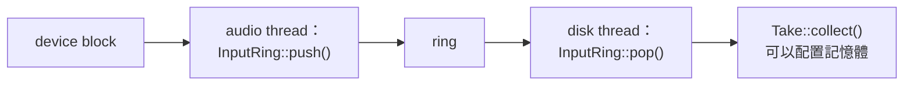
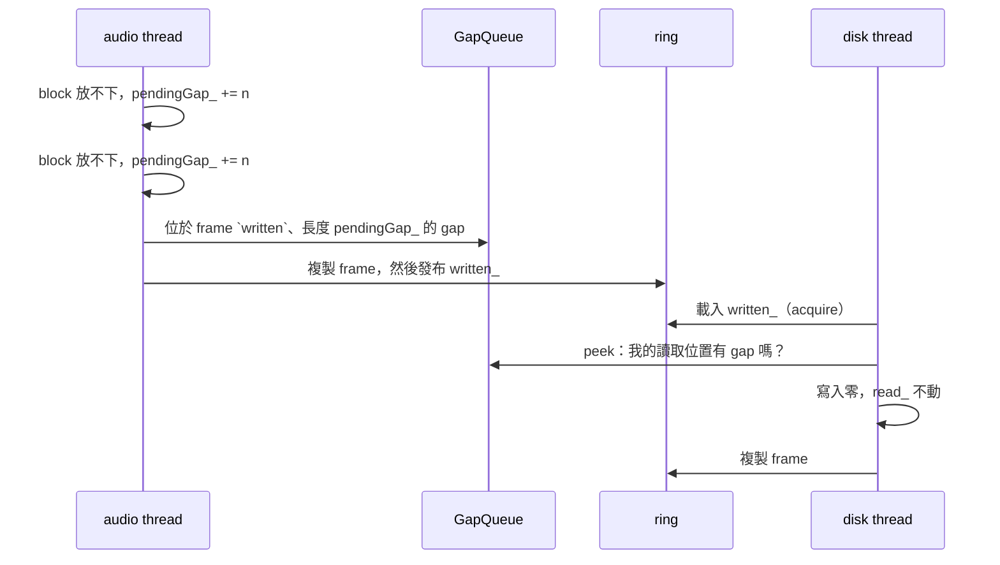

# Step 1 - 從 audio thread 到 disk thread

[English](step-01-input-ring.md) | **繁體中文**

[總覽](../README.zh-TW.md) | 下一步：[Step 2 - Take 放在哪裡](step-02-placement.zh-TW.md)

## 目標

把音訊 input 的每個 block 交出 audio thread，而且這個 thread 永遠不等待、不配置記憶體；就算硬碟跟不
上，錄音的時間位置也要保持正確。

## 設計

### 兩個不能碰面的 thread

audio thread 每個 block 只有幾毫秒，而且不能等任何東西。錄音卻必須在記憶體和硬碟上不斷變長，硬碟也可
能卡住幾百毫秒。所以這兩件工作放在兩個 thread 上，中間隔著一個 ring buffer：



disk thread 用輪詢的方式工作。audio thread 不會叫醒它，因為叫醒 thread 是 system call，可能會 block。
ring 必須大到撐得過一次輪詢間隔，再加上你想撐過的最長卡頓，這就是 `framesForStall()` 算的東西。48 kHz
下半秒是 24000 個 frame。

### 為什麼不用第 14 章的 `SpscQueue`？

`SpscQueue` 一次搬一個項目，而一個 block 有好幾個 channel、每個幾百個 frame。給音訊用的 ring 會分一到
兩段複製整個 block，然後一次讓 reader 看到。

### 兩個只會增加的 counter

`written_` 和 `read_` 計算從開始以來的 frame 數，實際上不會繞回（`uint64_t` 裝得下幾百萬年的音訊）。這
讓計算變得很簡單：

```text
fill level  = written - read
free room   = capacity - (written - read)
index       = counter & mask          (capacity 是 2 的次方，mask = capacity - 1)
```

`SpscQueue` 必須留一格空位才能分辨「滿」和「空」。這裡 `written == read` 就是空，
`written - read == capacity` 就是滿。

每個 counter 只有一個 writer，而操作的順序就是整個協定：

<div align="center">

| Thread | 先做 | 然後 | 代表 |
|---|---|---|---|
| audio | 把 frame 複製進去 | `written_.store(..., release)` | reader 只會看到完成的 frame |
| disk | 把 frame 複製出來 | `read_.store(..., release)` | writer 只會重用已經讀完的位置 |

</div>

兩邊都用 `acquire` 讀對方的 counter。把其中一個 `release` store 改成 `relaxed`，ThreadSanitizer 就會回
報 sample 上的 data race。

### Ring 滿了的時候

audio thread 只剩一件事能做：丟掉這個 block 並記錄下來。它不能等空位，而且 block 要嘛整個放進去，要嘛
完全不放。

不過丟掉 block 還不是真正的問題。看看如果不多做處理，take 會變成什麼樣子：

```text
device:   A A A B B B C C C D D D
dropped:        B B B
take:     A A A C C C D D D             缺口之後的所有內容都提早 3 個 frame，一直到結束
```

一個和歌曲其他部分錯位的 take 比 click 更糟，而且可能到混音完成都沒人發現。所以被丟掉的 frame 要用等長
的靜音取代：

```text
take:     A A A 0 0 0 C C C D D D       一個 click，而 C 和 D 都在正確的位置
```

### Gap

audio thread 沒辦法把靜音寫進 ring，因為 ring 已經滿了。所以它記下一個數字 `pendingGap_`，等到有 block
放得進去時，先在一個獨立的小 queue 裡宣告這個 gap：



有三個細節讓它正確：

- **Queue 也可能滿。** 有十六個 gap 在等，代表硬碟已經落後很多。這時 block 就算放得下也會被丟掉，gap 繼
  續變長，時間位置依然正確。
- **`pop()` 裡的順序很重要。** `push()` 會在發布 gap 後面的 frame *之前*先宣告 gap，所以 `pop()` 必須在
  檢查 gap *之前*先載入 `written_`。這樣只要看到了那些 frame，就一定看得到 gap。如果順序反過來，它可能
  先找 gap、沒找到，接著卻看到在這段時間內才宣告的 gap 後面的 frame：這些 frame 會太早被讀走，take 剩下
  的部分時間位置全都會錯。
- **最尾端的 gap 永遠不會寫出來。** 後面沒有東西，所以不會有任何東西移位，take 只是短了一點。

靜音對 reader 來說也算 frame，但 `read_` 不會移動，因為它們從來沒有進過 ring。

沒有任何測試能穩定抓到 `pop()` 的順序錯誤，因為兩個 thread 必須剛好在那個瞬間切換。下面的壓力測試有時
抓得到、有時抓不到，而 ThreadSanitizer 完全不會回報：每次存取都有正確同步，錯的只有邏輯。有些規則必須
靠推理遵守，不能等測試來抱怨。

### 沒有 input 時的靜音

裝置的 input 可能比 take 的 channel 少，也可能對沒啟用的 channel 傳 null pointer。這兩種情況都錄成靜
音。零必須真的寫入，因為 ring 裡還留著上一個 block 的內容。

## 用 ThreadSanitizer 檢查

self-check 最後會讓真的 audio thread 和 disk thread 同時運作，分成有卡頓和沒卡頓兩種。MSVC 沒有
ThreadSanitizer，所以在 Windows 上要在 WSL 裡執行，做法同
[第 15 章 Step 2](../../15-daw-growing/docs/step-02-track-pool.zh-TW.md#用-threadsanitizer-檢查)：

```bash
./scripts/build.sh --only 17-recording --sanitize thread --build-dir build-tsan
```

## 換你了

在 `steps/step01-input-ring/starter/step01.cpp` 寫出五個函式：

1. `InputRing::copyIn()`：把 n 個 sample 寫進 storage，跨過尾端時分成兩段。null source 寫入零。
2. `InputRing::copyOut()`：方向相反的同一件事。
3. `InputRing::push()`：確認有空位、宣告 gap、複製每個 channel、發布。
4. `InputRing::pop()`：在 gap 和 frame 之間交替，絕不讀過下一個 gap。
5. `Take::collect()`：一直 pop 並附加，直到沒有東西為止。

在 block 能夠通過 ring 之前，self-check 跑完最前面幾個案例就會停下來。全部完成後，輸出的結尾會像這樣：

```text
  2000 blocks, 246 of them dropped: 0 allocations (expected 0)
  200 random sessions, 4996226 frames, 27753 dropped blocks: 0 differ from the reference (expected 0)
  two threads, nothing dropped: 3845387 frames, 0 wrong, 0 silent (expected 0, 0)
  two threads, the disk stalls: 3845387 frames, 0 wrong, 25513 silent
[PASS] l17_step01 (60 checks passed)
```

最後一行的靜音 frame 數取決於兩個 thread 實際的執行情況，每次都不一樣；但那些 0 不會變。

## 你學到了什麼

- audio thread 把工作交出去就繼續往前，剩下的交給可以 block 的 thread。
- 只會增加的 counter 讓 ring 變簡單：相減就是 fill level，`& mask` 就是 index。
- 複製之後 `release`、複製之前 `acquire`，就是兩個 thread 之間的完整協定。
- 丟掉 block 很糟，但讓後面的內容全部移位更糟。寧可損失音訊，也要保住時間位置。
- 抓 data race 的工具找不到邏輯順序上的錯誤。
