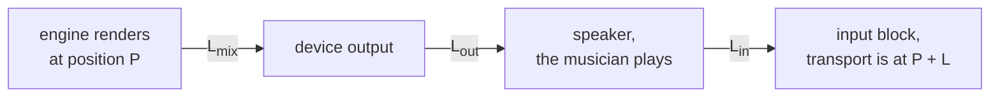
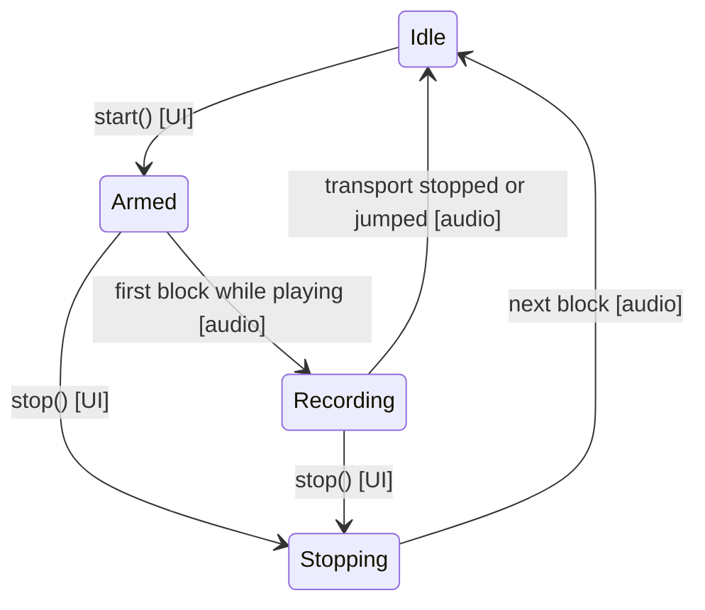

# Step 2 - Where the take belongs

**English** | [繁體中文](step-02-placement.zh-TW.md)

[Overview](../README.md) | Previous: [Step 1 - From the audio thread to the disk thread](step-01-input-ring.md) | Next: [Step 3 - The take on disk](step-03-take-on-disk.md)

## Goal

The musician plays exactly in time with what they hear, and the recording arrives late. Put the take on
the timeline where it was played, to the sample, and end a take in a way both threads agree on.

## Design

### Three delays

Chapter 14 already worked out half of this: what the transport calls position $`P`$ is what the engine
*renders*, and the speakers play it later (`AudioHost::getAudiblePosition`). Recording adds the way back:



Follow one sample. The sound of timeline position $`c`$ leaves the mix $`L_{\text{mix}}`$ samples after it
was rendered, and reaches the musician's ears $`L_{\text{out}}`$ later. The musician plays along, and that
note arrives in an input block $`L_{\text{in}}`$ later still. By then the transport is at
$`c + L_{\text{mix}} + L_{\text{out}} + L_{\text{in}}`$. So frame $`i`$ of a take whose first block came
in at position $`P`$ belongs at

```math
\text{timeline}(i) = P + i - (L_{\text{in}} + L_{\text{out}} + L_{\text{mix}})
```

For typical numbers (240, 480 and 752 samples) that is 1472 samples, or 30.7 ms at 48 kHz: clearly audible
as a late performance, and the same on every take, so that overdubs drift further and further behind.

### Who knows what

<div align="center">

| Value | Known by | When |
|---|---|---|
| $`L_{\text{in}}`$, $`L_{\text{out}}`$ | the device, so the UI thread can ask | before the take |
| $`L_{\text{mix}}`$ | the engine, and it changes when a plugin is added | the moment the take begins |
| $`P`$ of the first block | only the audio thread | the moment the take begins |

</div>

So the audio thread **stamps** the take with the position and the mix latency of its first block. The
latencies then stay as stamped for the whole take. If the user adds a plugin in the middle, what they
hear shifts, and no single number can be right for both parts. One constant is the honest answer.

The stamp comes before the push. If the very first block is dropped (Step 1), the take still starts where
that block would have been.

### Before the beginning

Recording from the song's start gives a negative position: the first
$`L_{\text{in}} + L_{\text{out}} + L_{\text{mix}}`$ frames were captured before anyone could have heard
the song. They are not part of it. `place()` starts the clip at 0 and skips them, which is what
`Clip::sourceOffset` is for.

### What the driver says

$`L_{\text{in}}`$ and $`L_{\text{out}}`$ are only what the driver reports, and drivers can be wrong. The
real round trip can be measured: connect the output to the input with a cable (or hold a microphone
to the speaker), render a click and record it. `measureRoundTrip()` looks for the first frame that reaches
half of the take's peak, since a real click has noise before it and rings after it. A take without a
clear peak measures nothing, instead of something wrong.

The difference from the reported value is the trim, which the user can keep:

```text
reported  240 + 480           = 720
measured                      = 757
trim                          = 37
```

### A take is one straight line

Each block must continue where the last one ended, because frame $`i`$ is at position $`P + i`$. A seek
breaks that, and so does a stopped transport, so either one ends the take. (Step 4 lets a loop continue
as a new take.)

### Who may say "finished"

The disk thread must not stop reading too early: frames may still be on their way. And `start()` may
only prepare the ring when the audio thread is certain to stay away. Both come down to the same rule:



**Only the audio thread ever makes the state Idle.** So Idle means that it has left the take, and everything
but the state belongs to the UI thread. In every other state it belongs to the audio thread. This gives
a simple rule for the fields, without any locks:

- The audio thread may write the stamp only after it has won Armed -> Recording. If it wrote first and
  `stop()` then won, a take that never began would look as if it had begun.
- The UI reads the stamp only after it has seen Idle. The `release` store of Idle and the `acquire` load
  are what make the audio thread's plain writes visible.

Both threads can leave Armed, and the UI can leave Recording while the audio thread does too, so those
changes are `compare_exchange_strong`, not plain stores.

There is one consequence: without a running device, nobody confirms the stop. The engine and app steps
have to deal with a device that stops while a take is running.

## Your turn

Write the five functions in `steps/step02-placement/starter/step02.cpp`:

1. `place()`: the formula, and the frames before the timeline's zero.
2. `measureRoundTrip()`: the peak, then the first frame at half of it.
3. `Recorder::start()`: only from Idle; `Armed` is stored last.
4. `Recorder::stop()`: Armed or Recording to Stopping. Never Idle.
5. `Recorder::process()`: the state diagram above, from the audio thread's side.

When it works, the output ends like this:

```text
  without the correction the first click lands 1472 samples late (30.7 ms at 48 kHz)
  the driver reports 720 samples, the click measures 757: trim 37
  300 random latencies, block sizes and starts, 1323 clicks: 0 sessions wrong (expected 0)
  two threads: 465 takes (135 never started), 2044 clicks, 0 in the wrong place (expected 0)
[PASS] l17_step02 (58 checks passed)
```

The numbers of takes and clicks in the two-threads line can differ from run to run.

## What you learned

- A recording is late by the whole way around: mix, output and input.
- Only the audio thread knows the position of a block, so it stamps the take.
- A constant latency for a whole take is a decision, not an oversight.
- Measure what a driver reports, and let the user correct it.
- When two threads can end the same thing, let only one of them say that it is over.
