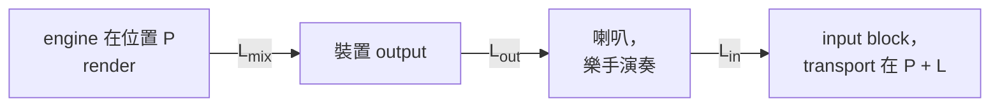
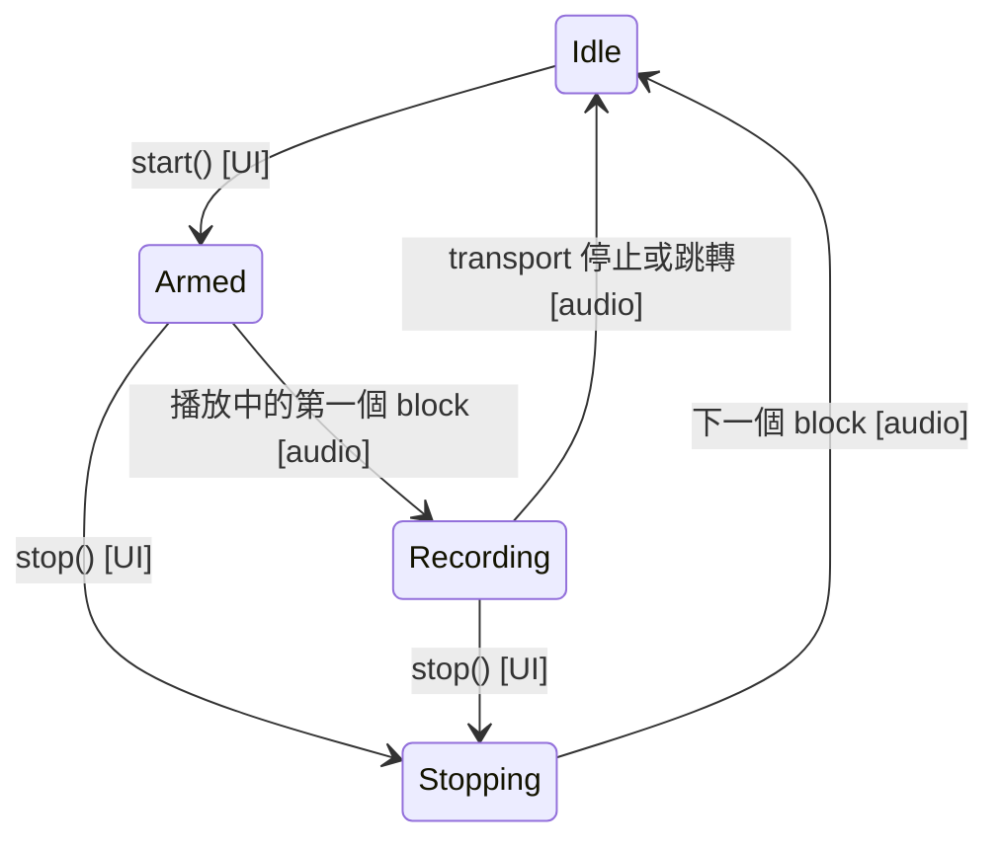

# Step 2 - Take 放在哪裡

[English](step-02-placement.md) | **繁體中文**

[總覽](../README.zh-TW.md) | 上一步：[Step 1 - 從 audio thread 到 disk thread](step-01-input-ring.zh-TW.md) | 下一步：[Step 3 - 把 take 寫進硬碟](step-03-take-on-disk.zh-TW.md)

## 目標

樂手完全對著聽到的聲音演奏，但錄音到達時已經晚了。把 take 放回時間軸上演奏時的位置，精確到 sample，並
用兩個 thread 都同意的方式結束一個 take。

## 設計

### 三段延遲

第 14 章已經算出其中一半：transport 所說的位置 $`P`$ 是 engine *render* 的位置，喇叭要晚一點才播出來
（`AudioHost::getAudiblePosition`）。錄音則多了回程：



跟著一個 sample 走。時間軸位置 $`c`$ 的聲音在 render 之後 $`L_{\text{mix}}`$ 個 sample 才離開混音，再過
$`L_{\text{out}}`$ 才傳到樂手耳中。樂手跟著演奏，這個音符再過 $`L_{\text{in}}`$ 才進到 input block。這時
transport 已經在 $`c + L_{\text{mix}} + L_{\text{out}} + L_{\text{in}}`$。所以如果 take 的第一個 block 是在
位置 $`P`$ 進來的，它的第 $`i`$ 個 frame 應該放在

```math
\text{timeline}(i) = P + i - (L_{\text{in}} + L_{\text{out}} + L_{\text{mix}})
```

以常見的數字來說（240、480 和 752 個 sample），這是 1472 個 sample，48 kHz 下 30.7 ms：明顯聽得出演奏偏
晚，而且每個 take 都一樣，所以 overdub 會愈疊愈落後。

### 誰知道什麼

<div align="center">

| 數值 | 誰知道 | 何時 |
|---|---|---|
| $`L_{\text{in}}`$、$`L_{\text{out}}`$ | 裝置，所以 UI thread 可以問 | take 開始之前 |
| $`L_{\text{mix}}`$ | engine，而且加入 plugin 時會變 | take 開始的那一刻 |
| 第一個 block 的 $`P`$ | 只有 audio thread | take 開始的那一刻 |

</div>

所以由 audio thread 為 take **蓋章**：記下第一個 block 的位置和當下的 mix latency。之後整個 take 都用蓋章
時的 latency。如果使用者在錄到一半時加了 plugin，聽到的聲音會移位，沒有任何單一數字能同時對前後兩段都正
確。用一個常數才是誠實的答案。

蓋章在 push 之前。就算第一個 block 就被丟掉（Step 1），take 仍然從那個 block 應該在的位置開始。

### 開頭之前

從歌曲開頭錄音會得到負的位置：最前面 $`L_{\text{in}} + L_{\text{out}} + L_{\text{mix}}`$ 個 frame 是在任何
人聽到歌曲之前錄到的，不屬於這首歌。`place()` 讓 clip 從 0 開始並跳過它們，這正是
`Clip::sourceOffset` 的用途。

### Driver 說的話

$`L_{\text{in}}`$ 和 $`L_{\text{out}}`$ 只是 driver 回報的值，而 driver 可能是錯的。真正的來回延遲可以量出
來：用一條線把 output 接回 input（或把麥克風靠近喇叭），render 一個 click 再錄回來。
`measureRoundTrip()` 會找第一個達到 take 峰值一半的 frame，因為真實的 click 前面有噪音、後面有餘震。沒有
明顯峰值的 take 就不量，而不是量出一個錯的值。

和回報值之間的差就是 trim，使用者可以把它留著：

```text
reported  240 + 480           = 720
measured                      = 757
trim                          = 37
```

### Take 是一條直線

每個 block 都必須接在上一個結束的地方，因為第 $`i`$ 個 frame 就在位置 $`P + i`$。seek 會破壞這點，transport
停止也一樣，所以兩者都會結束 take。（Step 4 會讓 loop 接續成新的 take。）

### 誰可以說「結束了」

disk thread 不能太早停止讀取：可能還有 frame 在路上。`start()` 也只有在確定 audio thread 不會碰 ring 時才
能準備它。兩者都歸結到同一條規則：



**只有 audio thread 能把 state 變成 Idle。** 所以 Idle 代表它已經離開 take，除了 state 以外的東西都歸 UI
thread 所有；其他所有 state 下則都歸 audio thread 所有。這樣欄位的規則就很簡單，不需要任何 lock：

- audio thread 必須贏得 Armed -> Recording 之後才能寫入章的內容。如果先寫，而 `stop()` 接著贏了，一個從未開
  始的 take 看起來就會像開始過。
- UI 必須看到 Idle 之後才讀取章的內容。Idle 的 `release` store 和 `acquire` load，就是讓 audio thread 的一
  般寫入被看見的原因。

兩個 thread 都可能離開 Armed，UI 離開 Recording 時 audio thread 也可能同時在離開，所以這些變更要用
`compare_exchange_strong`，不能用單純的 store。

這有一個後果：沒有運作中的裝置，就沒有人確認停止。engine 和 app 的 step 必須處理裝置在 take 進行中停止的
情況。

## 換你了

在 `steps/step02-placement/starter/step02.cpp` 寫出五個函式：

1. `place()`：公式，以及時間軸零點之前的 frame。
2. `measureRoundTrip()`：峰值，然後第一個達到一半的 frame。
3. `Recorder::start()`：只能從 Idle 開始；`Armed` 最後才 store。
4. `Recorder::stop()`：把 Armed 或 Recording 變成 Stopping，絕不變成 Idle。
5. `Recorder::process()`：上面的 state diagram，audio thread 這一側。

全部完成後，輸出的結尾會像這樣：

```text
  without the correction the first click lands 1472 samples late (30.7 ms at 48 kHz)
  the driver reports 720 samples, the click measures 757: trim 37
  300 random latencies, block sizes and starts, 1323 clicks: 0 sessions wrong (expected 0)
  two threads: 465 takes (135 never started), 2044 clicks, 0 in the wrong place (expected 0)
[PASS] l17_step02 (58 checks passed)
```

兩個 thread 那一行的 take 和 click 數量每次執行可能不同。

## 你學到了什麼

- 錄音晚了一整圈：混音、output，再加上 input。
- 只有 audio thread 知道 block 的位置，所以由它為 take 蓋章。
- 整個 take 用一個常數 latency 是一個決定，不是疏忽。
- 量測 driver 回報的值，並讓使用者校正。
- 當兩個 thread 都能結束同一件事時，只讓其中一個宣布它結束了。
