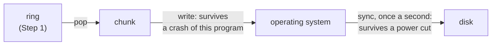
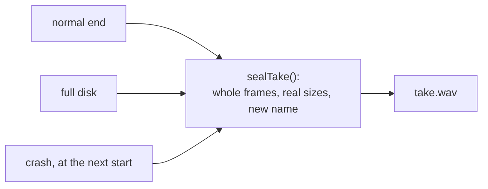
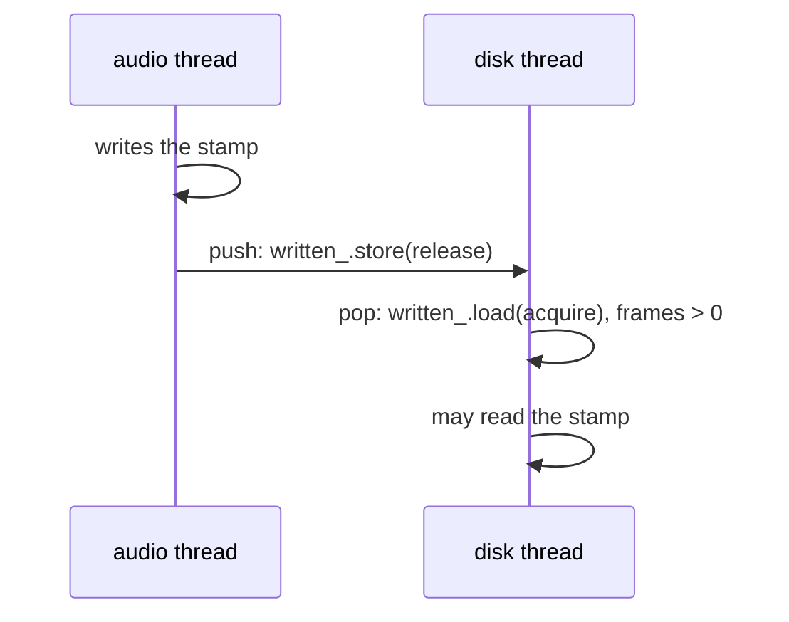

# Step 3 - The take on disk

**English** | [繁體中文](step-03-take-on-disk.zh-TW.md)

[Overview](../README.md) | Previous: [Step 2 - Where the take belongs](step-02-placement.md)

## Goal

Write a take to a WAV file while it is being recorded, so that a crash or a full disk loses as little as
possible, and what is left is still a good take that knows where it belongs.

## Design

### What can go wrong

Until now the take has been in memory. An hour of stereo at 48 kHz is 1.4 GB, and a crash loses all of
it. A musician cannot always play it again, so a recording has stricter rules than anything else a DAW
saves:

<div align="center">

| What happens | What must be true afterwards |
|---|---|
| the program crashes | everything up to the last chunk or so is still there |
| the disk fills up | the recording ends, and what fitted is a good take |
| the file limit is reached | the same |
| the new name is taken | no other take is ever overwritten |

</div>

Chapter 16 saves projects by writing a temporary file and then moving it into place. That protects the
old version, but it does not help here: there is no old version, and the temporary file is what we want to
keep.

### The file

A WAV file begins with its sizes, which nobody knows until the recording ends:

```text
  offset
       0  RIFF  [file size - 8]  WAVE            0 while recording
      12  fmt   16  3 (float), channels, rate, bytes/s, bytes/frame, 32
      36  dlab  24  stamped position, input, output, mix, trim
      68  data  [bytes of samples]               0 while recording
      76  the samples, interleaved
```

The usual trick is to go back and update the sizes now and then, but that only makes them less wrong.
The real size of the file is the one number that a crash cannot make wrong, so the sizes simply stay 0 and
nothing believes them until the take is finished. A program that does not know any of this sees an empty
WAV, not a damaged one.

The `dlab` chunk is our own; the WAV format says that readers skip chunks they do not know. It holds the
stamp and the latencies of Step 2, because a take without them is sound without a place. It is written
once, with the header.

While recording, the file is called `take.wav.recording`, and the name itself says that it is not
finished. So after a crash, the unfinished takes are simply the `.recording` files in the folder.

### Nothing waits in this process

`fwrite` normally collects bytes in a buffer in this process, and a crash takes that buffer with it. Each
chunk of 4096 frames (85 ms at 48 kHz) is already a buffer, so the file is unbuffered and every write goes
straight to the operating system:



The operating system keeps the bytes even if this program dies, but not if the power fails. `sync`
(`fsync` or `_commit`) forces them to the disk, and it can take a long time, which is one more reason that
the audio thread never waits for the disk thread. Once a second, the cost is small and at most a second
is at risk in a power cut.

### One way to finish

There could be two pieces of code here, one that finishes a take and one that repairs a crashed one.
Instead there is one:



`sealTake()` trusts nothing but the file:

1. Read the header. If it is not a take's, leave the file alone.
2. Work out the number of whole frames from the file's real length. Cut off a partial frame.
3. Overwrite the header, with the real sizes, and sync.
4. Rename the file. The rename is the moment it becomes finished.

So recovering from a crash is not a rarely used path that fails when it is finally needed: every take goes
through it. And a crash in the middle of sealing does no harm, since doing it again gives the same file.

### A full disk is a crash you survive

After a failed write, nothing can be said about how much reached the file. Part of a frame may have. But
that is what a crash leaves behind too, so `write()` does not try to clean anything up. It notes the
problem, stops writing, and `finish()` goes the same way as everything else. Sealing overwrites bytes that
exist already, so on an ordinary file system it needs no new space, and the rename only changes the folder.

`pump()` goes on emptying the ring when there is a problem, and the frames go nowhere. The audio thread must
not notice any of this: it keeps running, and the song keeps playing. The UI asks `problem()`, tells the user
and calls `Recorder::stop()`.

The file limit is the same case with a warning in advance. A RIFF size has 32 bits, so a take stops at 4 GiB,
about 3 h 6 min of stereo at 48 kHz. (A longer take would need the RF64 format. It is out of scope here.)

### When the stamp may be read

Step 2 said that the stamp may be read once the state is Idle, but a crash does not wait for that. The file
needs the stamp at the start. There is a second moment when it is safe:



Writes before a `release` store are visible to whoever `acquire`-loads that value. So the first frame out of
the ring is a promise that the stamp is complete, and the audio thread does not change it again in this
take. This is why the file is opened when the first frame arrives, and not when the recording starts. It has
a pleasant side effect: a take that never began leaves no file.

### The order in pump()

`pump()` asks whether the take is over, and only then empties the ring. The other order loses frames:

```text
  disk thread                        audio thread
  pop: the ring is empty
                                     push the last block
                                     Idle
  isIdle(): yes, so finish           (the last block is still in the ring)
```

If Idle was seen first, then everything was pushed before that, and the pops that follow find all of it.

### What this does not protect against

- A power cut can cost the last second. After one, some file systems can also leave a file with
  zeros at its end, which this cannot tell from silence.
- A disk that lies about having written something.
- The clip audio in the app stays in memory (Step 7), so an hour of recording still needs its 1.4 GB there.

## Your turn

Write the six functions in `steps/step03-take-on-disk/starter/step03.cpp`:

1. `makeHeader()`: the table in `minidaw.h`, with both sizes at 0.
2. `TakeFile::open()`: never over another file, unbuffered, header first.
3. `TakeFile::write()`: as much as fits, interleaved, in one write. Any failure is a problem, and the end of
   writing.
4. `TakeFile::finish()`: close and seal. Only the file knows how much it holds.
5. `sealTake()`: the four points above.
6. `TakeWriter::pump()`: is it over, then the ring, then the file. Open the file with the first frame.

When it works, the output ends like this:

```text
  a crash after any write: 8 copies recovered, 0 frames lost (expected 0)
  the file cut at each of its 157 lengths: 0 wrong (expected 0)
  the disk full at 111 different bytes: 0 wrong (expected 0)
  a crash during a take: 48000 frames recovered, 48 clicks, 0 in the wrong place (expected 0)
  three threads: 120 takes (30 never began), 30 disks full, 57 with dropped frames, 1445042 frames, 0 wrong (expected 0)
[PASS] l17_step03 (865 checks passed)
```

The numbers in the three-threads line can differ from run to run.

The checks imitate a crash by copying the file while the writer still has it open, and a full disk with a
write function that stops after so many bytes. No test here can cut the power, so a missing sync in
`sealTake()` would not show. The wrong order in `pump()` needs two audio blocks between two neighbouring lines,
so a run can easily pass with it: think it through instead of trusting the check.

## What you learned

- When the end cannot be known in advance, make the file's real length the truth.
- Do not keep what cannot be lost in the memory of the program that can crash.
- One way to finish means that the way a crash needs is tested by every take.
- A failed write says nothing about what reached the file, so ask the file.
- An `acquire` that sees a `release` also promises everything written before it.
