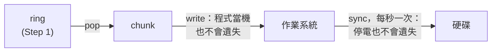
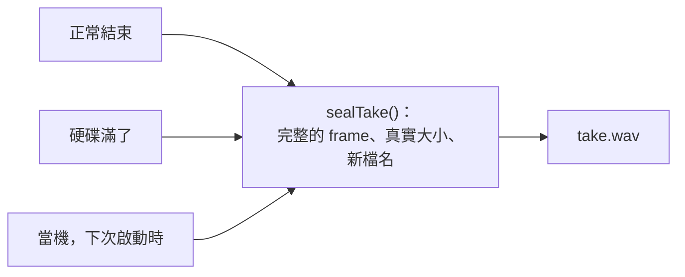
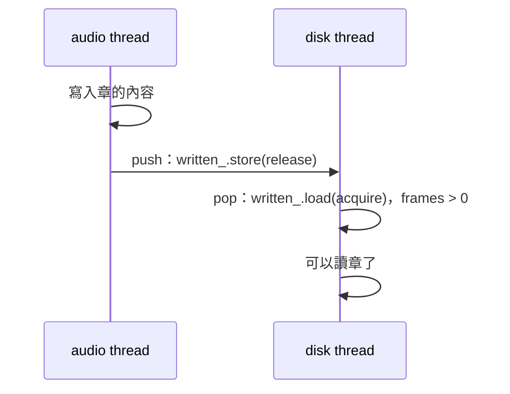

# Step 3 - 把 take 寫進硬碟

[English](step-03-take-on-disk.md) | **繁體中文**

[總覽](../README.zh-TW.md) | 上一步：[Step 2 - Take 放在哪裡](step-02-placement.zh-TW.md)

## 目標

在錄音的同時把 take 寫進 WAV 檔，讓當機或硬碟滿了時損失愈少愈好，而且留下來的仍然是一個完好的 take，也知
道自己該放在哪裡。

## 設計

### 可能出什麼事

到目前為止 take 都在記憶體裡。48 kHz 的立體聲一小時是 1.4 GB，一次當機就全沒了。樂手不一定能再演奏一次，
所以錄音的規則比 DAW 存的其他東西都嚴格：

<div align="center">

| 發生什麼事 | 事後必須成立 |
|---|---|
| 程式當機 | 最後一個 chunk 左右之前的內容都還在 |
| 硬碟滿了 | 錄音結束，寫得下的部分是完好的 take |
| 達到檔案上限 | 同上 |
| 新檔名已被使用 | 絕不覆蓋其他 take |

</div>

第 16 章存專案的方式是先寫暫存檔再移到定位。這能保護舊版本，但在這裡沒有幫助：沒有舊版本，而那個暫存檔正
是我們要保住的東西。

### 檔案

WAV 檔的開頭就是它的大小，而錄音結束之前沒有人知道這些數字：

```text
  offset
       0  RIFF  [檔案大小 - 8]  WAVE              錄音時是 0
      12  fmt   16  3 (float)、聲道數、取樣率、bytes/s、bytes/frame、32
      36  dlab  24  蓋章位置、input、output、mix、trim
      68  data  [樣本的 byte 數]                  錄音時是 0
      76  樣本，交錯排列
```

常見的做法是不時回頭更新大小，但那只是讓它們錯得少一點。檔案的真實大小是當機唯一無法弄錯的數字，所以大小
欄位就維持 0，在 take 結束之前沒有人相信它們。不懂這一切的程式看到的是一個空的 WAV，而不是損壞的檔案。

`dlab` chunk 是我們自己的；WAV 格式規定 reader 要跳過不認識的 chunk。它存放 Step 2 的章和 latency，因為沒有
這些，take 就只是沒有位置的聲音。它隨 header 寫入一次。

錄音時檔名是 `take.wav.recording`，名字本身就說明它還沒結束。所以當機之後，未完成的 take 就是資料夾裡的
`.recording` 檔。

### 什麼都不留在這個 process 裡

`fwrite` 通常會把 byte 收集在這個 process 裡的 buffer，當機時 buffer 就一起消失。每個 4096 frame 的 chunk
（48 kHz 下 85 ms）本身已經是 buffer 了，所以檔案不加 buffer，每次 write 都直接交給作業系統：



即使這個程式死掉，作業系統也會留著這些 byte，但停電就不行了。`sync`（`fsync` 或 `_commit`）強制把它們寫到硬
碟，這可能要花很久，這也是 audio thread 絕不等 disk thread 的另一個原因。每秒一次的成本很小，停電時最多損失
一秒。

### 只有一種結束方式

這裡本來可以有兩段程式碼，一段結束 take，一段修復當機的 take。實際上只有一段：



`sealTake()` 除了檔案之外什麼都不相信：

1. 讀取 header。如果不是 take 的 header，就不去碰這個檔案。
2. 從檔案真實長度算出完整 frame 的數量，切掉不完整的 frame。
3. 用真實大小覆寫 header，然後 sync。
4. 重新命名。rename 的那一刻，檔案才算完成。

所以從當機復原不是一條很少走、真正需要時才發現壞掉的路：每個 take 都會走過它。sealing 中途當機也沒有害處，
因為再做一次會得到同樣的檔案。

### 硬碟滿了，就是一次沒死的當機

write 失敗之後，無法得知有多少資料進了檔案，可能有不完整的 frame。但當機留下的也是這樣，所以 `write()` 不必
試著清理任何東西。它記下問題、停止寫入，`finish()` 則和其他情況走同一條路。sealing 只是覆寫已經存在的 byte，
所以在一般的檔案系統上不需要新的空間，rename 也只改動資料夾。

有問題時 `pump()` 仍會持續清空 ring，但 frame 不會寫到任何地方。audio thread 不能察覺這一切：它繼續執行，歌
曲繼續播放。UI 詢問 `problem()`、告知使用者，並呼叫 `Recorder::stop()`。

檔案上限是同一種情況，只是事先知道。RIFF 大小只有 32 bit，所以 take 停在 4 GiB，48 kHz 立體聲大約是 3 小時
6 分鐘。（更長的 take 需要 RF64 格式，不在本章範圍。）

### 什麼時候可以讀章

Step 2 說 state 變成 Idle 之後才能讀章的內容，但當機不會等到那時候，而檔案一開始就需要章。還有第二個安全的時
機：



在 `release` store 之前的寫入，對 `acquire` load 到該值的 thread 都看得見。所以 ring 出來的第一個 frame 就保證
章已經完整，而且 audio thread 在這個 take 內不會再改動它。這就是為什麼檔案在第一個 frame 到達時才開啟，而不
是在錄音開始時。這還有一個好處：從未開始的 take 不會留下檔案。

### pump() 裡的順序

`pump()` 先問 take 結束了沒，然後才清空 ring。反過來的順序會遺失 frame：

```text
  disk thread                        audio thread
  pop：ring 是空的
                                     push 最後一個 block
                                     Idle
  isIdle()：是，所以結束              （最後一個 block 還在 ring 裡）
```

如果先看到 Idle，那麼所有東西都在那之前 push 完了，接下來的 pop 會全部讀到。

### 這防不了什麼

- 停電可能損失最後一秒。停電之後，有些檔案系統還可能讓檔案結尾出現一段零，這裡分不出那和靜音的差別。
- 硬碟謊報已經寫入。
- App 裡的 clip 音訊仍在記憶體中（Step 7），所以錄一小時在那裡仍然需要 1.4 GB。

## 換你了

在 `steps/step03-take-on-disk/starter/step03.cpp` 寫出六個函式：

1. `makeHeader()`：`minidaw.h` 裡的表格，兩個大小都是 0。
2. `TakeFile::open()`：絕不覆蓋其他檔案、不加 buffer、先寫 header。
3. `TakeFile::write()`：寫得下多少就寫多少、交錯排列、一次 write。任何失敗都是問題，也是寫入的終點。
4. `TakeFile::finish()`：關閉再 seal。只有檔案知道自己有多少內容。
5. `sealTake()`：上面的四點。
6. `TakeWriter::pump()`：先問是否結束，再處理 ring，然後是檔案。第一個 frame 到達時開啟檔案。

全部完成後，輸出的結尾會像這樣：

```text
  a crash after any write: 8 copies recovered, 0 frames lost (expected 0)
  the file cut at each of its 157 lengths: 0 wrong (expected 0)
  the disk full at 111 different bytes: 0 wrong (expected 0)
  a crash during a take: 48000 frames recovered, 48 clicks, 0 in the wrong place (expected 0)
  three threads: 120 takes (30 never began), 30 disks full, 57 with dropped frames, 1445042 frames, 0 wrong (expected 0)
[PASS] l17_step03 (865 checks passed)
```

三個 thread 那一行的數字每次執行可能不同。

這些檢查用「writer 還開著檔案時複製一份」來模擬當機，用「寫到某個 byte 數就停止的 write 函式」來模擬硬碟滿了。
這裡沒有測試能切斷電源，所以 `sealTake()` 少了 sync 也不會被發現。`pump()` 順序寫錯時，要在相鄰兩行之間跑完兩個
audio block 才會出事，所以測試很可能照樣通過：請自己想清楚，不要只相信檢查結果。

## 你學到了什麼

- 事先無法知道結尾時，就讓檔案的真實長度當作事實。
- 不能遺失的東西，不要留在會當機的程式記憶體裡。
- 只有一種結束方式，代表當機需要走的那條路每個 take 都測過。
- write 失敗無法告訴你有多少資料進了檔案，所以要問檔案。
- `acquire` 看到 `release` 時，也保證了在它之前寫入的一切。
