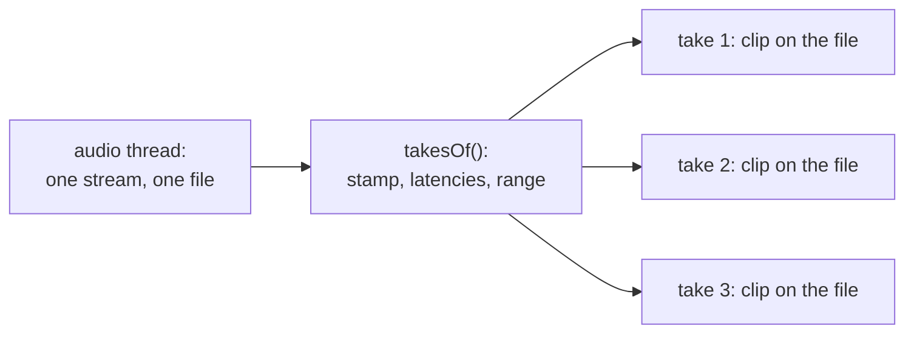

# Step 4 - Punch and loop

**English** | [繁體中文](step-04-punch-and-loop.zh-TW.md)

[Overview](../README.md) | Previous: [Step 3 - The take on disk](step-03-take-on-disk.md)

## Goal

Record only part of the timeline (a punch), and keep every pass of a loop as a take of its own, both exact
to the sample, wherever the device's blocks happen to end.

## Design

### The trap

A **punch** replaces a few bars: the song plays, recording begins at the punch-in and ends at the punch-out.
A **loop** plays a part of the song again and again, so that the musician can try until it is right.

The obvious way is to cut on the audio thread: begin a take at the punch-in, end it at the punch-out, and
start a new one each time the transport wraps. That is wrong, because of Step 2. Whatever arrives while the
transport is at $`P`$ was played along with $`P - L`$:

```text
  transport   ... 95998  95999 | 48000  48001  48002 ...      the wrap
  heard       ... 94526  94527   94528  94529  94530 ...      L = 1472 frames behind
```

For the next 1472 frames after the wrap, the musician is still playing the end of the *last* pass. Cutting at
the wrap puts those frames at the start of the next take, and leaves them missing at the end of this one. The
last note of every pass lands at the beginning of the loop.

So the cut would have to come $`L`$ frames after the wrap, in the middle of some later block, and if the
loop is shorter than $`L`$, several passes behind the transport. And it would have to do this on the audio
thread, for a stream of files.

### Do not cut

Nothing here needs to happen in real time, since nobody can hear a take before it is finished. So the audio
thread writes one straight stream into one file, and the takes are worked out afterwards:



A take is a `Placement`, which is a clip's `start`, `sourceOffset` and `length`. A chapter 14 clip does not
own its audio, so several clips on the same file cost nothing.

This gives more than simplicity:

- Punch points are exact because nothing happens at the edges of a block. There is no code here that knows
  what a block is.
- The frames around a punch stay in the file. The user can drag the edge of the clip to bring them back.
- A crash leaves one file. With the range in its header (the `dlab` chunk has grown), all the takes come back.

It costs some disk: the frames before a punch-in are written too, even though they may never be used. That is
about 12 MB per minute of mono. A later exercise could begin the stream only shortly before the punch-in.

### One number that keeps going up

Frame $`i`$ of the stream was played along with

```math
\text{heard}(i) = P + i - L
```

and this number simply keeps going up, while the transport jumps back. It is *unwrapped*. Each time it passes
the loop's end, one more pass begins, and the timeline position is one loop length further back:

```math
\text{timeline}(i) = \text{heard}(i) - k \cdot (\text{loopEnd} - \text{loopStart}) \qquad \text{in pass } k
```

So `takesOf()` goes through the passes. Each pass looks at the same *window*, the part of the timeline the
recording is for: from 0 on, inside the loop if there is one, inside the punch if there is one. The frames
of pass $`k`$ that belong to the take are those with

```math
\text{window.from} \le \text{heard}(i) - k \cdot \text{length} < \text{window.to}
```

Solved for $`i`$ this is two lines of code, and it already contains every special case:

<div align="center">

| Case | What happens |
|---|---|
| no loop, no punch | one pass, and the same answer as `place()` |
| from the song's start | the window begins at 0, so the first frames are skipped |
| a punch | the window is the punch |
| a run-up to the loop | the frames before the loop's start are outside the window |
| a punch inside a loop | the same part of every pass |
| latency longer than the loop | nothing special: the first frames are just more passes behind |
| stopped halfway through a pass | the take ends where the frames do |

</div>

The last row can leave a take of a few milliseconds if the user stops just after a wrap, so `minFrames` leaves
out those that are too short.

### What the audio thread still has to do

Only one thing: to know that the stream is unbroken, since `takesOf()` trusts that frame $`i`$ really came
$`i`$ frames after the first one. Chapter 14's `Transport::advance()` already describes a block with a wrap as
two segments, so the Recorder now takes those. Each segment has to start where the last one ended, with one
exception:

```cpp
expected = loops && nextPosition_ == loopEnd ? loopStart : nextPosition_;
```

Anything else ends the recording. This includes a transport that runs straight past the loop's end, because the
user switched the loop off. Those frames are unbroken as far as the transport goes, but `takesOf()` would count
them as a next pass, so the recording has to end there.

A transport that is already past the loop's end when the recording begins plays straight on (chapter 14, Step
2), so there the loop does not count at all: `loopsFrom()`.

### Which take plays

All the takes are there, and the app lets the user choose (Step 7). `bestTake()` picks the default: the longest,
and the later one if two are equal. No take is longer than the window, so that is the last whole pass, if
there is one. A last pass that was stopped halfway is rarely the one the user wants to hear.

### What this does not do

- Comping, meaning a new take made from the best parts of several takes, is not in this chapter.
- A hard edge at a punch can click. A clip has fades (chapter 14, Step 3), and Step 7 uses a short one.
- If the user stops as soon as a part ends, the input of the last $`L`$ frames has not arrived. Stopping a
  moment later costs nothing.

## Your turn

Write the four functions in `steps/step04-punch-and-loop/starter/step04.cpp`:

1. `visibleWindow()`: from 0 on, inside the loop, inside the punch.
2. `takesOf()`: the passes, and the frames in each one.
3. `bestTake()`: the longest, the later one if two are equal.
4. `Recorder::process()`: the state machine of Step 2, now with segments and a wrap that does not break the
   stream.

When it works, the output ends like this:

```text
  a loop, L = 1472: 4 takes, 0 frames in the wrong place (expected 0)
  cutting where the transport wraps would put the last 1472 frames of each pass into the next
  400 random sessions, 4299 takes: 0 frames in the wrong place (expected 0)
  a crash in the 4th pass: one file, 4 takes recovered, 0 frames in the wrong place (expected 0)
  three threads: 40 recordings, 206 takes, 0 wrong (expected 0)
[PASS] l17_step04 (405 checks passed)
```

The numbers in the three-threads line can differ from run to run.

In the checks every rendered sample says which position it is, and comes back around through a cable. So every
frame of every take can be compared with what was rendered at the place the take puts it.

## What you learned

- A wrap of the transport is not a wrap of what comes in: that one comes $`L`$ frames later.
- What does not have to happen in real time should not happen in real time.
- A number that only goes up is easier to think about than one that jumps (Step 1 said so too).
- A good formula has no special cases: they are all the same window.
