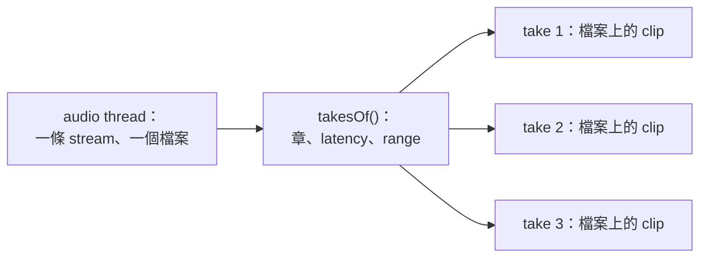

# Step 4 - Punch 與 loop

[English](step-04-punch-and-loop.md) | **繁體中文**

[總覽](../README.zh-TW.md) | 上一步：[Step 3 - 把 take 寫進硬碟](step-03-take-on-disk.zh-TW.md) | 下一步：[Step 5 - Input monitoring](step-05-input-monitoring.zh-TW.md)

## 目標

只錄時間軸的一部分（punch），並把 loop 的每一圈各存成一個 take。兩者都精確到 sample，不管裝置的 block 剛好在
哪裡結束。

## 設計

### 陷阱

**Punch** 是替換幾個小節：歌曲播放，到 punch-in 開始錄、到 punch-out 結束。**Loop** 是一再播放歌曲的一段，讓樂
手可以反覆嘗試，直到滿意為止。

直覺的做法是在 audio thread 上切：在 punch-in 開始一個 take、在 punch-out 結束，並在 transport 每次繞回時開始新
的 take。這是錯的，原因就在 Step 2。Transport 在 $`P`$ 時收到的東西，是對著 $`P - L`$ 演奏的：

```text
  transport   ... 95998  95999 | 48000  48001  48002 ...      繞回
  聽到的      ... 94526  94527   94528  94529  94530 ...      落後 L = 1472 個 frame
```

繞回之後的 1472 個 frame，樂手還在演奏*上一圈*的結尾。在繞回處切，這些 frame 就會跑到下一個 take 的開頭，而這
個 take 的結尾少了它們。每一圈的最後一個音符都落在 loop 的開頭。

所以切點必須在繞回之後 $`L`$ 個 frame，落在之後某個 block 的中間；如果 loop 比 $`L`$ 短，還會比 transport 落後好
幾圈。而且這一切都要在 audio thread 上，對著一連串檔案來做。

### 不要切

這裡沒有一件事需要即時完成，因為 take 結束之前沒有人能聽它。所以 audio thread 把一條筆直的 stream 寫進一個檔案，
take 則事後才算出來：



一個 take 就是一個 `Placement`，也就是 clip 的 `start`、`sourceOffset` 和 `length`。第 14 章的 clip 不擁有音訊，所
以同一個檔案上放好幾個 clip 不需要任何成本。

好處不只是簡單：

- Punch 點是精確的，因為在 block 的邊界上什麼都沒發生。這裡沒有任何程式碼知道 block 是什麼。
- Punch 前後的 frame 還留在檔案裡。使用者可以拖動 clip 的邊緣把它們找回來。
- 當機只留下一個檔案。header 裡有 range（`dlab` chunk 變大了），所有 take 都能找回來。

代價是一些硬碟空間：punch-in 之前的 frame 也會寫入，即使可能永遠用不到。單聲道每分鐘大約 12 MB。之後的練習可
以改成只在 punch-in 之前不久才開始 stream。

### 一個一直增加的數字

Stream 的第 $`i`$ 個 frame 是對著這個位置演奏的：

```math
\text{heard}(i) = P + i - L
```

Transport 會跳回去，這個數字卻只會一直增加。它是*展開的*（unwrapped）。每次超過 loop 的結尾，就開始新的一圈，時
間軸位置就再往回一個 loop 的長度：

```math
\text{timeline}(i) = \text{heard}(i) - k \cdot (\text{loopEnd} - \text{loopStart}) \qquad \text{第 } k \text{ 圈}
```

所以 `takesOf()` 逐圈處理。每一圈都看同一個 *window*，也就是這次錄音對應的時間軸範圍：從 0 開始，有 loop 就在
loop 內，有 punch 就在 punch 內。第 $`k`$ 圈屬於 take 的 frame 就是滿足下式的那些：

```math
\text{window.from} \le \text{heard}(i) - k \cdot \text{length} < \text{window.to}
```

對 $`i`$ 求解只有兩行程式碼，而且已經涵蓋所有特殊情況：

<div align="center">

| 情況 | 會發生什麼 |
|---|---|
| 沒有 loop、沒有 punch | 一圈，答案和 `place()` 相同 |
| 從歌曲開頭錄 | window 從 0 開始，所以跳過最前面的 frame |
| punch | window 就是 punch |
| 助跑進入 loop | loop 起點之前的 frame 在 window 之外 |
| loop 裡的 punch | 每一圈的同一段 |
| latency 比 loop 長 | 沒什麼特別：最前面的 frame 只是多落後幾圈 |
| 一圈中途停止 | take 在 frame 結束的地方結束 |

</div>

最後一列可能在使用者剛繞回就停止時留下幾毫秒的 take，所以 `minFrames` 會排除太短的 take。

### Audio thread 還要做的事

只有一件：確認 stream 沒有中斷，因為 `takesOf()` 相信第 $`i`$ 個 frame 真的是在第一個 frame 之後 $`i`$ 個 frame 來
的。第 14 章的 `Transport::advance()` 已經把有繞回的 block 描述成兩個 segment，所以 Recorder 現在接收這些 segment。
每個 segment 都必須從上一個結束的地方開始，只有一個例外：

```cpp
expected = loops && nextPosition_ == loopEnd ? loopStart : nextPosition_;
```

其他情況都會結束錄音，包括 transport 直接跑過 loop 結尾（使用者關掉了 loop）。對 transport 來說這些 frame 沒有中
斷，但 `takesOf()` 會把它們算成下一圈，所以錄音必須在那裡結束。

錄音開始時 transport 已經過了 loop 結尾，就會一直往前播（第 14 章 Step 2），這時 loop 完全不算數：`loopsFrom()`。

### 播放哪個 take

所有 take 都在，app 讓使用者選擇（Step 7）。`bestTake()` 挑預設值：最長的，一樣長就選後面的。沒有 take 會比 window
長，所以只要有完整的一圈，選到的就是最後一個完整的。中途停止的最後一圈很少是使用者想聽的。

### 這裡沒有做的事

- Comping，也就是從幾個 take 取最好的部分組成新 take，不在本章範圍。
- Punch 的硬邊可能會有爆音。Clip 有 fade（第 14 章 Step 3），Step 7 會用一段很短的 fade。
- 如果使用者在段落一結束就停止，最後 $`L`$ 個 frame 的 input 還沒到。晚一點停不需要任何代價。

## 換你了

在 `steps/step04-punch-and-loop/starter/step04.cpp` 寫出四個函式：

1. `visibleWindow()`：從 0 開始、在 loop 內、在 punch 內。
2. `takesOf()`：每一圈，以及每圈裡的 frame。
3. `bestTake()`：最長的，一樣長就選後面的。
4. `Recorder::process()`：Step 2 的 state machine，現在有 segment，繞回也不會中斷 stream。

全部完成後，輸出的結尾會像這樣：

```text
  a loop, L = 1472: 4 takes, 0 frames in the wrong place (expected 0)
  cutting where the transport wraps would put the last 1472 frames of each pass into the next
  400 random sessions, 4299 takes: 0 frames in the wrong place (expected 0)
  a crash in the 4th pass: one file, 4 takes recovered, 0 frames in the wrong place (expected 0)
  three threads: 40 recordings, 206 takes, 0 wrong (expected 0)
[PASS] l17_step04 (405 checks passed)
```

三個 thread 那一行的數字每次執行可能不同。

在這些檢查裡，每個 render 出來的 sample 都標明自己的位置，再透過線路繞回來。所以每個 take 的每個 frame 都能和
take 所放位置上 render 的內容比對。

## 你學到了什麼

- Transport 繞回不等於收到的東西繞回：後者晚 $`L`$ 個 frame。
- 不需要即時做的事，就不要即時做。
- 只會增加的數字比會跳動的數字容易思考（Step 1 也這麼說過）。
- 好的公式沒有特殊情況：它們都是同一個 window。
