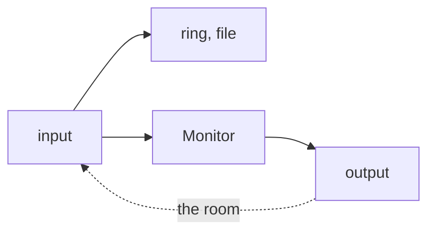
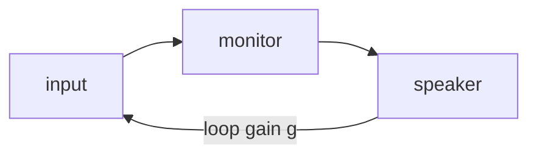

# Step 5 - Input monitoring

**English** | [繁體中文](step-05-input-monitoring.zh-TW.md)

[Overview](../README.md) | Previous: [Step 4 - Punch and loop](step-04-punch-and-loop.md) | Next: [Step 6 - The engine with recording](step-06-engine.md)

## Goal

Let the musician hear themselves while recording, as early as possible, without changing what is recorded, and
without letting a microphone near a speaker turn into a howl.

## Design

### Two paths

The same input goes two ways, and they have nothing to do with each other:



What is **recorded** stays dry, whatever the fader or the plugins do, so that they can still be changed afterwards.
What is **heard** has its own level, comes late, and can come back through the room. The rule follows from this:
nothing on the monitor path may touch the recording. Not the mode, not the level, not a mute.

### Heard late

A singer who hears their own voice late gets confused long before they could say why. So how late is it?

```math
\begin{aligned}
\text{direct:} \quad & L_{\text{in}} + L_{\text{out}} \\
\text{through the inserts:} \quad & L_{\text{in}} + L_{\text{mix}} + L_{\text{out}}
\end{aligned}
```

The second line has a trap. To hear the track's plugins, the input has to go through the track, and the mix delays
every track so that all of them match the slowest one (chapter 14, Step 8). So $`L_{\text{mix}}`$ is not the
latency of *this* track's plugins, but of the slowest plugin *anywhere in the song*. One look-ahead limiter on the
drums delays what the singer hears of themselves:

```text
  heard after: 15.0 ms directly, 30.7 ms through the inserts (one 752-sample plugin anywhere in the mix)
```

So there are two choices, `MonitorPath`, and the choice is the user's: a dry sound early, or the plugins late. The
placement of the take does not depend on it: the take is the dry input, and Step 2 already has the mix's latency,
because the musician hears the song through the mix.

### Auto: like a tape machine

`Always` is simple. `Auto` is what a punch needs: the musician hears the old take up to the punch-in, themselves in
the punch, and the old take after it. They hear themselves when stopped too, to be able to tune.

Here the switch is **not** shifted by $`L`$, unlike the takes in Step 4. What is rendered at position $`t`$ reaches
the musician as $`t`$, and the input that goes into that same output block is what they play now. So the monitor
simply follows the render position, and this is why a monitor's switch and a take's edge are at different places in
the stream, for the same punch point:

```text
  stream frame       ...  P    ...    P + L  ...
  monitor switches        ^ here
  take's first frame                   ^ here
```

### No clicks

A gain that jumps clicks. So there is only one gain, and every change goes through it, at most one step per frame:

```cpp
gain_ += std::clamp(target - gain_, -rampStep_, rampStep_);
```

Five milliseconds is short enough not to notice and long enough not to click. The mode, the level, the punch and the
guard are all just a different `target`. Nothing depends on the blocks, so the same input gives the same output in any
pieces.

The ramp must never see a level that is not a number: `target - gain_` would be NaN, `std::clamp` passes NaN through,
and from then on the gain stays NaN, even after the monitor is turned off. So `setLevel()` follows the rule for
setters: a setter that gets a non-finite value (NaN, +-inf) ignores it and keeps the previous level.

### Feedback

A microphone hears the speaker. If what comes back is softer than what went out, it dies away as an echo. If it is
louder, by any amount, it grows until the converter clips, and it does not stop by itself:



The output cannot be measured against the input in a simple way, because a real room is not one delay and one gain.
So `FeedbackGuard` listens for what the loop does to the level. It takes the peak of windows of 50 ms, which is longer
than a usual round trip, so each window holds what came back from the last one:

- **Growing:** six windows in a row, each at least 1.2 times the last one (a rise of 1.6 dB), and all of them loud.
- **Pinned:** five windows in a row at the top. This catches the loop that grows too slowly for the first rule.

A loud singer below the top, or drum hits that reach it with a window between them, trip neither rule.

A fast swell can still trip it. That is acceptable because of what a false alarm costs: a moment of monitoring and a
message. A missed howl costs the musician's ears. And the recording does not notice either way.

Once tripped, it stays tripped until the user resets it. Muting makes the loop silent, so a guard that forgot would
unmute it, and the howl would be back.

It only listens when the monitor is on. A loud input with monitoring off is not feedback, since nothing plays it.

### Threads

Mode, level and range are relaxed atomics that the UI can set at any time. A range being changed can be read half old
and half new for one block, but all that can do is to move a switch of what is heard. The recording reads its own copy,
taken in `start()`. That is why these do not need what the Recorder needs in Step 2.

The reset is a request. The guard belongs to the audio thread, and only it may touch it.

### What this does not do

- A plugin on the track does not get faster here. Step 6 connects both paths to the real mixer.
- Muting the old take during a punch is the engine's work (Step 6). The Monitor only adds the input.
- A hardware mixer or an interface's direct monitoring has no such latency at all. The app cannot know about it, so the
  monitor is off by default.
- Real rooms are harder than the simulation here. This has to be tried with a real microphone and speaker (Step 7).

## Your turn

Write the four functions in `steps/step05-input-monitoring/starter/step05.cpp`:

1. `monitorLatency()`: the two lines above.
2. `wantsInput()`: Off, Always and Auto.
3. `FeedbackGuard::listen()`: frame by frame, and window by window.
4. `Monitor::run()`: the target, the ramp, what the guard hears, and adding to the mix.

`Monitor::process()` is already there.

When it works, the output ends like this:

```text
  heard after: 15.0 ms directly, 30.7 ms through the inserts (one 752-sample plugin anywhere in the mix)
  a loop gain of 1.5: detected after 501 ms, and silent after that
  a loop gain of 1.05: detected after 1653 ms
  a musician, 800 notes: 0 false alarms (expected 0)
  two threads: 60 takes, 490496 frames recorded while the monitor kept changing, 0 wrong (expected 0)
[PASS] l17_step05 (92 checks passed)
```

The number of frames in the two-threads line can differ from run to run.

## What you learned

- What is heard and what is recorded are two paths. The one that can go wrong must not touch the one that matters.
- Plugin delay compensation makes the slowest plugin everyone's problem, also the singer's.
- For the same punch point, the monitor switches where it renders, and the take starts $`L`$ later.
- One gain with one ramp makes every change click-free.
- Choose a detector by what its mistakes cost.
