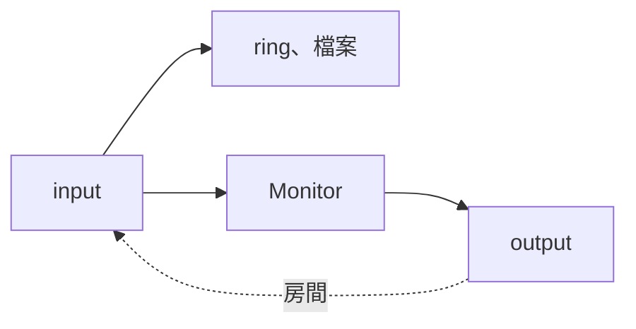
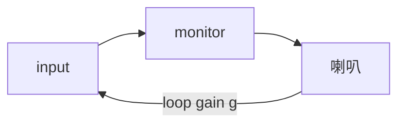

# Step 5 - Input monitoring

[English](step-05-input-monitoring.md) | **繁體中文**

[總覽](../README.zh-TW.md) | 上一步：[Step 4 - Punch 與 loop](step-04-punch-and-loop.zh-TW.md) | 下一步：[Step 6 - 有錄音的 engine](step-06-engine.zh-TW.md)

## 目標

讓樂手在錄音時聽到自己，愈早愈好，但不改變錄下來的內容，也不讓靠近喇叭的麥克風變成嘯叫。

## 設計

### 兩條路

同一個 input 走兩條路，兩者毫無關係：



**錄到的**維持 dry，不管 fader 或 plugin 做什麼，事後都還能改。**聽到的**有自己的音量、會晚到，還可能透過房間繞回來。
規則由此而來：monitor 這條路上的任何東西都不能碰到錄音。mode、音量、靜音都不行。

### 聽到的比較晚

歌手聽到自己的聲音變晚時，早在說得出原因之前就會亂掉。那到底晚多少？

```math
\begin{aligned}
\text{direct:} \quad & L_{\text{in}} + L_{\text{out}} \\
\text{through the inserts:} \quad & L_{\text{in}} + L_{\text{mix}} + L_{\text{out}}
\end{aligned}
```

第二行有個陷阱。要聽到 track 的 plugin，input 就得走過 track，而 mix 會延遲每個 track 以對齊最慢的那個（第 14 章
Step 8）。所以 $`L_{\text{mix}}`$ 不是*這個* track 的 plugin latency，而是*整首歌裡*最慢的 plugin。鼓上的一個
look-ahead limiter，就會延遲歌手聽到的自己：

```text
  heard after: 15.0 ms directly, 30.7 ms through the inserts (one 752-sample plugin anywhere in the mix)
```

所以有兩個選擇，也就是 `MonitorPath`，由使用者決定：早一點的 dry 聲音，或是晚一點但有 plugin。Take 的位置不受影響：
take 是 dry input，而 Step 2 已經包含 mix 的 latency，因為樂手是透過 mix 聽到歌曲的。

### Auto：像磁帶機一樣

`Always` 很簡單。`Auto` 是 punch 需要的：到 punch-in 之前聽舊的 take，punch 裡聽自己，之後再聽舊的 take。停止時也聽
自己，這樣才能調音。

這裡的切換點**沒有**移動 $`L`$，和 Step 4 的 take 不同。在位置 $`t`$ render 的聲音傳到樂手耳中時就是 $`t`$，而進入同
一個 output block 的 input，是樂手現在演奏的。所以 monitor 只要跟著 render 位置走。這就是為什麼同一個 punch 點，
monitor 的切換和 take 的邊緣在 stream 裡位於不同的地方：

```text
  stream frame       ...  P    ...    P + L  ...
  monitor 切換            ^ 這裡
  take 的第一個 frame                  ^ 這裡
```

### 沒有爆音

增益一跳就會有爆音。所以只有一個增益，所有變化都經過它，每個 frame 最多動一步：

```cpp
gain_ += std::clamp(target - gain_, -rampStep_, rampStep_);
```

5 毫秒短到聽不出來，又長到不會有爆音。Mode、音量、punch 和 guard 都只是不同的 `target`。這裡沒有東西依賴 block，所以
同樣的 input 不管切成幾塊，output 都相同。

### Feedback

麥克風聽得到喇叭。如果繞回來的比送出去的小，它會像回音一樣消失。如果比較大，不管大多少，它都會一直變大到 converter
削波，而且不會自己停止：



Output 和 input 無法簡單比較，因為真實的房間不是一個延遲加一個增益。所以 `FeedbackGuard` 聽的是這個迴路對音量做了什
麼。它取 50 ms window 的峰值，這比一般的來回時間長，所以每個 window 都包含從上一個 window 繞回來的聲音：

- **持續變大：**連續六個 window，每個都至少是上一個的 1.2 倍（上升 1.6 dB），而且都夠大聲。
- **頂到上限：**連續五個 window 都到頂。這抓的是成長太慢、第一條規則抓不到的迴路。

低於上限的大聲歌手，或是到頂但中間隔一個 window 的鼓擊，都不會觸發。

快速的漸強仍可能觸發它。這可以接受，是因為誤報的代價：片刻的 monitoring 和一則訊息。漏掉嘯叫的代價則是樂手的耳朵。而
且不管哪一種，錄音都不受影響。

一旦觸發，就會維持到使用者 reset 為止。靜音會讓迴路安靜下來，如果 guard 忘了這件事就會解除靜音，嘯叫就又回來了。

它只在 monitor 開著時才聽。Monitoring 關閉時的大聲 input 不是 feedback，因為根本沒有東西在播放它。

### Thread

Mode、音量和 range 都是 relaxed atomic，UI 隨時可以設定。正在變更的 range 可能在一個 block 內被讀成一半舊、一半新，但
那頂多移動聽到內容的切換點。錄音讀的是它自己的副本，在 `start()` 時取得。所以這些不需要 Step 2 的 Recorder 所需要的東西。

Reset 是一個請求。Guard 屬於 audio thread，只有它能碰。

### 這裡沒有做的事

- Track 上的 plugin 在這裡不會變快。Step 6 才會把兩條路接到真正的 mixer。
- Punch 時讓舊 take 靜音是 engine 的工作（Step 6）。Monitor 只負責加入 input。
- 硬體 mixer 或錄音介面的 direct monitoring 完全沒有這種 latency。App 無從得知，所以 monitor 預設關閉。
- 真實的房間比這裡的模擬困難。這必須用真的麥克風和喇叭試過（Step 7）。

## 換你了

在 `steps/step05-input-monitoring/starter/step05.cpp` 寫出四個函式：

1. `monitorLatency()`：上面那兩行。
2. `wantsInput()`：Off、Always 和 Auto。
3. `FeedbackGuard::listen()`：逐 frame，也逐 window。
4. `Monitor::run()`：target、ramp、guard 聽到的內容，以及加到 mix 裡。

`Monitor::process()` 已經寫好了。

全部完成後，輸出的結尾會像這樣：

```text
  heard after: 15.0 ms directly, 30.7 ms through the inserts (one 752-sample plugin anywhere in the mix)
  a loop gain of 1.5: detected after 501 ms, and silent after that
  a loop gain of 1.05: detected after 1653 ms
  a musician, 800 notes: 0 false alarms (expected 0)
  two threads: 60 takes, 490496 frames recorded while the monitor kept changing, 0 wrong (expected 0)
[PASS] l17_step05 (92 checks passed)
```

兩個 thread 那一行的 frame 數每次執行可能不同。

## 你學到了什麼

- 聽到的和錄到的是兩條路。可能出錯的那條，不能碰到重要的那條。
- Plugin delay compensation 讓最慢的 plugin 變成所有人的問題，歌手也不例外。
- 同一個 punch 點，monitor 在 render 的地方切換，take 則晚 $`L`$ 才開始。
- 一個增益配一個 ramp，所有變化都不會有爆音。
- 依照犯錯的代價來選擇偵測器。
