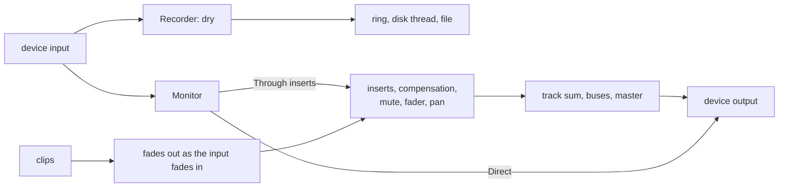

# Step 6 - The engine with recording

**English** | [繁體中文](step-06-engine.zh-TW.md)

[Overview](../README.md) | Previous: [Step 5 - Input monitoring](step-05-input-monitoring.md) | Next: [Step 7 - The app with recording](step-07-app.md)

## Goal

Bring Steps 1-5 into the real engine: the real transport, the real mixer, real plugins. Then prove three things:
without an input nothing changes, a click that goes all the way around lands on its own position, and what was
added is real-time safe and free of data races.

As in chapter 16's Step 5, this step has no starter: the code is the code of the snapshots, and what there is to
learn is what happens when it meets the rest of the engine.

## Design

### Copy first, then change

The first commit of this step is chapter 16's engine and tests, copied as they are, so that the next commit shows
exactly what recording changed. Chapter 16's eleven engine tests are not changed, and they still pass: that is the
proof that an engine without an input does what it did. (The test of the project file comes with the app, in Step 7.)

Only `Recording.h` and `RecordingSession.h` are new. `Track.h`, `Mixer.h`, `Engine.h` and `All.h` changed.
`scripts/check_copies.py` keeps the rest identical to chapter 16's.

### Where it all goes



The recorder takes the input before anything else, so that nothing the track does can reach the take. This is the
rule of Step 5, now with real faders and plugins against it.

The two monitor paths are not an abstract choice any more:

- **Through the inserts**, the input is added to the track's buffer before its inserts. From there it is simply part
  of the track. It gets the plugins, the fader and the pan, and because the mix waits for its slowest path, also the
  whole compensation. The test measures it: a 752-sample plugin on *another* track delays the input by 752 samples.
- **Direct**, the input is added to the output after the master. So it has no compensation to wait for, and also
  no fader and no mute: this is the musician's headphones, not the song. A muted track's Direct monitor is
  still heard, and `MonitorMode::Off` is how to turn it off.

### What the input replaces

In a punch, the musician should hear themselves *instead of* the old take. The Monitor can now fade out what it
replaces, by as much as the input fades in, with one more ramp next to the gain:

```cpp
share_ += std::clamp((on ? 1.0f : 0.0f) - share_, -rampStep_, rampStep_);
...
replaced[ch][i] *= 1.0f - share_;
```

The fade comes first. For the path through the inserts, the old take and the output are the same buffer, and the
input must not fade with it. And it is a ramp of its own, because a monitor level of 0 means that the musician does
not want to hear themselves, not that the old take should come back.

With `MonitorMode::Off` nothing fades, so whoever monitors through the interface's own direct monitoring hears
the old take as it is.

### Recorders in every slot

Step 2 said: only the audio thread may say that a recording is over. A free slot costs the mixer one comparison, and it
does not call anything in that slot. But a track can be removed while it records, and then the recording's stop would
never be confirmed, and the disk thread would wait forever.

So the recorders run before the check for a free slot. A slot that is not recording costs one atomic load.

This is the same consequence that Step 2 warned about, in a second form: no running device, no confirmation. For that
case `Engine::prepare()` runs when no audio thread is running, which makes it the one place that may finish a
recording without one:

```cpp
void finishWithoutAudio() noexcept { state_.store(State::Idle, std::memory_order_release); }
```

So a device that goes away or changes its sample rate ends the take. The take keeps the sample rate it was recorded at,
in its header. What to do with a take at another rate is for the app (Step 7).

### The input of a block

`processBlock()` splits long blocks into chunks, and each chunk may need several calls to `advance()` when a loop is very
short. The input has to go along, so that each call gets the frames that belong to it:

```cpp
inputs[ch] = input.channels[ch] + inputOffset + done;
```

`checkEveryFrameArrives` records a counter for several block sizes, with a loop of 3 frames among them, and compares
every frame of the file.

`kMaxInputChannels` limits how many channels this array has, since `processBlock()` may not allocate.

### A session

`RecordingSession.h` is what the app will use. `begin()` starts the Recorders of all armed tracks on the UI thread, and
makes one `TakeWriter` each with a name that is not used yet. `pump()` is all that the disk thread does. A recording of
several tracks shares one transport, so all its takes have the same stamp and line up.

### What is not done yet

- The app has to call `processBlock()` with the device's input (`AudioHost`), and run the disk thread (Step 7).
- Adding the takes to the song as clips, undo, saving, a recovered take, a warning when something went wrong: all Step
  7.
- The device's reported latencies are only `Latencies` here. `AudioHost` has to ask for them (Step 7).
- This has only ever heard a fake device. CI has no input, so a real microphone, a real cable and real ears are for
  Step 7, and for you.

## Run it

```powershell
.\scripts\build.ps1 -Only 17-recording
.\build\bin\Debug\l17_test_recording.exe
.\build\bin\Debug\l17_test_recording_threads.exe
```

On Linux / macOS: `./scripts/build.sh --only 17-recording`, then run `./build/bin/l17_test_recording`. To look for data
races:

```bash
./scripts/build.sh --only 17-recording --sanitize thread --build-dir build-tsan
```

The output looks like this:

```text
the engine with an input
  a loop-back through the engine: 40 takes, 365 clicks, 0 in the wrong place (expected 0)
  what the musician hears: 720 samples directly, 1472 through the inserts
  the mix makes the loop louder: detected after 496 ms, the take has every frame
[PASS] l17_test_recording (323 checks passed)
```

```text
the engine with an input, on three threads
  60 recordings, 176 takes, 3052460 frames, 12 tracks replaced: 0 wrong (expected 0)
  allocations on the audio thread: 0 (expected 0)
[PASS] l17_test_recording_threads (4 checks passed)
```

The numbers in the second one can differ from run to run.

## What you learned

- Copying first makes a change visible, and tests that stay as they are make it safe.
- Where a signal joins the mixer decides everything that happens to it.
- A slot that does nothing still has to answer for what it started.
- The one moment without an audio thread is the one moment that can do without it.
