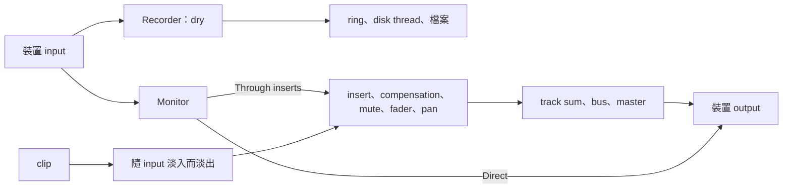

# Step 6 - 有錄音的 engine

[English](step-06-engine.md) | **繁體中文**

[總覽](../README.zh-TW.md) | 上一步：[Step 5 - Input monitoring](step-05-input-monitoring.zh-TW.md)

## 目標

把 Step 1-5 帶進真正的 engine：真正的 transport、真正的 mixer、真正的 plugin。然後證明三件事：沒有 input 時什麼都不變、繞完一整圈的 click 落在自己的位置上，以及新增的部分符合 real-time 要求且沒有 data race。

和第 16 章 Step 5 一樣，這一步沒有 starter：程式碼就是 snapshot 裡的程式碼，要學的是它碰到 engine 其他部分時會發生什麼。

## 設計

### 先複製，再修改

這一步的第一個 commit 是第 16 章 engine 和測試的原樣複本，所以下一個 commit 剛好顯示錄音改了什麼。第 16 章的十一個 engine 測試沒有被修改，而且仍然通過：這就是沒有 input 的 engine 行為不變的證明。（專案檔的測試要等 app 在 Step 7 一起過來。）

只有 `Recording.h` 和 `RecordingSession.h` 是新的。`Track.h`、`Mixer.h`、`Engine.h` 和 `All.h` 有改動。`scripts/check_copies.py` 會確保其他檔案和第 16 章相同。

### 東西都接到哪裡



Recorder 在一切之前就取得 input，所以 track 做的任何事都碰不到 take。這是 Step 5 的規則，現在面對的是真正的 fader 和 plugin。

兩條 monitor 路徑也不再是抽象的選擇：

- **經過 insert 時**，input 在 track 的 insert 之前加進 track 的 buffer。從那裡開始，它就是 track 的一部分：有 plugin、fader 和 pan，而且因為 mix 要等最慢的路徑，也包含整個 compensation。測試實際量過：*另一個* track 上 752 sample 的 plugin，會讓 input 延遲 752 個 sample。
- **Direct 時**，input 在 master 之後才加進 output。所以它不用等 compensation，也沒有 fader 和 mute：這是樂手的耳機，不是歌曲。被 mute 的 track 的 Direct monitor 仍然聽得到，要關掉它就用 `MonitorMode::Off`。

### Input 取代了什麼

Punch 時，樂手應該聽到自己，*而不是*舊的 take。Monitor 現在可以把被取代的東西淡出，淡出多少，input 就淡入多少，做法是在 gain 旁邊多一個 ramp：

```cpp
share_ += std::clamp((on ? 1.0f : 0.0f) - share_, -rampStep_, rampStep_);
...
replaced[ch][i] *= 1.0f - share_;
```

淡出要先做。經過 insert 的路徑上，舊 take 和 output 是同一個 buffer，input 不能跟著一起淡出。而且它是獨立的 ramp，因為 monitor 音量是 0 代表樂手不想聽到自己，不代表舊 take 應該回來。

`MonitorMode::Off` 時什麼都不會淡出，所以用錄音介面 direct monitoring 的人會聽到原本的舊 take。

### 每個 slot 都有 Recorder

Step 2 說過：只有 audio thread 能宣布錄音結束。空的 slot 對 mixer 來說只花一次比較，不會呼叫 slot 裡的任何東西。但 track 可能在錄音時被移除，這樣錄音的 stop 就永遠不會被確認，disk thread 會一直等下去。

所以 Recorder 在檢查空 slot 之前就先執行。沒在錄音的 slot 只多花一次 atomic load。

這是 Step 2 警告過的同一個後果的第二種形式：沒有運作中的裝置，就沒有確認。針對這種情況，`Engine::prepare()` 執行時沒有 audio thread 在跑，所以它是唯一可以在沒有 audio thread 時結束錄音的地方：

```cpp
void finishWithoutAudio() noexcept { state_.store(State::Idle, std::memory_order_release); }
```

所以裝置消失或改變取樣率時，take 就結束了。Take 的 header 裡保留了錄音當時的取樣率。取樣率不同的 take 要怎麼處理，是 app 的事（Step 7）。

### 一個 block 的 input

`processBlock()` 會把長的 block 切成 chunk，而 loop 很短時，每個 chunk 可能需要呼叫好幾次 `advance()`。Input 必須跟著走，每次呼叫才會拿到屬於它的 frame：

```cpp
inputs[ch] = input.channels[ch] + inputOffset + done;
```

`checkEveryFrameArrives` 用幾種 block 大小錄下一個計數器，其中包含只有 3 個 frame 的 loop，再比對檔案裡的每個 frame。

`kMaxInputChannels` 限制這個陣列有幾個 channel，因為 `processBlock()` 不能配置記憶體。

### Session

`RecordingSession.h` 是 app 會用到的部分。`begin()` 在 UI thread 上啟動所有 armed track 的 Recorder，並為每個 track 建立一個 `TakeWriter`，檔名不與現有檔案重複。`pump()` 就是 disk thread 要做的全部事情。多個 track 的錄音共用一個 transport，所以 take 都有相同的章，彼此對齊。

### 還沒做的事

- App 要用裝置的 input 呼叫 `processBlock()`（`AudioHost`），並執行 disk thread（Step 7）。
- 把 take 以 clip 加進歌曲、undo、存檔、復原 take、出問題時的警告：都在 Step 7。
- 裝置回報的 latency 在這裡只是 `Latencies`，`AudioHost` 要去問裝置（Step 7）。
- 這一切目前只聽過假的裝置。CI 沒有 input，所以真的麥克風、真的線路和真的耳朵要等 Step 7，也要靠你。

## 跑起來

```powershell
.\scripts\build.ps1 -Only 17-recording
.\build\bin\Debug\l17_test_recording.exe
.\build\bin\Debug\l17_test_recording_threads.exe
```

在 Linux / macOS：`./scripts/build.sh --only 17-recording`，然後執行 `./build/bin/l17_test_recording`。要找 data race：

```bash
./scripts/build.sh --only 17-recording --sanitize thread --build-dir build-tsan
```

輸出會像這樣：

```text
the engine with an input
  a loop-back through the engine: 40 takes, 365 clicks, 0 in the wrong place (expected 0)
  what the musician hears: 720 samples directly, 1472 through the inserts
  the mix makes the loop louder: detected after 496 ms, the take has every frame
[PASS] l17_test_recording (323 checks passed)
```

```text
the engine with an input, on three threads
  60 recordings, 176 takes, 3052460 frames, 12 tracks replaced: 0 wrong (expected 0)
  allocations on the audio thread: 0 (expected 0)
[PASS] l17_test_recording_threads (4 checks passed)
```

第二段的數字每次執行可能不同。

## 你學到了什麼

- 先複製讓改動看得見，測試維持不變讓改動安全。
- 訊號在哪裡加入 mixer，決定了它會遇到的一切。
- 什麼都不做的 slot，仍然要為它開始的事情負責。
- 沒有 audio thread 的那一刻，就是唯一可以不靠它的那一刻。
