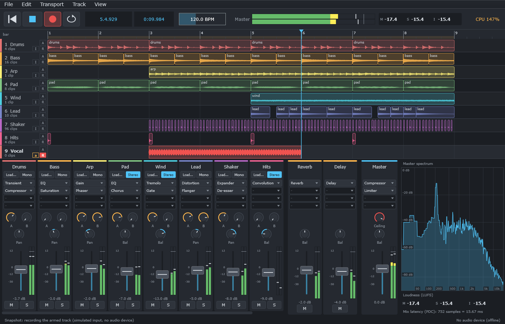
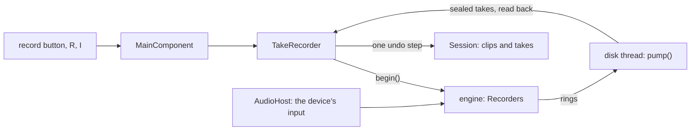

# Step 7 - The app with recording

**English** | [繁體中文](step-07-app.zh-TW.md)

[Overview](../README.md) | Previous: [Step 6 - The engine with recording](step-06-engine.md)

<p align="center"></p>

## Goal

Put the chapter into the user's hands. **DawLab 17** is chapter 16's application with a record button, armed tracks,
an input for each, monitoring, punch and loop recording, and takes that become clips. They can be undone and saved,
and they come back after a crash.

## Design

### Copy first, then change

As in Step 6, the first commit is chapter 16's application as it is, with only its name changed, so that the next
commit shows what recording changed. Chapter 16's smoke test stays in, and it still passes, next to the new
recording checks.

### What is new



- `AudioHost` passes the device's input to `processBlock()`, and reports the device's input latency next to its output
  latency.
- `TakeRecorder` owns one recording: the disk thread, the takes it reads back, and the step that makes them clips.
- `Session` knows which parts of a recording are its takes, and can put a take in the place of what was on the track.
- The project file is format 5: it has a `takes` line.

### Inputs, only when asked

The app opens its device without inputs, as chapter 16 did, and the first armed track asks for them
(`AudioHost::ensureInputsOpen()`). There are three reasons:

- On macOS, asking for the input is what brings up the system's microphone permission. That should happen when the
  user wants to record, not when the app starts. (`MICROPHONE_PERMISSION_ENABLED` in `app/CMakeLists.txt` puts the
  reason into the app's `Info.plist`; without it, macOS gives silence.)
- Bluetooth headphones switch to a telephone codec as soon as their microphone is opened.
- A device whose input and output cannot run at one sample rate fails here, with JUCE's message on the status line,
  instead of when the app starts.

### One recording

```text
  R          start(): the armed tracks' Recorders, a file name each, the disk thread; the transport plays
  ...        the disk thread pumps; tick() watches for problems and dropped frames
  R / Space  stop(): the audio thread confirms with its next block
             the disk thread seals each take and reads it back (in whole, off the message thread)
  tick()     the takes become clips: one undo step "Record" for all tracks
```

Reading the take back happens on the disk thread. This is the limit the plan accepted: clip audio stays in memory, so an
hour of stereo is 1.4 GB there, but the message thread never waits for it.

### A take in the place of the old one

Clips on one track are mixed, so a new take on top of an old one would be heard together with it. In a DAW, recording
over something means replacing it. So `Session::withClipOnTop()` cuts what the new clip covers out of the old clips:

```text
  before    [old ...............................................]
  after     [old ....][new take ..........][old, later source ...]
                     ^ 5 ms fades on the new edges, and the old ones keep theirs
```

The part after has to start in its source where the new take ends, or the old take would start over from where it was
cut. It is still there: the take on top can be removed again by undo.

### Takes of a loop

Step 4 gives all the passes as `Placement`s on one buffer. The clip plays one of them (`bestTake()`), and the session
keeps the rest next to it: a right click on the clip lists "Take 1, 2, 3...". Choosing another one only changes the
clip's source offset, so it is an ordinary undoable change of the clip list.

The project file keeps the takes with the audio file they belong to:

```text
takes "Song_media/1f3a...wav" 96000 1472 48000 96000 49472 48000 96000 97472 48000
```

When the device changes its sample rate, the takes follow their audio, as clips and curves already do.

### Punch

The loop's locators are the punch points as well, like in Cubase: Transport > Punch (P) records only between them,
with or without the loop running. Step 4 does the rest. The frames before the punch-in are in the file too, so the
clip's edge can be moved later.

### What the musician hears

`I` in a track's header turns its monitor through Off, Auto and Always. A right click on `R` or `I` has the input
channel and the monitor's path: directly and dry, or through the track's effects with all the mix's latency (Step 5).
Turning a monitor on says on the status line how late the musician will hear themselves. An "I" in red means that the
guard heard feedback; the same menu turns it back on.

Disarming a track also turns its monitor off, because nothing would explain to the user why an unarmed track can still
be heard.

### When something goes wrong

<div align="center">

| What happens | What the app does |
|---|---|
| nothing is armed | nothing starts; the status line says to arm a track |
| no file can be created | nothing is recorded; it says so, in red |
| the disk fills up | the recording stops, the song plays on, what fitted becomes a take |
| the disk cannot keep up | silence in the take, its timing right; it says how many milliseconds |
| the device stops | `audioDeviceStopped()` finishes the recording (Step 6) |
| the sample rate changes | the take is converted to the clips' rate, like every clip |
| the track is deleted | the take stays in the takes folder; the status line says where |
| the program crashes | the next start finds the `.recording` files and puts them on new tracks |
| New, Open, Export, Delete while recording | refused until the recording is stopped |

</div>

### Where the takes go

A recording may start before the project has a file, so takes go to one folder, `Documents/DawLab 17 Takes`. Saving a
project copies their audio into its media folder like any other audio, so the takes folder can be cleaned up by hand.
The app never deletes a take.

At the next start, any `.recording` file in that folder is a take that a crash left behind. `TakeRecorder::recover()`
seals it with Step 3's `sealTake()`, the same function that finishes every take, and puts it on a new track where it
was played. This happens instead of loading the demo song, so the user sees it first.

Two copies of the app running at the same time share the folder. If one crashes, the other one should not be the one to
recover it while the first is still being restarted. This app does not check for that.

### Latency, by hand

The driver's latencies are only what it reports. Transport > Recording Latency Trim... adds a number of samples to
them, and it is saved with the app's settings, not with the song: it belongs to the machine.

To find the number, connect an output to an input with a cable, put a click track on one track, arm another one with
that input and record. The distance between a click and its recording, in samples, is the trim. Step 2's
`measureRoundTrip()` does this measurement. A button for it is a good exercise.

## Checks

The smoke test has no audio device, so the input comes from the test, through the same `processBlock()` that a device
calls. The disk thread is real. It checks:

- a take lands where it was played, bit for bit what came in, cut into an old take; one undo step, also for two tracks;
- a loop of 3.5 passes gives four takes, plays the third, can choose another, saves and opens them, and follows a
  change of the sample rate;
- a punch is exact, and a punch that was never reached gives nothing;
- a full disk, no file at all, a stalling disk, a device that stops, a rate change on the way, a deleted track, a crash;
- a click track that goes through the real mix and a cable comes back on the beat.

```text
Recording
  a take through the real paths: at 95660, 48000 frames, 0 wrong (expected 0)
  a loop of 3.5 passes: 4 takes, one clip plays take 3
  the disk is full after 24000 frames: a take of 24000 frames, recording stopped
  the disk stalls: 17088 frames in place, 35712 silent, 0 wrong (expected 0)
  a crash: the take comes back at 9280, 51200 frames
  the click track through a cable, with the mix's latency of 240: 19 clicks, 0 in the wrong place (expected 0)
...
[PASS] l17_app_smoke_test (418 checks passed)
```

How much of a stalled take is silence depends on the threads, and differs from run to run.

## What you have to try yourself

CI has no microphone and no ears. These are for you:

1. **Record a real input.** Arm a track (R in its header, or Shift+R), press R, play, press R again. On macOS the system
   asks for the microphone the first time.
2. **The latency.** With a cable from an output to an input, record a click track and zoom in: each recorded click
   should sit on its click. If they do not, set the trim. Do it again at another buffer size.
3. **Monitoring.** With headphones: Auto and Always, both paths. Then put a plugin with latency on another track and
   hear the difference through the inserts.
4. **Feedback.** Carefully, at a low volume, with a microphone near a speaker and the monitor on: the guard should mute
   the monitor within about a second.
5. **A loop.** Record three passes, and choose another take with a right click on the clip.
6. **A crash.** Close the app from the task manager while it records, and start it again.

If any of these goes wrong, the status line usually says why. Tell me what it says.

## What you learned

- A device's input is a permission, a codec and a sample rate: ask for it when it is needed.
- Recording over something means replacing it, so the old clip has to make room, with the right source offset.
- Takes are data next to a clip: choosing one is an ordinary edit.
- Every way a recording can end has to end in a take or in a clear message.
