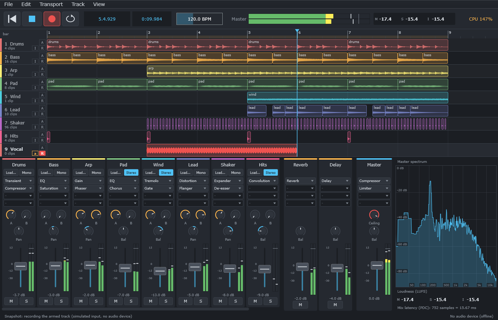
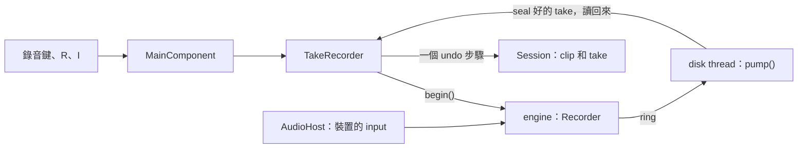

# Step 7 - 有錄音的 app

[English](step-07-app.md) | **繁體中文**

[總覽](../README.zh-TW.md) | 上一步：[Step 6 - 有錄音的 engine](step-06-engine.zh-TW.md)

<p align="center"></p>

## 目標

把這一章交到使用者手上。**DawLab 17** 是第 16 章的應用程式，加上錄音鍵、armed track、每個 track 的 input、monitoring、punch 和 loop 錄音，以及會變成 clip 的 take。這些都可以 undo、可以存檔，當機之後也會回來。

## 設計

### 先複製，再修改

和 Step 6 一樣，第一個 commit 是第 16 章應用程式的原樣複本，只改了名稱，所以下一個 commit 剛好顯示錄音改了什麼。第 16 章的 smoke test 留在裡面，和新的錄音檢查一起執行，而且仍然通過。

### 新增了什麼



- `AudioHost` 把裝置的 input 交給 `processBlock()`，並在 output latency 旁邊回報裝置的 input latency。
- `TakeRecorder` 負責一次錄音：disk thread、讀回來的 take，以及把它們變成 clip 的那一步。
- `Session` 知道一次錄音的哪些部分是它的 take，也能把 take 放到 track 上原有內容的位置。
- 專案檔是格式 5：多了 `takes` 這一行。

### Input，需要時才開

App 開啟裝置時不開 input，和第 16 章一樣，等第一個 track 被 arm 時才要求開啟（`AudioHost::ensureInputsOpen()`）。原因有三個：

- 在 macOS 上，要求 input 就會跳出系統的麥克風權限。這應該發生在使用者想錄音時，而不是 app 啟動時。（`app/CMakeLists.txt` 裡的 `MICROPHONE_PERMISSION_ENABLED` 會把理由寫進 app 的 `Info.plist`；沒有它，macOS 只會給你靜音。）
- 藍牙耳機一旦開啟麥克風，就會切換成電話用的 codec。
- Input 和 output 無法用同一個取樣率運作的裝置，會在這裡失敗，JUCE 的訊息會顯示在狀態列，而不是在 app 啟動時失敗。

### 一次錄音

```text
  R          start()：armed track 的 Recorder、每個一個檔名、disk thread；transport 開始播放
  ...        disk thread 執行 pump()；tick() 留意問題和被丟掉的 frame
  R / 空白鍵  stop()：audio thread 用下一個 block 確認
             disk thread seal 每個 take 並整個讀回來（不在 message thread 上）
  tick()     take 變成 clip：所有 track 共用一個 undo 步驟「Record」
```

讀回 take 是在 disk thread 上做的。這是計畫接受的限制：clip 的音訊放在記憶體裡，所以一小時的立體聲在那裡要 1.4 GB，但 message thread 永遠不用等它。

### Take 取代舊的內容

同一個 track 上的 clip 會混在一起，所以新 take 疊在舊 take 上會一起被聽到。在 DAW 裡，錄在某段內容上就代表取代它。所以 `Session::withClipOnTop()` 會把新 clip 蓋住的部分從舊 clip 中切掉：

```text
  之前    [舊 ...............................................]
  之後    [舊 ....][新 take ..........][舊，來源往後 ...........]
                  ^ 新的邊緣有 5 ms 的 fade，舊的邊緣保留原本的
```

後面那段在來源裡必須從新 take 結束的地方開始，否則舊 take 會從被切斷的地方重新開始。它還在：疊上去的 take 可以用 undo 再拿掉。

### Loop 的 take

Step 4 把每一圈都變成同一個 buffer 上的 `Placement`。clip 播放其中一個（`bestTake()`），其他的由 session 保留在它旁邊：在 clip 上按右鍵會列出「Take 1、2、3…」。選另一個只會改變 clip 的 source offset，所以就是一般可以 undo 的 clip 清單變更。

專案檔把 take 和它所屬的音訊檔放在一起：

```text
takes "Song_media/1f3a...wav" 96000 1472 48000 96000 49472 48000 96000 97472 48000
```

裝置改變取樣率時，take 會跟著它的音訊一起轉換，就像 clip 和曲線一樣。

### Punch

Loop 的 locator 也是 punch 點，和 Cubase 一樣：Transport > Punch（P）只錄 locator 之間的部分，不管 loop 有沒有在跑。剩下的交給 Step 4。Punch-in 之前的 frame 也在檔案裡，所以之後可以移動 clip 的邊緣。

### 樂手聽到什麼

Track 標頭的 `I` 讓 monitor 在 Off、Auto 和 Always 之間切換。在 `R` 或 `I` 上按右鍵可以選 input channel 和 monitor 的路徑：直接聽 dry 的聲音，或經過 track 的效果器，連同整個 mix 的 latency（Step 5）。打開 monitor 時，狀態列會說樂手聽到自己的聲音會晚多少。紅色的「I」代表 guard 偵測到 feedback，同一個選單可以重新打開它。

取消 arm 也會關掉 monitor，因為沒有任何東西能向使用者解釋，為什麼沒有 arm 的 track 還聽得到。

### 出問題的時候

<div align="center">

| 發生什麼事 | App 怎麼做 |
|---|---|
| 沒有 track 被 arm | 什麼都不開始；狀態列提示要先 arm 一個 track |
| 無法建立檔案 | 什麼都沒錄到；以紅字說明 |
| 硬碟滿了 | 錄音停止，歌曲繼續播放，寫得下的部分成為 take |
| 硬碟跟不上 | take 裡出現靜音，時間仍然正確；說明有幾毫秒 |
| 裝置停止 | `audioDeviceStopped()` 結束錄音（Step 6） |
| 取樣率改變 | take 被轉換成 clip 的取樣率，和每個 clip 一樣 |
| track 被刪除 | take 留在 takes 資料夾，狀態列說明在哪裡 |
| 程式當機 | 下次啟動時找到 `.recording` 檔，把它們放到新的 track 上 |
| 錄音中要 New、Open、Export、Delete | 拒絕，直到錄音停止 |

</div>

### Take 放在哪裡

錄音可能在專案還沒有檔案之前就開始，所以 take 都放在同一個資料夾：`Documents/DawLab 17 Takes`。存專案時，它們的音訊會和其他音訊一樣複製到專案的 media 資料夾，所以 takes 資料夾可以手動清理。App 永遠不會刪除 take。

下次啟動時，那個資料夾裡的任何 `.recording` 檔都是當機留下的 take。`TakeRecorder::recover()` 用 Step 3 的 `sealTake()` 把它 seal 起來（正是結束每個 take 的同一個函式），並放到新的 track 上當初演奏的位置。這會取代載入示範歌曲，所以使用者會先看到它。

同時執行兩個 app 會共用這個資料夾。如果其中一個當機，在它重新啟動之前，不應該由另一個去復原它的 take。這個 app 沒有檢查這件事。

### Latency，手動校正

Driver 的 latency 只是它的回報值。Transport > Recording Latency Trim... 會在上面加上一個 sample 數，並且存在 app 的設定裡，而不是歌曲裡：它屬於這台機器。

要找出這個數字，用一條線把 output 接到 input，在一個 track 放 click track，再 arm 另一個 track 並選那個 input 來錄音。Click 和它錄下的聲音之間相差的 sample 數，就是 trim。Step 2 的 `measureRoundTrip()` 做的就是這個量測，替它做一個按鈕是很好的練習。

## 檢查

Smoke test 沒有音訊裝置，所以 input 由測試提供，經過和裝置呼叫的同一個 `processBlock()`。Disk thread 是真的。它檢查：

- take 落在演奏時的位置，和進來的內容逐位元相同，切進舊的 take 裡；一個 undo 步驟，兩個 track 時也是；
- 3.5 圈的 loop 產生四個 take、播放第三個、可以選另一個、能存檔也能開啟，並且跟著取樣率的改變一起轉換；
- punch 是精確的，從未到達的 punch 不會產生任何東西；
- 硬碟滿了、完全無法建立檔案、硬碟停頓、裝置停止、轉換途中的取樣率改變、被刪除的 track、當機；
- 經過真正的 mix 和線路的 click track，回來時落在拍子上。

```text
Recording
  a take through the real paths: at 95660, 48000 frames, 0 wrong (expected 0)
  a loop of 3.5 passes: 4 takes, one clip plays take 3
  the disk is full after 24000 frames: a take of 24000 frames, recording stopped
  the disk stalls: 17088 frames in place, 35712 silent, 0 wrong (expected 0)
  a crash: the take comes back at 9280, 51200 frames
  the click track through a cable, with the mix's latency of 240: 19 clicks, 0 in the wrong place (expected 0)
...
[PASS] l17_app_smoke_test (418 checks passed)
```

停頓的 take 有多少是靜音取決於 thread 的執行情況，每次執行都不一樣。

## 你要自己試的

CI 沒有麥克風，也沒有耳朵。這些要靠你：

1. **錄真正的 input。** Arm 一個 track（標頭的 R，或 Shift+R），按 R，演奏，再按一次 R。在 macOS 上，第一次會跳出麥克風權限。
2. **Latency。** 用一條線從 output 接到 input，錄一個 click track 並放大來看：每個錄下的 click 都應該落在它的 click 上。如果沒有，就設定 trim。換一個 buffer 大小再做一次。
3. **Monitoring。** 戴耳機：Auto 和 Always，兩條路徑都試。然後在另一個 track 放一個有 latency 的 plugin，聽聽經過 insert 時的差別。
4. **Feedback。** 小心、用小音量，把麥克風靠近喇叭並打開 monitor：guard 應該在一秒左右把 monitor 靜音。
5. **Loop。** 錄三圈，在 clip 上按右鍵選另一個 take。
6. **當機。** 錄音時從工作管理員關掉 app，再啟動一次。

如果其中任何一項出錯，狀態列通常會說明原因。把它說的內容告訴我。

## 你學到了什麼

- 裝置的 input 牽涉到權限、codec 和取樣率：需要時才要求。
- 錄在某段內容上就是取代它，所以舊 clip 必須讓出位置，而且 source offset 要正確。
- Take 是 clip 旁邊的資料：選擇其中一個只是一般的編輯。
- 錄音的每一種結束方式，都必須以一個 take 或一則清楚的訊息收場。
