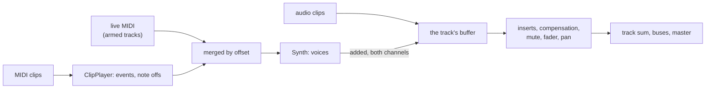

# Step 7 - The engine with instruments

**English** | [繁體中文](step-07-engine.zh-TW.md)

[Overview](../README.md) | Previous: [Step 6 - Recording MIDI](step-06-recording.md) | Next: [Step 8 - The app with instruments](step-08-app.md)

## Goal

Bring Steps 1-5 into the real engine: the real transport, the real mixer, the command queue, the track pool. Then
prove that a note still starts on its sample, that nothing hangs whatever the transport and the user do, that live
MIDI reaches the right tracks, and that all of it is real-time safe and free of data races.

As in chapter 17's Step 6, this step has no starter: the code is the code of the snapshots, and what there is to
learn is what happens when it meets the rest of the engine.

## Design

### Copy first, then change

The first commit of this step is chapter 17's engine and engine tests, copied as they are, so that the next commit
shows exactly what instruments changed. `Midi.h` is new; `Track.h`, `Mixer.h`, `Engine.h`, `Commands.h`,
`Constants.h` and `All.h` changed; `scripts/check_copies.py` keeps the rest identical to chapter 17's.

Chapter 17's thirteen engine tests still pass, with one line changed - and that line is worth a look. The automation
test removes a track that owns everything it can own and requires the garbage it hands back to be exactly
`kMaxGarbagePerCommand`: the proof that the bound is tight. A track can now also own a MIDI clip list, so the bound
grew by one, and that test's track, which has no MIDI clips, hands back one less. The new test removes a track that
owns everything, MIDI clips too, and requires the new bound exactly.

### Where the instrument plays



An instrument track is a track: `Track::setInstrument(true)`. Its synth's sound is added to the track's buffer
where a clip's audio is, before the inserts, so everything that happens to a track happens to it - plugins, plugin
delay compensation, automation, mute, solo, sends. A mono track folds the two equal channels back into one, as it
folds a mono file.

### What the transport tells the player

Step 2's player was handed segments with a `jump` flag by a transport made for it. The engine's `Transport` hands
out `TimelineSegment`s without one, and it does not need to change: the player remembers where the last segment
ended, and a segment that starts anywhere else is a jump - a play, a seek, a loop wrap. No segments at all is a stop.
The rest is Step 2 as it was: a table of what was started, note offs at a jump and at a stop, controllers chased.

### Live MIDI

`processBlock()` gets one more argument, a `MidiBlock`: this block's live messages, at their offsets. The host makes
it with Step 5's `MidiFifo` and `drainMidi()` (Step 8 does that in `AudioHost`). The engine plays it on every
**armed** instrument track - arming means "this track listens to the keyboard", for audio as for MIDI - merged with
the clips' events in order of offset, the clips' first at a tie.

`processBlock()` may cut a block into chunks, and each chunk into calls for a short loop; the live events have to
follow, each into the call that holds its sample, with its offset moved:

```cpp
const int offset = midi.events[e].offset - from;
if (offset >= 0 && offset < n)
    midiSlice_.push_back({offset, midi.events[e].message});
```

### Real-time

The player and the synth are Steps 2-4: fixed tables, reserved lists, nothing that allocates once prepared. One
thing did change, and the engine found it: a track's synth and player are about 8 KB, and 128 tracks of them added a
megabyte to every `Engine`. The copied tests put an `Engine` on the stack, and four of them crashed with a stack
overflow. The instrument's state now lives in one heap object per track, allocated in `prepare()`, where allocating
is allowed.

When a track is removed, its MIDI clip list goes back as garbage like its audio clips, its synth falls silent at once
(the track is gone; there is nothing to release into).

What the removal must *not* do is reset the instrument flag, although that looks tidy - and the first version did.
The flag is the UI's value, like a fader: the UI reuses a slot at once, so by the time the audio thread takes the
RemoveTrack, the UI may already have given the slot to a new instrument track and set its flag. Resetting it there
turned that new track back into an audio track. It showed up in the app (Step 8): undo, then redo, of adding an
instrument track gave a silent track, and so did opening a project. Now `Engine::addTrack()` resets the flag when the
UI hands out the slot, with the other values of a new track, and the test removes an instrument track and adds a
new one in its slot before the audio thread has seen either.

### How the test knows

`l18_test_midi`:

- **On its sample.** A note at tick 960 is first heard at sample 24001 - the envelope starts at 0, so the first sound
  is one sample after the note on - in blocks of 512, 64, 100, 1 and random sizes.
- **The same in any block size.** Four bars of chords and an overlapping melody in a trimmed clip with controllers,
  with a loop played three times, identical to the bit in blocks of 512, 37, 1000 and random sizes.
- **Nothing hangs.** After a stop, a seek into a chord, the instrument switched off, the clips replaced by none, the
  track removed: silence, and a new track in the old slot starts as a plain audio track - or as an instrument, when
  the UI says so before the audio thread has even seen the removal.
- **Nor with the sustain pedal.** The clip player remembers which clip pressed the pedal (controller 64) on each
  MIDI channel and lets it go - a controller 64 of 0 - when that clip stops sounding: on a stop, a seek or a wrap
  (after the note offs), where the clip ends, and when the clip is deleted or muted. Without that a pedal pressed
  in a clip held its notes for ever once the transport stopped. Live, the track remembers the keys and the pedal
  the keyboard holds on it; disarmed, it still lets through the note offs and the pedal up that end them, and
  nothing else - a key played before the track was disarmed would otherwise never stop.
- **More cases.** A seek *back* into a long note ends it; the sustain pedal is chased past a seek; an instrument
  track's audio clips still play; tick 960 at 60 BPM is sample 48000; a reset silences the synth.
- **Live MIDI.** Not armed: nothing. Armed: from the sample after its offset. An armed audio track: nothing. In the
  fourth chunk of a 2048-sample block on an engine prepared for 512: where it belongs. With a clip's note in the same
  block: both.
- **Garbage.** A track with every insert, audio clips, MIDI clips and two curves hands back exactly
  `kMaxGarbagePerCommand`.
- **Real-time.** No allocation on the audio thread with clips, a loop, seeks, live MIDI and a new clip list.
- **Threads.** A UI thread replaces clips, seeks, switches the instrument and the arm; an audio thread drains a
  `MidiFifo` and processes; a MIDI thread plays. ThreadSanitizer (in CI, and below) must find nothing.

## Run it

```powershell
.\scripts\build.ps1 -Only 18-midi
.\build\bin\Debug\l18_test_midi.exe
```

On Linux / macOS: `./scripts/build.sh --only 18-midi`, then run `./build/bin/l18_test_midi`. To look for data races:

```bash
./scripts/build.sh --only 18-midi --sanitize thread --build-dir build-tsan
```

The output looks like this:

```text
l18_test_midi: instrument tracks in the engine
  a note at tick 960 sounds from sample 24001 in blocks of 512, 64, 100, 1 and random: yes
  a song with a loop, 7 bars: the same in blocks of 512, 37, 1000 and random: yes (peak 0.47)
  removing a track with everything hands back 13 objects (kMaxGarbagePerCommand = 13)
  another instrument in the synth's place: 4 events at their samples, its sound on the track
  the synth again, its settings changed while a note sounds, a new track with the default sound
  allocations on the audio thread with clips, a loop, seeks and live MIDI: 0
  UI, audio and MIDI threads for 300 UI steps: 0 allocations on the audio thread, 0 bad blocks, 0 leaked
[PASS] l18_test_midi (40 checks passed)
```

## What is not done yet

- The app: instrument tracks in the arrangement, MIDI clips, a piano roll, a keyboard through `AudioHost`, recording
  with Step 6's recorder, quantize, the project file, undo. That is Step 8.
- The synth has one sound. Its settings (`VoiceSettings`) are fixed in `prepare()`; a panel for them is an exercise.

## Added after the chapter: another instrument

Exercises 8 and 12 need two things this step did not have: the synth's settings changing while it plays, and an
instrument other than the synth. So the engine got one hook more, after the chapter was done:

- `Instrument` (in `Midi.h`) is what a track plays its notes with: `prepare()`, `reset()`, and `render()`, which
  ADDS its sound to the track's channels. Every slot has the built-in synth as a `SynthInstrument`.
- `SynthInstrument::setSettings()` may be called on any thread: each value is an atomic, and the next block hands
  them to the voices without resetting them (`Voice::setSettings()`). The velocity's gain and the level are now
  kept apart, so that the level reaches the notes that already sound. `Engine::getTrackSynth()` finds a track's
  synth; `Engine::addTrack()` gives a new track the default sound, as it resets the instrument flag.
- `Engine::setTrackInstrument(track, instrument)` puts another instrument in the synth's place (nullptr: the
  synth again) through the command `ReplaceInstrument`, the way `replaceInsert()` swaps an effect: prepared on
  the calling thread, swapped in at a block boundary, the old one back through `collectGarbage()`. Removing a
  track hands its instrument back too, so `kMaxGarbagePerCommand` is now `kMaxInserts + 5`.
- `Engine::prepare()` applies the queued commands first and then prepares every insert and instrument for the
  new device. An instrument still in the queue when the sample rate or block size changes is prepared again
  too; otherwise it would get blocks larger than it was prepared for.
- `Engine::getSongEndSample()` is the song's end: the last clip on any track, audio or MIDI (a MIDI clip's end
  tick at the tempo now; through the tempo map from chapter 19). `renderOffline()` without a length, and so
  File > Export, renders up to there. `Mixer::getSongEndSample()` knows only the audio clips: the mixer has no
  tempo to turn ticks into samples.

`tests/test_midi.cpp` checks it (`testAnotherInstrument`, `testQueuedThroughADeviceChange`, and the full track
and no-allocation tests); the app
does not use it yet.

## What you learned

- A segment that does not continue the last one is a jump; the transport does not need to say so.
- An instrument's sound joins the track where a clip's does, so everything a track does applies to it.
- Live input follows the chunks and calls of a block, each event into the one that holds its sample.
- A bound that a test proves tight has to grow with what the track can own - and the test says so.
- Memory that is fine on the heap can be too much on a stack: the engine's own tests found it.
