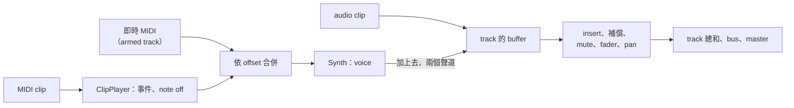

# Step 7 - 有樂器的 engine

[English](step-07-engine.md) | **繁體中文**

[總覽](../README.zh-TW.md) | 上一步：[Step 6 - 錄 MIDI](step-06-recording.zh-TW.md) | 下一步：[Step 8 - 有樂器的 app](step-08-app.zh-TW.md)

## 目標

把 Step 1-5 帶進真正的 engine：真正的 transport、真正的 mixer、command queue、track 池。然後證明音符仍然在它的 sample 上開始、不論 transport 和使用者做什麼都不會有卡住的音、即時 MIDI 會送到正確的 track，而且這一切都是 real-time safe 且沒有 data race。

和第 17 章的 Step 6 一樣，這個 step 沒有 starter：程式碼就是各個 snapshot 的程式碼，要學的是它碰上 engine 其他部分時會發生什麼事。

## 設計

### 先複製，再修改

這個 step 的第一個 commit 是原封不動複製過來的第 17 章 engine 和 engine 測試，好讓下一個 commit 清楚顯示樂器到底改了什麼。`Midi.h` 是新的；`Track.h`、`Mixer.h`、`Engine.h`、`Commands.h`、`Constants.h` 和 `All.h` 有修改；`scripts/check_copies.py` 確保其餘檔案和第 17 章的完全相同。

第 17 章的十三個 engine 測試仍然通過，只改了一行——而那一行值得一看。Automation 測試會移除一個擁有一切可擁有之物的 track，並要求它交回的 garbage 剛好是 `kMaxGarbagePerCommand`：這證明這個上限是緊的。現在 track 也可以擁有一串 MIDI clip，所以上限多了一，而那個測試的 track 沒有 MIDI clip，交回的就少一個。新的測試會移除一個擁有一切——包括 MIDI clip——的 track，並要求剛好等於新的上限。

### 樂器在哪裡發聲



Instrument track 就是一個 track：`Track::setInstrument(true)`。它的 synth 的聲音加到 track 的 buffer 上，位置和 clip 的音訊相同，在 insert 之前，所以 track 會經歷的一切都會套用在它身上——plugin、plugin delay compensation、automation、mute、solo、send。Mono track 會把兩個相同的聲道折回成一個，就像它折回 mono 檔案一樣。

### Transport 告訴播放器什麼

Step 2 的播放器收到的 segment 帶有 `jump` 旗標，是為它量身打造的 transport 給的。Engine 的 `Transport` 交出的 `TimelineSegment` 沒有這個旗標，而且它不需要修改：播放器記得上一個 segment 結束在哪裡，從其他任何地方開始的 segment 就是跳躍——播放、seek、loop 繞回。完全沒有 segment 就是停止。其餘都和 Step 2 一樣：一張記錄啟動過什麼的表、在跳躍和停止時送 note off、chase controller。

### 即時 MIDI

`processBlock()` 多了一個參數，`MidiBlock`：這個 block 的即時訊息，各在它們的 offset 上。Host 用 Step 5 的 `MidiFifo` 和 `drainMidi()` 產生它（Step 8 會在 `AudioHost` 裡這麼做）。Engine 會在每個 **armed** 的 instrument track 上播放它——arm 的意思是「這個 track 聽鍵盤」，音訊和 MIDI 都一樣——和 clip 的事件依 offset 合併，同 offset 時 clip 的在前。

`processBlock()` 可能把一個 block 切成數個 chunk，每個 chunk 又因為很短的 loop 而分成多次呼叫；即時事件必須跟著走，每個都進到包含它那個 sample 的那次呼叫，並移動它的 offset：

```cpp
const int offset = midi.events[e].offset - from;
if (offset >= 0 && offset < n)
    midiSlice_.push_back({offset, midi.events[e].message});
```

### Real-time

播放器和 synth 就是 Step 2-4：固定大小的表、預留好的清單，prepare 之後沒有任何會配置記憶體的東西。有一件事確實改變了，而且是 engine 自己找出來的：每個 track 的 synth 和播放器大約 8 KB，128 個 track 就讓每個 `Engine` 多了 1 MB。複製過來的測試把 `Engine` 放在 stack 上，其中四個因為 stack overflow 而當掉。現在樂器的狀態放在每個 track 一個的 heap 物件裡，在 `prepare()` 中配置，那裡是允許配置記憶體的。

Track 被移除時，它的 MIDI clip 清單像 audio clip 一樣以 garbage 交回，它的 synth 立刻靜音（track 已經不在了，沒有地方可以 release）。

移除時*不能*做的，是重設樂器旗標，雖然那看起來很整齊——而第一版就這麼做了。這個旗標是 UI 的值，就像 fader 一樣：UI 會立刻重用 slot，所以等到 audio thread 拿到 RemoveTrack 時，UI 可能已經把這個 slot 交給一個新的 instrument track 並設好了旗標。在那裡重設它，就把那個新 track 變回了 audio track。這在 app（Step 8）裡出現：新增 instrument track 後 undo 再 redo，得到一個無聲的 track，開啟專案時也一樣。現在由 `Engine::addTrack()` 在 UI 交出 slot 時重設這個旗標，和新 track 的其他值一起，而測試會移除一個 instrument track，並在 audio thread 看到任何一個之前，在它的 slot 加入一個新的。

### 測試怎麼知道

`l18_test_midi`：

- **在它的 sample 上。** 位於 tick 960 的音符，第一次被聽到是在 sample 24001——envelope 從 0 開始，所以第一個聲音在 note on 之後一個 sample——不論 block 是 512、64、100、1 或隨機大小。
- **任何 block 大小都一樣。** 四小節的和弦，加上一段在被修剪過、有 controller 的 clip 中互相重疊的旋律，loop 播三次，用 512、37、1000 和隨機大小的 block 逐位元相同。
- **不會卡住音。** 停止、seek 到和弦中間、關掉樂器、把 clip 換成空的、移除 track 之後：都是無聲，而舊 slot 裡的新 track 以一般的 audio track 開始——或者，若 UI 在 audio thread 看到移除之前就這麼說，以樂器開始。
- **踩著 sustain pedal 也不會。** clip player 記住每個 MIDI channel 上是哪個 clip 踩下 pedal（controller 64），在那個 clip 不再發聲時放開它（送出值為 0 的 controller 64）：停止、seek 或 loop 繞回時（在 note off 之後）、clip 結束的地方、clip 被刪除或 mute 時。沒有這一步，clip 裡踩下的 pedal 會在 transport 停止後讓音永遠響下去。Live 輸入時，track 記住鍵盤在它上面按住的鍵和 pedal；disarm 之後，它仍然放行結束這些音的 note off 和 pedal 放開，其他一律不放——不然 disarm 前彈下的鍵永遠不會停。
- **更多情況。** 往回 seek 到長音符中間會結束它；延音踏板在 seek 之後會被 chase；instrument track 的 audio clip 仍然會播；60 BPM 時 tick 960 是 sample 48000；reset 會讓 synth 靜音。
- **即時 MIDI。** 沒有 arm：什麼都沒有。Arm 了：從它的 offset 之後一個 sample 開始。Arm 的 audio track：什麼都沒有。在為 512 準備的 engine 上、2048 個 sample 的 block 的第四個 chunk：在它該在的地方。同一個 block 裡也有 clip 的音符：兩者都有。
- **Garbage。** 擁有所有 insert、audio clip、MIDI clip 和兩條曲線的 track，交回剛好 `kMaxGarbagePerCommand` 個。
- **Real-time。** 有 clip、loop、seek、即時 MIDI 和新的 clip 清單時，audio thread 都不配置記憶體。
- **Thread。** UI thread 替換 clip、seek、切換樂器和 arm；audio thread 排空 `MidiFifo` 並處理；MIDI thread 彈奏。ThreadSanitizer（在 CI 上，以及下面）必須什麼都找不到。

## 執行

```powershell
.\scripts\build.ps1 -Only 18-midi
.\build\bin\Debug\l18_test_midi.exe
```

在 Linux / macOS：`./scripts/build.sh --only 18-midi`，然後執行 `./build/bin/l18_test_midi`。要找 data race：

```bash
./scripts/build.sh --only 18-midi --sanitize thread --build-dir build-tsan
```

輸出看起來像這樣：

```text
l18_test_midi: instrument tracks in the engine
  a note at tick 960 sounds from sample 24001 in blocks of 512, 64, 100, 1 and random: yes
  a song with a loop, 7 bars: the same in blocks of 512, 37, 1000 and random: yes (peak 0.47)
  removing a track with everything hands back 13 objects (kMaxGarbagePerCommand = 13)
  another instrument in the synth's place: 4 events at their samples, its sound on the track
  the synth again, its settings changed while a note sounds, a new track with the default sound
  allocations on the audio thread with clips, a loop, seeks and live MIDI: 0
  UI, audio and MIDI threads for 300 UI steps: 0 allocations on the audio thread, 0 bad blocks, 0 leaked
[PASS] l18_test_midi (40 checks passed)
```

## 還沒做的

- App：arrangement 裡的 instrument track、MIDI clip、piano roll、經由 `AudioHost` 的鍵盤、用 Step 6 的 recorder 錄音、quantize、專案檔、undo。那是 Step 8。
- Synth 只有一種音色。它的設定（`VoiceSettings`）在 `prepare()` 中固定；設定面板是一個練習。

## 本章之後加上的：另一個樂器

練習 8 和 12 需要這個 step 沒有的兩件事：synth 的設定在播放時改變，以及 synth 以外的樂器。所以在本章完成之後，engine 多了一個 hook：

- `Instrument`（在 `Midi.h` 裡）是 track 用來播放音符的東西：`prepare()`、`reset()`，以及把聲音*加到* track 各 channel 上的 `render()`。每個 slot 都有內建的 synth，以 `SynthInstrument` 的形式存在。
- `SynthInstrument::setSettings()` 可以在任何 thread 呼叫：每個值都是一個 atomic，下一個 block 會把它們交給 voice，而不重設 voice（`Voice::setSettings()`）。Velocity 的 gain 和 level 現在分開保存，讓 level 也能作用在已經在響的音上。`Engine::getTrackSynth()` 找到 track 的 synth；`Engine::addTrack()` 會給新的 track 預設的音色，就像它重設樂器旗標一樣。
- `Engine::setTrackInstrument(track, instrument)` 透過 command `ReplaceInstrument` 把另一個樂器放到 synth 的位置（nullptr：再換回 synth），就像 `replaceInsert()` 替換 effect 一樣：在呼叫的 thread 上 prepare，在 block 邊界換上，舊的經由 `collectGarbage()` 回來。移除 track 也會交回它的樂器，所以 `kMaxGarbagePerCommand` 現在是 `kMaxInserts + 5`。
- `Engine::prepare()` 先套用 queue 裡的 command，再為新的 device prepare 每個 insert 和樂器。sample rate 或 block size 改變時還在 queue 裡的樂器也會重新 prepare；否則它會拿到比它 prepare 時更大的 block。
- `Engine::getSongEndSample()` 是歌曲的結尾：任何 track 上最後一個 clip 的結尾，audio 或 MIDI 都算（MIDI clip 的結尾 tick 用現在的 tempo 換算；從第 19 章起經由 tempo map）。沒有指定長度的 `renderOffline()`，也就是 File > Export，會 render 到那裡。`Mixer::getSongEndSample()` 只知道 audio clip：mixer 沒有 tempo，無法把 tick 換成 sample。

`tests/test_midi.cpp` 會檢查它（`testAnotherInstrument`、`testQueuedThroughADeviceChange`，以及完整 track 和不配置記憶體的測試）；app 還沒有用到它。

## 你學到了什麼

- 不接續上一個 segment 的 segment 就是跳躍；transport 不需要明說。
- 樂器的聲音在 clip 的聲音加入的地方加入 track，所以 track 做的一切都套用在它身上。
- 即時輸入要跟著 block 的 chunk 和呼叫走，每個事件進到包含它那個 sample 的那一次。
- 被測試證明是緊的上限，必須隨 track 能擁有的東西一起成長——而且測試要寫明這點。
- 在 heap 上沒問題的記憶體，放在 stack 上可能太多：是 engine 自己的測試發現的。
